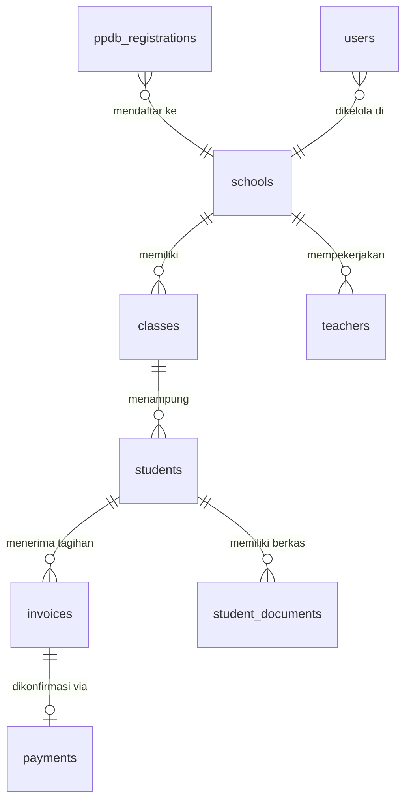

# 🏛️ ARSITEKTUR SISTEM & PANDUAN KOMPONEN VITAL (SIYAYASAN V2)
> **Sistem Informasi Manajemen & Portal Terpadu Yayasan At Tarbiyyah Wijaya Kusuma Samarinda (PAUD Terpadu, TK, TPQ)**  
> *Dokumen Pengetahuan Resmi (Knowledge Base) — Terakhir Diperbarui: 21 Oktober 2026*

---

## 📌 1. Ringkasan Arsitektur Sistem (Modern Jamstack & Serverless BaaS)

Aplikasi **SIYAYASAN V2** dirancang menggunakan arsitektur **Modern Jamstack & Serverless BaaS** (*Backend-as-a-Service*). Arsitektur ini mengeliminasi kebutuhan server fisik konvensional (VPS), memangkas biaya pemeliharaan menjadi **Nol Rupiah**, dan menghasilkan kecepatan muat halaman (*load speed*) kelas dunia tanpa hambatan *hydration* framework.

```mermaid
flowchart TD
    subgraph Client ["1. Lapisan Klien / Frontend (Browser Pengunjung)"]
        HTML["HTML5 Semantik Murni"]
        CSS["Tailwind CSS (Oceanic Blue System)"]
        JS["Vanilla JavaScript (ES6+ Modern)"]
        SVG["Vektor SVG Presisi (Fine-Line 1.75px)"]
    end

    subgraph Edge ["2. Lapisan Edge Network & Keamanan (Vercel Cloud)"]
        VercelCDN["Vercel Edge CDN Global"]
        CanonicalRedirect["HTTP 308 Permanent Redirect"]
        SecurityHeaders["X-Robots-Tag Noindex & Cache-Control"]
    end

    subgraph BackendEngine ["3. Lapisan Backend & API Engine"]
        PostgREST["PostgREST RESTful Engine (Supabase)"]
        AuthRBAC["JWT & Session Guard (Super Admin, TU, Siswa)"]
        LocalDev["Node.js Portabel (Dev Server Port 3000)"]
    end

    subgraph CloudStorage ["4. Lapisan Basis Data & Penyimpanan Berkas"]
        PostgreSQL["PostgreSQL 15+ Relational DB (Cloud)"]
        BucketStorage["Supabase Storage (siyayasan-uploads)"]
    end

    Client -->|Permintaan HTTPS / Navigasi| Edge
    Edge -->|Pengiriman Berkas Statis Super Cepat| Client
    Client -->|Panggilan API (api.js)| BackendEngine
    BackendEngine -->|Kueri SQL & Unggah Dokumen| CloudStorage
```

---

## ⚙️ 2. Matriks Tumpukan Teknologi (Tech Stack)

| Lapisan Sistem | Teknologi yang Digunakan | Karakteristik & Alasan Pemilihan |
| :--- | :--- | :--- |
| **Frontend UI** | **HTML5 Semantik** | Struktur rapi, aksesibel (WCAG), dan ramah terhadap *crawler* mesin pencari Google (SEO Friendly). |
| **Styling & Desain** | **CSS3 & Tailwind CSS** | Desain responsif (*mobile-first*) dengan token warna resmi: **Oceanic Blue Palette** (`#0284c7`, `#0ea5e9`, `#0369a1`). Dilarang menggunakan warna hijau (*Zero-Green Rule*). |
| **Logika Frontend** | **Vanilla JavaScript (ES6+)** | **Murni JavaScript tanpa framework berat** (tanpa React/Vue/Angular). Menghilangkan *bundle bloat* sebesar ratusan megabyte sehingga aplikasi dapat dibuka seketika dalam milidetik. |
| **Ikonografi** | **Vektor SVG Murni Inline** | Menggunakan SVG garis halus (*fine-stroke 1.75px*) untuk komponen utama. Dijamin 100% selalu muncul tajam di semua perangkat tanpa risiko bug font pihak ketiga. |
| **API Engine** | **PostgREST (Supabase Cloud)** | Mengonversi skema database relasional PostgreSQL secara otomatis menjadi API RESTful berkecepatan tinggi dengan *endpoint-level security*. |
| **Adapter Klien** | **JavaScript (`shared/js/api.js`)** | Modul penghubung frontend-ke-cloud (~3.350 baris kode) dengan kapabilitas **Automatic Column Self-Healing** untuk menangani perbedaan skema tanpa crash. |
| **Basis Data** | **PostgreSQL 15+ Cloud** | Database relasional SQL ACID-compliant standar enterprise dunia untuk integritas data santri dan pencatatan keuangan SPP. |
| **Penyimpanan File** | **Supabase Object Storage** | Bucket cloud terenkripsi (`siyayasan-uploads`) untuk berkas Akta Kelahiran, KK, Pas Foto, Bukti Bayar Bank, dan Foto Galeri. |
| **Edge & Hosting** | **Vercel Cloud Platform** | CDN global berlatensi rendah dengan integrasi otomatis GitHub CI/CD, sertifikat SSL HTTPS otomatis, dan manajemen aturan *edge header*. |

---

## 💎 3. Komponen Paling Penting di Setiap Tempat (*The Crown Jewels*)

Di bawah ini adalah file-file paling vital pada setiap direktori proyek yang menjadi penggerak utama sistem dan **tidak boleh dirusak atau diubah secara ceroboh**:

### 🧠 A. Lapisan Shared Engine (`frontend/shared/`)
*Otak utama penghubung antarmuka dengan basis data cloud.*

1. **[`shared/js/api.js`](file:///d:/Source_code_yayasan/frontend/shared/js/api.js) — Jantung Logika Sistem (The Master Brain)**
   * **Fungsi:** Mengatur seluruh alur data aplikasi (pendaftaran PPDB, konversi calon siswa, pencatatan tagihan SPP, verifikasi transfer, login, profil, audit log, dan backup cloud).
   * **Keistimewaan:** Memiliki mekanisme *Self-Healing PostgREST* yang otomatis memangkas kolom usang jika database mengalami perubahan struktur.
2. **[`shared/js/supabase-config.js`](file:///d:/Source_code_yayasan/frontend/shared/js/supabase-config.js) — Kunci Gerbang Cloud**
   * **Fungsi:** Memuat kredensial alamat URL server dan anon key resmi Supabase. Tanpa file ini, seluruh aplikasi offline.
3. **[`shared/js/auth.js`](file:///d:/Source_code_yayasan/frontend/shared/js/auth.js) — Satpam Keamanan (RBAC Guard)**
   * **Fungsi:** Memeriksa token otentikasi. Melindungi ruang portal Admin dari akses publik dan mengunci sesi siswa agar hanya bisa melihat data pribadi mereka.

---

### 🏛️ B. Lapisan Website Publik (`frontend/public/`)
*Etalase resmi yayasan untuk calon wali murid dan mesin pencari Google.*

1. **[`public/index.html`](file:///d:/Source_code_yayasan/frontend/public/index.html) — Beranda Utama Yayasan**
   * **Fungsi:** Pintu gerbang utama pengunjung: memuat Hero Carousel dinamis, kartu 3 Program Pendidikan (PAUD, TK, TPQ) berikon SVG garis halus, dan Smart Bento Hub (Warta Berita & Cuplikan Galeri Kegiatan Santri).
2. **[`public/ppdb.html`](file:///d:/Source_code_yayasan/frontend/public/ppdb.html) — Mesin Pendaftaran Santri Baru**
   * **Fungsi:** Formulir pendaftaran online 5-tahap lengkap dengan upload berkas (Akta/KK), rincian biaya resmi, dan Accordion Persyaratan Berkas minimalis.
3. **[`public/login.html`](file:///d:/Source_code_yayasan/frontend/public/login.html) — Gerbang Masuk SIAKAD Terpadu**
   * **Fungsi:** Satu-satunya pintu login resmi untuk Siswa (NIS + Tanggal Lahir) dan Admin/TU (Email + Password), dilengkapi modal panduan login editorial bebas AI-slop.
4. **[`public/js/public-shell.js`](file:///d:/Source_code_yayasan/frontend/public/js/public-shell.js) — Rangka Header & Footer Publik**
   * **Fungsi:** Menginjeksi navbar ramping (brand 2 baris proporsional) dan footer resmi secara otomatis ke seluruh 11 halaman publik.

---

### 💼 C. Lapisan Portal Admin & TU (`frontend/portal/admin/`)
*Pusat operasional manajemen sekolah bagi Tenaga Kependidikan & Yayasan.*

1. **[`portal/admin/dashboard.html`](file:///d:/Source_code_yayasan/frontend/portal/admin/dashboard.html) — Kokpit Kendali Utama (KPI)**
   * **Fungsi:** Menampilkan rekapitulasi real-time: total kas SPP masuk, jumlah santri aktif per jenjang, sisa kuota rombel, dan notifikasi berkas PPDB tertunda.
2. **[`portal/admin/ppdb.html`](file:///d:/Source_code_yayasan/frontend/portal/admin/ppdb.html) — Verifikasi & Konversi Siswa**
   * **Fungsi:** Tempat staf TU memeriksa berkas pendaftar baru, menyetujui, dan **mengonversi pendaftar menjadi Siswa Aktif lengkap dengan pembuatan NIS dan akun login otomatis**.
3. **[`portal/admin/payments.html`](file:///d:/Source_code_yayasan/frontend/portal/admin/payments.html) — Manajemen Kas & SPP**
   * **Fungsi:** Memeriksa bukti transfer bank dari wali murid, mengubah status tagihan menjadi Lunas, atau mencatat pembayaran tunai di kasir sekolah.
4. **[`portal/admin/students.html`](file:///d:/Source_code_yayasan/frontend/portal/admin/students.html) — Buku Induk Santri Digital**
   * **Fungsi:** Direktori data seluruh siswa aktif terfilter rombel kelas, riwayat orang tua, dan modal pratinjau berkas digital (Akta & KK).

---

### 🎒 D. Lapisan Portal Siswa & Wali Murid (`frontend/portal/siswa/`)
*Layanan mandiri (self-service) bagi wali murid santri.*

1. **[`portal/siswa/dashboard.html`](file:///d:/Source_code_yayasan/frontend/portal/siswa/dashboard.html) — Beranda Adaptif Santri**
   * **Fungsi:** Beroperasi cerdas: jika pendaftar berstatus *Calon Siswa*, menampilkan pelacak 4 tahap verifikasi pendaftaran; jika sudah *Siswa Aktif*, otomatis beralih menampilkan ringkasan tagihan SPP dan informasi akademik.
2. **[`portal/siswa/spp.html`](file:///d:/Source_code_yayasan/frontend/portal/siswa/spp.html) — Pembayaran & Kuitansi Digital**
   * **Fungsi:** Menampilkan nomor rekening resmi yayasan, form upload bukti transfer bank, dan tombol **Cetak Kuitansi Resmi PDF/Print** setelah pembayaran disetujui TU.

---

### 🚦 E. Lapisan Routing & Edge Security (`vercel.json`)
*Pengatur lalu lintas hosting dan perlindungan bot mesin pencari.*

1. **[`vercel.json`](file:///d:/Source_code_yayasan/vercel.json) — Konfigurasi Produksi Vercel**
   * **Kanonikalisasi Domain:** Mengalihkan domain lama `siyayasan-portal.vercel.app` secara permanen (**HTTP 308**) ke `https://siyayasan.vercel.app/`.
   * **Proteksi Privasi Portal:** Memasang HTTP Header `X-Robots-Tag: noindex, nofollow, noarchive` pada seluruh rute `/portal/*` dan `/admin/*` agar data rahasia santri tidak terindeks oleh Google.
   * **Caching Optimal:** Mengatur `Cache-Control: public, max-age=604800, immutable` pada folder `images/`, `css/`, dan `js/`.

---

## 🗃️ 4. Struktur Basis Data Relasional PostgreSQL (Supabase)

Seluruh data sekolah disimpan pada basis data cloud PostgreSQL dengan relasi terstruktur:



| Nama Tabel | Fungsi Penyimpanan | Data Kunci |
| :--- | :--- | :--- |
| **`schools`** | Profil yayasan, rekening bank, jam kerja, peta Maps | `id`, `name`, `address`, `phone`, `bank_accounts` |
| **`users`** | Akun login Super Admin dan Staf TU | `id`, `email`, `password_hash`, `role` (`admin`/`tu`) |
| **`students`** | Data santri aktif, identitas, rombel, kontak ortu | `id`, `nis`, `full_name`, `birth_date`, `class_id`, `status` |
| **`classes`** | Rombel kelas per jenjang (PAUD, TK A, TK B, TPQ) | `id`, `level`, `class_name`, `capacity`, `academic_year` |
| **`teachers`** | Direktori guru & staf (data direktori, tanpa login) | `id`, `nip`, `full_name`, `position`, `phone` |
| **`ppdb_registrations`**| Registrasi santri baru online 5-tahap | `id`, `registration_number`, `student_name`, `level`, `status` |
| **`invoices`** | Tagihan SPP bulanan otomatis santri | `id`, `student_id`, `month`, `year`, `amount`, `status` |
| **`payments`** | Riwayat pembayaran & unggahan bukti transfer | `id`, `invoice_id`, `amount`, `proof_url`, `status` (`verified`) |
| **`student_documents`**| Berkas digital siswa (Akta Kelahiran, KK, Foto) | `id`, `student_id`, `doc_type`, `file_url`, `created_at` |
| **`news` / `events`** | Artikel warta berita dan agenda kegiatan sekolah | `id`, `title`, `slug`, `content`, `image_url`, `status` |
| **`gallery`** | Dokumentasi foto kegiatan santri & fasilitas | `id`, `title`, `image_url`, `category`, `created_at` |
| **`web_settings`** | Banner Hero Carousel, Google Maps, legalitas | `id`, `hero_images`, `maps_embed_url`, `announcement_banner` |
| **`audit_logs`** | Catatan forensik seluruh aktivitas perubahan admin | `id`, `user_id`, `action`, `entity`, `details`, `created_at` |

---

## 🔑 5. Kredensial Akun Pengujian Sistem Resmi

Gunakan kredensial berikut untuk melakukan audit atau verifikasi sistem di `https://siyayasan.vercel.app/login.html`:

| Role | Identitas (Email / NIS) | Password | Akses Halaman Utama |
| :--- | :--- | :--- | :--- |
| **Super Admin** | `admin@yayasan.sch.id` | `230400` | `/portal/admin/dashboard.html` (Akses Penuh Seluruh Modul) |
| **Admin TU** | `tu@yayasan.sch.id` | `tu123456` | `/portal/admin/dashboard.html` (Operasional Siswa, SPP & Berkas) |
| **Siswa Aktif 1** | `2026001` (NIS) | `2020-03-12` (Tgl Lahir) | `/portal/siswa/dashboard.html` (SIAKAD & Pembayaran SPP Mandiri) |
| **Siswa Aktif 2** | `2026002` (NIS) | `2019-08-25` (Tgl Lahir) | `/portal/siswa/dashboard.html` (SIAKAD & Pembayaran SPP Mandiri) |

---

## 🛡️ 6. Aturan Emas Arsitektur (Golden Architecture Rules)
Setiap pengembang atau asisten AI yang memelihara proyek ini **wajib mematuhi 6 aturan baku berikut**:

1. **Sistem Murni 2-Portal + Web Publik:**  
   Arsitektur resmi hanya mencakup Portal Admin, Portal Siswa, dan Web Publik. Dilarang menghidupkan kembali sistem lama yang telah dihapus (*Google Apps Script, Portal Guru terpisah, Portal Orang Tua terpisah, Password Guru, dan Rapor Elektronik Santri*).
2. **Zero-Green Color Rule (Oceanic Blue Palette):**  
   Seluruh antarmuka publik dan portal harus menggunakan palet biru maritim institusi (`#0284c7`, `#0ea5e9`, `#0369a1`). Dilarang keras menggunakan aksen warna hijau.
3. **No-Framework Bloat (Vanilla JS & HTML5 Native):**  
   Dilarang mengubah proyek menjadi SPA berbasis React, Vue, atau Angular. Pertahankan kecepatan native browser dengan Vanilla JS dan Tailwind CSS.
4. **Integritas Skema Supabase & Self-Healing:**  
   Perubahan logika pada [`frontend/shared/js/api.js`](file:///d:/Source_code_yayasan/frontend/shared/js/api.js) tidak boleh merusak fungsi *auto-column self-healing* yang melindungi database dari kegagalan query.
5. **Kanonikalisasi Domain Tunggal:**  
   Satu-satunya domain resmi institusi adalah **`https://siyayasan.vercel.app`**. Seluruh akses dari domain lama wajib dibelokkan melalui redirect 308 di `vercel.json`.
6. **Proteksi Anti-AI Slop:**  
   Pertahankan prinsip tipografi bersih: hindari floating kicker pill badges di atas H1, hindari badge "Interaktif", dan gunakan garis pemisah tipis (*clean hairline dividers*) daripada kotak bersarang (*box-in-box*).

