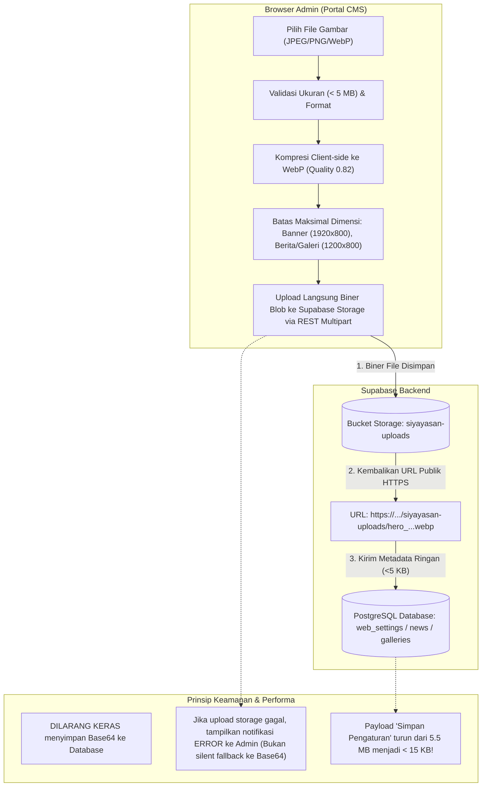
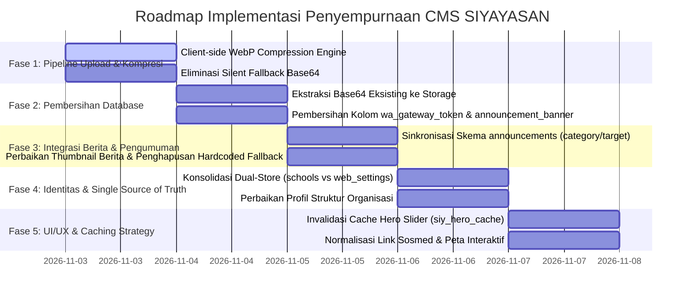

# RENCANA PENYEMPURNAAN KONTEN CMS & PIPELINE MEDIA
## Comprehensive CMS Content Improvement Plan & Media Pipeline Modernization
**Proyek:** Sistem Informasi Yayasan At Tarbiyyah Wijaya Kusuma Samarinda (SIYAYASAN)  
**Dokumen:** `CMS_CONTENT_IMPROVEMENT_PLAN.md`  
**Status:** Usulan Rencana Terstruktur (Audit & Planning Only — Menunggu Persetujuan Eksekusi)  
**Tanggal:** 2 November 2026  
**Penyusun:** Tim Arsitektur Sistem & Rekayasa Frontend SIYAYASAN  

---

## 1. TUJUAN & STRATEGI TRANSFORMASI

Dokumen ini merumuskan rencana aksi teknis untuk menyelesaikan secara tuntas seluruh kelemahan dan anomali yang ditemukan dalam audit integrasi konten CMS SIYAYASAN:
1. **Mengeliminasi Tumpukan Data Base64 pada Database**: Memastikan seluruh media (banner, galeri, foto pimpinan, thumbnail berita) disimpan murni sebagai file biner pada bucket Supabase Storage (`siyayasan-uploads`), dengan database hanya menyimpan URL publik HTTPS.
2. **Mempercepat Waktu Upload & Simpan Semua Pengaturan**: Mengurangi payload JSON dari >5,5 MB menjadi <15 KB per transaksi simpan, serta memangkas waktu respons dari 30+ detik menjadi <1,5 detik.
3. **Menghapus Ketergantungan Gambar Bawaan Statis (Hardcoded Fallbacks)**: Mengganti fallback gambar statis dengan *dynamic skeleton loader* dan *modern placeholder* agar website publik merefleksikan 100% data aktif CMS.
4. **Menata Ulang Arsitektur Identitas Sekolah (*Single Source of Truth*)**: Mengakhiri dual-storage antara tabel `schools` dan `web_settings`, serta membebaskan kolom `wa_gateway_token` dari penyalahgunaan penyimpanan JSON 3,2 MB.
5. **Menyelaraskan Skema Form dan Database**: Menstandarisasi parameter form berita, pengumuman, dan galeri agar sesuai dengan tipe kolom PostgreSQL di Supabase.

---

## 2. ARSITEKTUR PIPELINE MEDIA BARU (TARGET ARCHITECTURE)

Diagram berikut mengilustrasikan pipeline media baru yang memisahkan secara tegas antara alur penyimpanan biner (*Storage Bucket*) dan alur metadata (*Database PostgREST*):



---

## 3. ROADMAP PERBAIKAN BERTAHAP (PHASED ROADMAP)

Perbaikan akan dilaksanakan secara bertahap dalam 5 fase untuk menjamin **keamanan data, zero downtime, dan zero regression**:



---

### FASE 1: Modernisasi Pipeline Kompresi & Upload Media

#### Masalah yang Diselesaikan:
- Upload gambar memakan waktu puluhan detik.
- Sistem secara diam-diam (*silent fallback*) menyimpan string Base64 jutaan karakter ke database jika storage lambat.

#### Rencana Tindakan:
1. **Engine Kompresi WebP Otomatis (`frontend/shared/js/api.js`):**
   - Mengubah fungsi `optimizeImageForUpload()` agar selalu mengonversi gambar ke format **WebP modern** dengan parameter kualitas $0.82$.
   - Menerapkan batas resolusi maksimum yang ketat:
     - Slide Banner Hero: Lebar maksimal $1920\text{ px}$, tinggi maksimal $800\text{ px}$. Estimasi ukuran file: $\approx 120-220\text{ KB}$ (sebelumnya file kamera HP $5-15\text{ MB}$).
     - Gambar Berita & Galeri: Lebar maksimal $1200\text{ px}$, tinggi maksimal $800\text{ px}$. Estimasi ukuran file: $\approx 80-150\text{ KB}$.
     - Foto Struktur Organisasi: Lebar maksimal $600\text{ px}$, tinggi maksimal $600\text{ px}$ (persegi 1:1). Estimasi ukuran file: $\approx 40-70\text{ KB}$.
2. **Eliminasi Silent Fallback Base64:**
   - Menghapus logika lama:
     ```javascript
     // KODE LAMA BERMASALAH DI api.js:
     console.warn("Storage upload failed, falling back to base64 data URL");
     return base64Data; // PENYEBAB DATABASE MEMBENGKAK
     ```
   - Menggantinya dengan penanganan galat eksplisit: Jika upload ke storage bucket gagal, sistem melempar `Error("Gagal mengunggah media ke Supabase Storage. Periksa koneksi internet atau hak akses storage.")`. Admin diberikan informasi yang jelas dan tidak ada data Base64 yang masuk ke database.
3. **Visual Upload Progress Bar:**
   - Menambahkan indikator persentase proses upload dan kompresi pada antarmuka admin (`content.html` dan `cms_setting.html`) sehingga admin dapat memantau proses secara transparan.

---

### FASE 2: Pembersihan Database & Konversi Base64 Eksisting

#### Masalah yang Diselesaikan:
- `web_settings.hero_images` menyimpan string Base64 sepanjang 2.195.451 karakter pada slide 2, serta ratusan ribu karakter pada slide 3 & 4.
- `web_settings.announcement_banner` dan `schools.wa_gateway_token` masing-masing menyimpan JSON berukuran 3.232.690 karakter (~3,23 MB).
- Tabel `galleries` menyimpan string Base64 ~800 KB pada kedua baris datanya.

#### Rencana Tindakan:
1. **Skrip Konversi Base64 ke Supabase Storage (One-time Migration Utility):**
   - Menyiapkan utilitas aman yang membaca record yang mengandung string `data:image/...;base64,`.
   - Mengonversi data biner Base64 tersebut menjadi file WebP/JPEG, mengunggahnya ke bucket `siyayasan-uploads/migrated/`, dan mendapatkan URL HTTPS publik Supabase.
   - Menggantikan string Base64 di database dengan URL publik baru:
     ```json
     // SEBELUMNYA (2.2 MB text):
     { "title": "mushola", "url": "data:image/jpeg;base64,/9j/4AAQSkZJRg..." }

     // SETELAHNYA (82 bytes):
     { "title": "mushola", "url": "https://hnkxrbmngmveoxipohtk.supabase.co/storage/v1/object/public/siyayasan-uploads/migrated/hero_mushola_clean.webp" }
     ```
2. **Pembersihan Kolom `wa_gateway_token` & `announcement_banner`:**
   - Menghapus tumpukan data Base64 foto struktur pengurus yang tertanam di dalam JSON kedua kolom ini.
   - Mengembalikan kolom `schools.wa_gateway_token` ke fungsi aslinya sebagai token string murni untuk WhatsApp gateway API.

---

### FASE 3: Normalisasi Modul Berita, Pengumuman, & Galeri

#### Masalah yang Diselesaikan:
- Gambar berita `NWS-1793241017163` kosong sehingga memicu gambar lokal default.
- Form pengumuman mengirimkan field `category` yang tidak ada di skema fisik Supabase (hanya `target_audience`).
- Galeri foto menyimpan string Base64.

#### Rencana Tindakan:
1. **Penyempurnaan Modul Berita (`content.html` & `app.js`):**
   - Memastikan saat berita dibuat/diedit, gambar wajib divalidasi dan diunggah ke storage bucket.
   - Pada `berita.html` dan `index.html`, jika berita tidak memiliki gambar (kolom kosong/null), jangan memunculkan foto gedung sekolah default yang menipu mata. Gantilah dengan **Placeholder Grafis Berita Resmi Yayasan** berlogo SIYAYASAN dengan warna tema yang elegan dan teks kategori berita.
2. **Penyelarasan Skema Pengumuman:**
   - Menyesuaikan form di `content.html` agar field dropdown secara langsung memetakan ke `target_audience` (`all`, `siswa`, `guru`, `wali`, `umum`) dan `target_role`.
   - Menambahkan kolom migration SQL opsional jika yayasan ingin mempertahankan kolom `category` secara formal di PostgreSQL.
3. **Penyempurnaan Galeri Foto:**
   - Memastikan form tambah galeri mengunggah file ke bucket `siyayasan-uploads/galleries/` dan menyimpan URL publik ke kolom `image_url` tabel `galleries`.

---

### FASE 4: Resolusi Dual-Store & Single Source of Truth Identitas

#### Masalah yang Diselesaikan:
- Data sekolah dan kontak disimpan terpisah di `schools` (SCH-001) dan `web_settings` (default).
- Terjadi logika rekonsiliasi yang rumit dan tumpukan JSON di kolom token.

#### Rencana Tindakan:
1. **Definisi Tanggung Jawab Tunggal (*Separation of Concerns*):**
   - **Tabel `schools`**: Ditetapkan sebagai *Single Source of Truth* untuk **Profil Lembaga, Legalitas, dan Struktur Organisasi**:
     - `name`, `npsn`, `address`, `phone`, `email`, `website`, `logo_url`
     - Pimpinan: `pembina`, `pengawas`, `ketua_yayasan`, `sekretaris`, `bendahara`
     - Foto pimpinan disimpan sebagai URL murni di storage bucket (`pembina_photo_url`, `ketua_photo_url`, dll.).
   - **Tabel `web_settings`**: Ditetapkan sebagai *Single Source of Truth* untuk **Pengaturan Visual & Fitur Website**:
     - `hero_images` (Array JSON berisi URL publik slide banner)
     - `facebook_url`, `instagram_url`, `youtube_url`
     - `maps_url`, `maps_embed_url`
     - `operating_hours`
     - `footer_bg_url`
2. **Penyelarasan API Controller (`api.js`):**
   - Menghapus perulangan sinkronisasi ganda (*dual sync loop*) di baris 961–968 yang mengirimkan data identitas berukuran 3,2 MB ke dua tabel sekaligus.
   - Menyederhanakan payload simpan `cms_setting.html` agar hanya mengirimkan field visual website ke `web_settings`, sehingga proses simpan berlangsung instan (< 1 detik).

---

### FASE 5: UI/UX, Caching Strategy & Integrasi Halaman Publik

#### Masalah yang Diselesaikan:
- `localStorage` hero banner cache (`siy_hero_cache`) mengunci slide lama.
- Link sosmed kosong tetap aktif sebagai link kosong di footer.
- Format teks berita kehilangan pemisahan paragraf.

#### Rencana Tindakan:
1. **Manajemen Cache Hero Slider (`index.html`):**
   - Menambahkan metadata versi pada cache:
     ```javascript
     { "version": "1.1", "updated_at": "2026-11-02T...", "slides": [...] }
     ```
   - Skrip inline hanya merender cache jika `updated_at` sesuai dengan hash versi terbaru.
   - Jika cache kosong atau tidak valid, tampilkan skeleton shimmer yang halus (bukan slide default lama yang tidak terdaftar di CMS).
2. **Kondisional Tautan Media Sosial (`public-shell.js`):**
   - Memperbaiki fungsi `hydrateSocialLinks()`:
     ```javascript
     function updateSocialIcon(el, url) {
       if (url && typeof url === 'string' && url.trim() !== '' && url.trim() !== '#') {
         el.href = url.trim();
         el.style.display = 'inline-flex';
       } else {
         el.style.display = 'none'; // Sembunyikan jika kosong
       }
     }
     ```
     Jika akun Twitter atau YouTube tidak diisi di CMS, ikonnya otomatis menghilang rapi dari navbar dan footer publik.
3. **Format Paragraf Berita Kaya:**
   - Menambahkan dukungan format paragraf yang lebih rapi di `detail.html` dengan pembagian paragraf otomatis berbasis line breaks ganda, serta sanitasi teks agar aman dan nyaman dibaca di perangkat mobile.

---

## 4. STANDAR PENGELOLAAN MEDIA & SPESIFIKASI FILE

Untuk memastikan performa website tetap prima secara jangka panjang, standar media berikut ditetapkan untuk seluruh pengelola CMS:

| Jenis Konten Media | Resolusi Target (Lebar x Tinggi) | Format Optimal | Batas Ukuran File Maksimal | Bucket & Folder Tujuan |
|:---|:---:|:---:|:---:|:---|
| **Slide Banner Hero** | $1920 \times 800\text{ px}$ | WebP / JPEG | $\le 250\text{ KB}$ | `siyayasan-uploads/hero/` |
| **Gambar Berita Utama** | $1200 \times 800\text{ px}$ | WebP / JPEG | $\le 150\text{ KB}$ | `siyayasan-uploads/news/` |
| **Galeri Foto Kegiatan** | $1200 \times 900\text{ px}$ | WebP / JPEG | $\le 200\text{ KB}$ | `siyayasan-uploads/galleries/` |
| **Foto Pejabat Organisasi** | $600 \times 600\text{ px}$ (1:1) | WebP / PNG | $\le 80\text{ KB}$ | `siyayasan-uploads/org/` |
| **Logo Yayasan / Favicon** | $512 \times 512\text{ px}$ (Transparan) | PNG / WebP | $\le 100\text{ KB}$ | `siyayasan-uploads/branding/` |
| **Background Footer** | $1920 \times 600\text{ px}$ | WebP / JPEG | $\le 200\text{ KB}$ | `siyayasan-uploads/layout/` |

---

## 5. MATRIKS RISIKO & MITIGASI (RISK MITIGATION)

| Potensi Risiko | Tingkat Risiko | Dampak | Strategi Mitigasi / Rollback |
|:---|:---:|:---|:---|
| File biner gagal terunggah ke Supabase Storage karena kuota atau hak akses bucket. | **MEDIUM** | Gambar tidak tersimpan. | Validasi hak akses bucket `siyayasan-uploads` (kebijakan RLS publik READ, anon/authenticated INSERT). Sistem menampilkan modal error jelas kepada admin dan tidak menyimpan referensi rusak. |
| Slide hero banner tidak muncul sesaat setelah migrasi Base64. | **LOW** | Tampilan hero kosong. | Buat cadangan string JSON `hero_images` eksisting sebelum pembersihan. Jalankan skrip validasi ketersediaan file storage sebelum menghapus string lama. |
| Gambar lama ter-cache di browser pengunjung. | **LOW** | Tampilan tidak langsung berubah. | Terapkan parameter timestamp acak (*cache busting query*) pada URL gambar: `url + '?v=' + Date.now()`. |

---

## 6. REKOMENDASI PERSETUJUAN (NEXT ACTION)

Seluruh rencana perbaikan dalam dokumen ini telah dirancang secara presisi tanpa menyentuh kode produksi pada tahap audit ini. 

Setelah pimpinan Yayasan menyetujui dokumen perencanaan ini, eksekusi akan dilakukan secara bertahap mulai dari **Fase 1 (Modernisasi Pipeline Kompresi & Upload Media)** dan **Fase 2 (Pembersihan Database & Konversi Base64 Eksisting)**.

