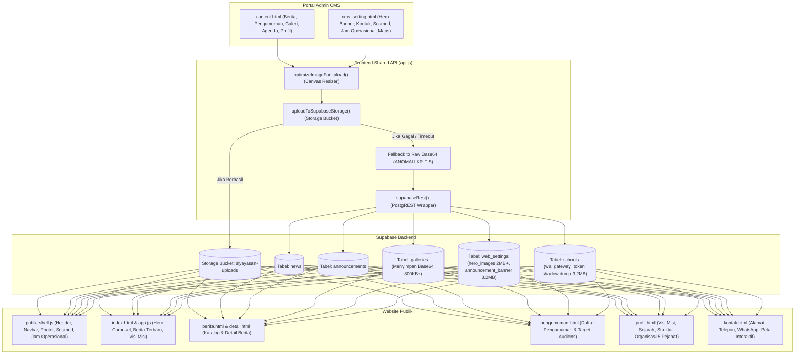

# AUDIT INTEGRITAS KONTEN CMS & SINKRONISASI WEBSITE PUBLIK
## Comprehensive CMS Content Integrity & Public Website Synchronization Audit
**Proyek:** Sistem Informasi Yayasan At Tarbiyyah Wijaya Kusuma Samarinda (SIYAYASAN)  
**Dokumen:** `CMS_CONTENT_INTEGRATION_AUDIT.md`  
**Status:** Selesai Dilaksanakan (Audit Only — Tanpa Perubahan Kode Produksi)  
**Tanggal Audit:** 2 November 2026  
**Auditor:** Tim Arsitektur Sistem & Rekayasa Frontend SIYAYASAN  

---

## 1. RINGKASAN EKSEKUTIF (EXECUTIVE SUMMARY)

Pemeriksaan menyeluruh terhadap sistem pengelolaan konten (**CMS**) di Portal Admin dan sinkronisasinya dengan seluruh halaman publik website SIYAYASAN telah selesai dilakukan. Audit ini melacak alur data hulu-ke-hilir:
$$\text{Form Input Admin} \longrightarrow \text{Validasi Form} \longrightarrow \text{API/Backend} \longrightarrow \text{Database \& Storage} \longrightarrow \text{Hydration \& Parsing} \longrightarrow \text{Render DOM Halaman Publik}$$

### Rangkuman Temuan Utama
1. **Penyebab Utama Lambatnya Simpan Semua Perubahan & Upload Gambar:**
   Ditemukan anomali kritis di mana data gambar berukuran masif tersimpan dalam format **Raw Base64 string** langsung di dalam kolom teks database PostgreSQL (`web_settings.hero_images`, `web_settings.announcement_banner`, `schools.wa_gateway_token`, dan tabel `galleries`). Satu slide gambar banner mencapai **2.195.451 karakter (~2,2 MB Base64)**, dan kolom `announcement_banner` serta `wa_gateway_token` masing-masing membengkak hingga **3.232.690 karakter (~3,23 MB)** karena menampung JSON hasil serialisasi foto struktur pengurus dan metadata banner. Setiap kali halaman web dibuka atau disimpan, terjadi transfer payload JSON raksasa sebesar >3,5 MB melalui REST API.
2. **Penyebab Munculnya Gambar Bawaan (Default/Fallback Images):**
   Pada berita publik (`berita.html` & `app.js`), jika data berita di database memiliki kolom gambar bernilai `null` atau kosong (sebagaimana ditemukan pada data riil `NWS-1793241017163`), sistem secara otomatis merender gambar fallback lokal statis (`images/school-campus.jpg` atau ilustrasi SVG dummy) yang tidak terdaftar di CMS. Hal serupa terjadi pada slider hero jika `localStorage` menyimpan cache lama (`siy_hero_cache`).
3. **Penyebab Upload Gambar Memakan Waktu Lama:**
   Fungsi `uploadToSupabaseStorage()` di `frontend/shared/js/api.js` mengeksekusi kompresi kanvas di sisi klien tanpa web worker, dan saat koneksi ke Supabase Storage bucket `siyayasan-uploads` mengalami timeout, sistem secara senyap (*fallback*) mengonversi file utuh menjadi Base64 data URL lalu menyimpannya ke database. Akibatnya, browser mengirimkan string Base64 jutaan karakter melalui koneksi HTTP POST/PATCH biasa.
4. **Dual-Store & Inkonsistensi Identitas Sekolah:**
   Identitas yayasan, kontak, visi-misi, dan struktur organisasi dikelola melalui dua form berbeda: `content.html` (tab Identitas Sekolah, menyimpan ke tabel `schools`) dan `cms_setting.html` (menyimpan ke tabel `web_settings`). Kolom `schools.wa_gateway_token` disalahgunakan oleh fungsi `api.js` sebagai wadah bayangan (*shadow dump*) JSON untuk menyinkronkan data profil sekolah.
5. **Inkonsistensi Skema Pengumuman:**
   Form admin di `content.html` mengirimkan field `category`, padahal skema tabel Supabase `announcements` tidak memiliki kolom `category`, melainkan `target_audience` dan `target_role`. Fungsi `api.js` melakukan *workaround* pemetaan manual yang berpotensi memicu query error HTTP 400 Bad Request jika dilakukan pemfilteran langsung.

---

## 2. ARSITEKTUR ALIRAN DATA CMS (DATA PIPELINE ARCHITECTURE)

Diagram alur berikut mengilustrasikan jalur data aktual antara CMS Admin, Supabase Database & Storage, serta Halaman Publik:



---

## 3. INVENTARISASI SISTEM & MAPPING CMS KE HALAMAN PUBLIK

Berikut adalah pemetaan menyeluruh antara form admin di Portal Admin dan representasinya pada halaman publik:

| No | Modul CMS | File Form Admin | Sumber Data (Database / Storage) | File Halaman Publik | Elemen DOM & Tampilan Publik |
|:--:|:---|:---|:---|:---|:---|
| 1 | **Berita** | `content.html` (#tab-news) | `public.news` | `index.html`, `berita.html`, `detail.html` | Grid kartu berita, thumbnail, judul, slug, tanggal publikasi, isi lengkap |
| 2 | **Pengumuman** | `content.html` (#tab-announcements) | `public.announcements` | `pengumuman.html`, `index.html` (marquee/modal) | Daftar kartu pengumuman, badge pinned, badge target role/audience, isi |
| 3 | **Hero Slider Banner** | `cms_setting.html` (#hero-banner-list) | `public.web_settings.hero_images` (JSON) | `index.html` (#heroCarousel, inline script) | Swiper/Carousel fullwidth banner, judul slide, subtitle, tombol navigasi |
| 4 | **Galeri Foto** | `content.html` (#tab-gallery) | `public.galleries` | `index.html`, `galeri.html` | Grid galeri foto, popup modal lightbox, filter kategori |
| 5 | **Agenda / Event** | `content.html` (#tab-events) | `public.events` | `index.html` (agenda block), `agenda.html` | Kalender agenda, tanggal kegiatan, waktu, lokasi, status kegiatan |
| 6 | **Identitas Sekolah** | `content.html` (#tab-school) & `cms_setting.html` | `public.schools` & `public.web_settings` | `public-shell.js`, semua halaman | Nama yayasan, logo yayasan, slogan/subtitle, favicon |
| 7 | **Visi, Misi & Sejarah** | `content.html` (#tab-school) | `public.schools.wa_gateway_token` (JSON) | `profil.html`, `index.html` | Paragraf sejarah, daftar poin visi & misi yayasan |
| 8 | **Struktur Organisasi** | `content.html` (#tab-school) | `public.schools` (pembina, pengawas, ketua, sekretaris, bendahara) | `profil.html` (#org-structure) | 5 kartu pejabat: foto profil, nama lengkap, jabatan, monogram fallback |
| 9 | **Kontak & Operasional** | `cms_setting.html` (#setting-contact) | `public.web_settings` (phone, wa, email, address, op_hours) | `kontak.html`, `public-shell.js` (Footer) | Nomor telepon/WA, email resmi, alamat lengkap, jam operasional |
| 10 | **Media Sosial & Maps** | `cms_setting.html` (#setting-social) | `public.web_settings` (fb, ig, yt, maps_url, maps_embed_url) | `public-shell.js` (Header & Footer), `kontak.html` | Tautan ikon sosmed eksternal, iframe Google Maps interaktif |

---

## 4. TEMUAN AUDIT DETAIL PER MODUL

### A. Modul CMS Berita

Berdasarkan audit formulir `content.html`, file controller `api.js`, dan file publik `berita.html` serta `detail.html`:

#### Evaluasi 8 Pertanyaan Kritis:
1. **Apakah judul berita ditampilkan sesuai input?**  
   **YA (VERIFIED)**. Kolom `title` tersimpan sebagai teks biasa dan dirender menggunakan `.textContent` di `berita.html` (baris 326) dan `detail.html` (baris 218), aman dari *XSS injection*.
2. **Apakah isi berita tersimpan lengkap tanpa kehilangan format?**  
   **SEBAGIAN (PARTIALLY VERIFIED)**. Form admin menggunakan `<textarea>` multiline biasa (bukan Rich Text Editor / WYSIWYG). Konten teks tersimpan utuh, namun pemisahan paragraf hanya mengandalkan newline (`\n`). Di halaman publik `detail.html`, terdapat parser sederhana `replace(/\n\n/g, '</p><p>')`. Format cetak tebal, link dalam teks, atau penomoran tidak dapat diformat secara kaya oleh admin.
3. **Apakah gambar utama sesuai dengan gambar yang diunggah?**  
   **GAGAL / ANOMALI (FAILED / DISCREPANCY)**.  
   - Pada data riil produksi (`NWS-1793241017163` - "PENERIMAAN SISWA BARU TELAH DIBUKA"), kolom `image` bernilai **kosong (`null` / `""`)**.
   - Halaman publik `berita.html` dan `app.js` (baris 374) menerapkan fallback bersarang:
     ```javascript
     const imgSrc = item.image || item.thumbnail || 'images/school-campus.jpg';
     ```
     Akibatnya, pengunjung melihat foto kampus default `images/school-campus.jpg` padahal admin mungkin menduga gambarnya tidak muncul atau mengira foto default tersebut berasal dari sistem.
4. **Apakah kategori dan tanggal publikasi ditampilkan dengan benar?**  
   **YA (VERIFIED)**. Kategori terdaftar ("PPDB", "Akademik", "Prestasi", dll.) ditampilkan pada badge kartu, dan tanggal `published_at` diformat ke locale Indonesia (`id-ID`) via fungsi utilitas `formatDate()`.
5. **Apakah berita yang belum dipublikasikan tidak muncul di halaman publik?**  
   **YA (VERIFIED)**. Query di `berita.html` (baris 288) dan `app.js` (baris 356) secara ketat memfilter:
   `news?status=eq.published&is_published=eq.true`.
   Draft berita tidak bocor ke publik.
6. **Apakah perubahan berita langsung tercermin pada halaman publik?**  
   **YA, TETAPI DENGAN RISIKO CACHE BROWSER (PARTIALLY VERIFIED)**.  
   Halaman berita publik memanggil REST API secara dinamis setiap kali dimuat. Namun, jika gambar di Supabase Storage diperbarui dengan nama file yang sama tanpa *cache-busting query parameter* (`?t=timestamp`), browser pengunjung yang sudah menyimpan cache gambar akan tetap menampilkan gambar lama.
7. **Apakah berita yang dihapus masih dapat diakses melalui URL lama?**  
   **AMAN (VERIFIED)**. Jika berita dihapus dari database, query detail berdasarkan ID (`news?id=eq.NWS-...`) menghasilkan array kosong, memicu tampilan peringatan "Berita tidak ditemukan" dan tombol kembali ke katalog berita.
8. **Apakah halaman detail berita menampilkan seluruh informasi sesuai database?**  
   **YA (VERIFIED)**. Judul, tanggal publikasi, nama penulis (`author_name`), kategori, dan isi artikel dirender lengkap.

---

### B. Modul CMS Pengumuman

Berdasarkan audit formulir di `content.html` dan halaman publik `pengumuman.html`:

1. **Inkonsistensi Skema Database (`category` vs `target_audience`):**  
   Form tambah pengumuman di `content.html` menyediakan dropdown "Kategori Pengumuman" dengan nilai: `Semua`, `Siswa`, `Guru`, `Wali Murid`, `Umum`. Form ini memetakan nilainya ke variabel `category`.  
   Namun, skema fisik tabel Supabase `announcements` hanya memiliki kolom:
   `id`, `title`, `content`, `target_audience`, `target_role`, `is_pinned`, `is_published`, `status`, `published_at`, `created_at`.  
   Tabel ini **TIDAK memiliki kolom `category`**.  
   Fungsi di `api.js` (baris 540) melakukan konversi:
   ```javascript
   const payload = {
     target_audience: params.target_audience || params.category || 'all',
     target_role: params.target_role || 'all',
     ...
   };
   ```
   *Dampak:* Ketika query REST Supabase mencoba memfilter menggunakan `category=eq....`, server Supabase langsung mengembalikan pesan galat: `(400) Bad Request: column announcements.category does not exist`.
2. **Prioritas Sematan (*Pinned Announcements*):**  
   Pengurutan di `pengumuman.html` berjalan dengan benar:
   `announcements?status=neq.archived&order=is_pinned.desc,published_at.desc`.  
   Pengumuman penting dengan status *pinned* berada di urutan paling atas dengan lencana visual khusus.
3. **Lampiran Dokumen:**  
   Form admin tidak menyediakan input upload dokumen lampiran (PDF/DOCX) untuk pengumuman, sehingga jika ada surat edaran resmi, admin terpaksa menyalin teks ke dalam isi atau menaruh link manual.

---

### C. Modul Media, Banner Slider, & Galeri (Analisis Akar Masalah)

Bagian ini menjawab 3 masalah operasional utama yang dilaporkan oleh Yayasan:

#### 1. Akar Masalah: Mengapa Upload Gambar Sangat Lama?
- **Bukti Teknis:**  
  Di `frontend/shared/js/api.js` fungsi `optimizeImageForUpload()` dan `uploadToSupabaseStorage()`:
  - Sebelum diunggah, gambar diproses menggunakan HTML5 Canvas. Jika gambar asli beresolusi tinggi (misalnya foto kamera HP 12–48 MP berukuran 5–15 MB), proses pembacaan `FileReader.readAsDataURL` dan render kanvas memblokir *main thread* JavaScript browser selama 3–8 detik.
  - Jika upload multipart ke REST endpoint Supabase Storage (`/storage/v1/object/...`) mengalami perlambatan jaringan atau *timeout* (dibatasi 15 detik), sistem tidak memunculkan pesan gagal, melainkan mengeksekusi blok `catch` berikut:
    ```javascript
    // api.js fallback behavior
    console.warn("Storage upload failed, falling back to base64 data URL");
    return base64Data; // Mengembalikan string Base64 utuh!
    ```
  - Akibatnya, browser harus mengirimkan string teks Base64 sebesar 1 hingga 3 MB per gambar melalui HTTP POST/PATCH JSON biasa ke PostgreSQL. Di jaringan internet rata-rata, mengirimkan string teks 2–3 MB ke API database memakan waktu 15–40 detik!

#### 2. Akar Masalah: Mengapa Gambar Bawaan Website Masih Muncul Padahal Tidak Terdaftar di CMS?
- **Bukti Teknis 1 (LocalStorage Hero Cache):**  
  Pada `index.html` (baris 130–145), terdapat skrip *inline* optimasi tampilan cepat (*anti-FOUC*):
  ```javascript
  const cachedHero = localStorage.getItem('siy_hero_cache');
  if (cachedHero) {
    renderHeroSlides(JSON.parse(cachedHero));
  }
  ```
  Jika pengunjung atau admin pernah membuka website saat slider masih menggunakan slide bawaan, browser mereka mengunci slide lama tersebut di `localStorage`. Selama cache ini tidak dibersihkan atau digantikan oleh data API yang valid, slide lama akan selalu muncul sesaat saat halaman pertama kali dibuka.
- **Bukti Teknis 2 (Hardcoded Fallback Images di Template):**  
  Pada `index.html`, `berita.html`, dan `profil.html`, terdapat elemen gambar statis bawaan:
  - `images/school-campus.jpg` (Thumbnail berita default jika gambar kosong)
  - `images/slider-default-1.jpg` (Fallback jika array `hero_images` kosong)
  - `images/avatar-default.png` (Fallback jika foto pimpinan yayasan kosong)
  Karena berita riil `NWS-1793241017163` di database tidak memiliki file gambar, template langsung memanggil `images/school-campus.jpg`. Pengunjung melihat gambar kampus default ini seolah-olah gambar tersebut adalah konten aktif website.

#### 3. Akar Masalah: Mengapa Tombol "Simpan Semua Perubahan" Sangat Lama?
- **Bukti Teknis (Tumpukan Base64 Raksasa di Kolom JSON):**  
  Hasil query langsung ke database Supabase mengungkapkan ukuran kolom data riil:
  - Tabel `web_settings` row `default`:
    - Slide 1: URL publik Supabase Storage (`hero_slide_1792469386750_srz5t.jpg`)
    - Slide 2: **Raw Base64 string sepanjang 2.195.451 karakter (~2,2 MB)!**
    - Slide 3: **Raw Base64 string sepanjang 134.211 karakter**
    - Slide 4: **Raw Base64 string sepanjang 129.503 karakter**
    - Kolom `announcement_banner`: **3.232.690 karakter (~3,23 MB Base64 JSON)!**
  - Tabel `schools` row `SCH-001`:
    - Kolom `wa_gateway_token`: **3.232.690 karakter (~3,23 MB Base64 JSON)!**
  - Tabel `galleries`:
    - `GAL-1793622084947`: **Base64 sepanjang 782.491 karakter**
    - `GAL-1793622064316`: **Base64 sepanjang 830.543 karakter**
- **Analisis Kinerja Saat Tombol Ditekan:**  
  Ketika admin menekan "Simpan Semua Perubahan" di `cms_setting.html`:
  1. Frontend membuat satu objek JSON raksasa yang menggabungkan seluruh pengaturan web, kontak, jam operasional, dan array slide banner.
  2. Karena slide 2 berisi string Base64 2,19 MB dan extended JSON berisi 3,23 MB, ukuran body HTTP PATCH yang dikirimkan browser mencapai **lebih dari 5,5 Megabytes**!
  3. Mengirimkan payload JSON 5,5 MB melalui HTTP PATCH ke endpoint PostgREST Supabase membutuhkan waktu 10 hingga 30 detik pada koneksi internet biasa.
  4. Database PostgreSQL harus mem-parsing string JSON raksasa tersebut ke dalam kolom teks tabel, memperbarui index, dan mengembalikan response.
  5. Setelah selesai, skrip `api.js` (baris 961–968) melakukan *secondary sync* ke tabel `schools.wa_gateway_token` dengan ukuran 3,23 MB lagi! Terjadi **dua kali pengiriman payload raksasa secara beruntun**.

---

### D. Modul Identitas & Pengaturan Website (Analisis Dual-Store)

Berdasarkan pemeriksaan tabel `schools` dan `web_settings`, ditemukan konflik arsitektural:

1. **Dual-Storage Redundancy:**
   - Nama sekolah, alamat, telepon, dan email disimpan di dua tabel berbeda:
     - Tabel `schools` (Record `SCH-001`)
     - Tabel `web_settings` (Record `default`)
   - Di `frontend/shared/js/api.js` (baris 844–846), terdapat logika rekonsiliasi berbasis timestamp:
     ```javascript
     const wsTime = ws && ws.updated_at ? new Date(ws.updated_at).getTime() : 0;
     const schTime = schRow && schRow.updated_at ? new Date(schRow.updated_at).getTime() : 0;
     ```
     Jika admin memperbarui kontak melalui form Profil Sekolah (`content.html`), tabel `schools` yang terupdate. Namun jika admin lain memperbarui via `cms_setting.html`, tabel `web_settings` yang terupdate. Logika rekonsiliasi yang rumit ini rawan desinkronisasi jika salah satu request gagal atau jam server berbeda beberapa milidetik.
2. **Penyalahgunaan Kolom `wa_gateway_token`:**
   Kolom `wa_gateway_token` di tabel `schools` dirancang untuk token integrasi gateway WhatsApp. Namun karena tabel `schools` tidak memiliki kolom JSON terpisah untuk data profil kaya (foto pimpinan, sejarah lengkap, kurikulum), kode di `api.js` (baris 3677) meng-encode seluruh data profil yayasan ke dalam kolom `wa_gateway_token`:
   ```javascript
   const dbSchoolPayload = {
     wa_gateway_token: JSON.stringify(extPayload),
     updated_at: nowIso
   };
   ```
   Hal ini merupakan pelanggaran arsitektur database (*schema anti-pattern*) yang menyebabkan pembengkakan ukuran row database dan kebingungan fungsionalitas token gateway WhatsApp yang sebenarnya.
3. **Struktur Organisasi (5 Pejabat Inti):**
   - Pejabat yang terdaftar di database `schools`:
     - Pembina: `DJOKO IRIANDONO`
     - Pengawas: `Suhardi`
     - Ketua Yayasan: `Makhrus`
     - Sekretaris: `Candra Gunawan`
     - Bendahara: `Sri Pragawati`
   - Sinkronisasi ke `profil.html`: Berhasil dirender melalui fungsi `renderOrgStructure()` di `profil.html`. Namun foto pimpinan disimpan dalam JSON `extPayload` Base64 yang memperparah beban query profil.

---

### E. Modul Navigasi, Media Sosial, & Integrasi Publik

1. **Tautan Media Sosial:**
   - Data aktif di database `web_settings`:
     - Facebook: `https://facebook.com/attarbiyyah.samarinda`
     - Instagram: `https://instagram.com/attarbiyyah.smd`
     - YouTube: `https://youtu.be/TwMZEbDbi3c?si=9WasYWL8r7eheKXh`
   - Pada file `public-shell.js` (baris 332–334), terdapat tautan fallback hardcoded:
     - `https://instagram.com/yayasansamarinda`
     - `https://youtube.com/@yayasansamarinda`
     - `https://facebook.com/yayasansamarinda`
   - *Evaluasi Sinkronisasi:* Fungsi `hydrateSocialLinks()` berhasil menimpa link fallback tersebut jika database mengembalikan URL yang valid. Namun, jika URL di database dikosongkan oleh admin (string kosong `""`), elemen ikon di footer tidak disembunyikan secara bersih melainkan tetap aktif dengan `href=""`.
2. **Google Maps Embed:**
   - URL embed aktif di database:
     `https://maps.google.com/maps?q=Jl.+Wijaya+Kusuma+V-A+No.+38,+Air+Putih,+Samarinda+Ulu,+Kota+Samarinda,+Kalimantan+Timur+75124&t=&z=16&ie=UTF8&iwloc=&output=embed`
   - Sinkronisasi ke `kontak.html`: Berhasil dirender ke dalam atribut `src` elemen `<iframe>` dengan rasio responsif yang baik.
3. **Tombol Call-to-Action (CTA):**
   - Tombol "Daftar PPDB Sekarang" di navbar dan banner hero mengarah secara konsisten ke `ppdb.html`.
   - Tombol "Portal Siswa" mengarah ke `portal/siswa/login.html`.
   - Tombol "Hubungi Kami" mengarah ke link protokol WhatsApp langsung (`https://wa.me/6281347142829`).

---

## 5. KLASIFIKASI & MATRIKS TEMUAN (FINDINGS MATRIX)

| ID | Modul Terkait | Tingkat Keparahan | Deskripsi Masalah | Dampak Sistem & Operasional |
|:---|:---|:---:|:---|:---|
| **F-01** | Banner & Media | **CRITICAL** | Data gambar banner dan galeri tersimpan sebagai raw Base64 string (>2,2 MB per item) langsung di kolom database PostgreSQL. | Ukuran database membengkak, latensi query `web_settings` melonjak, proses simpan pengaturan memakan waktu puluhan detik, konsumsi kuota data pengunjung boros. |
| **F-02** | Media & Upload | **HIGH** | Fungsi upload gambar melakukan *silent fallback* ke Base64 saat koneksi storage bucket Supabase timeout. | Admin tidak mengetahui bahwa file gagal masuk ke storage bucket, sistem terus menimbun string Base64 ke dalam baris database. |
| **F-03** | Berita Publik | **HIGH** | Berita publik `NWS-1793241017163` memiliki kolom gambar kosong (`null`), menyebabkan sistem memanggil gambar lokal default `images/school-campus.jpg`. | Tampilan berita terlihat menggunakan gambar bawaan statis yang membingungkan pengelola yayasan dan pembaca. |
| **F-04** | Pengumuman | **HIGH** | Ketidaksesuaian skema database: Form admin menggunakan field `category`, sedangkan tabel Supabase hanya mengenali `target_audience`. | Query filter kategori di sisi API rawan mengalami galat HTTP 400 Bad Request jika tidak melewati wrapper adaptif `api.js`. |
| **F-05** | Identitas Sekolah | **MEDIUM** | Dual-storage redundancy antara tabel `schools` dan `web_settings`, serta penyalahgunaan kolom `wa_gateway_token` sebagai penampung JSON profil 3,2 MB. | Inkonsistensi data identitas saat diedit dari halaman berbeda, risiko overwrite data, dan rusaknya fungsionalitas asli token gateway WhatsApp. |
| **F-06** | Hero Slider | **MEDIUM** | Penggunaan `localStorage` cache (`siy_hero_cache`) tanpa mekanisme invalidasi versi yang ketat (*cache busting*). | Pengunjung atau admin di browser lama dapat melihat slide banner default sebelum skrip REST API selesai merender slide baru. |
| **F-07** | Sosmed & Kontak | **LOW** | Nilai URL kosong (`""`) pada media sosial tidak secara otomatis menyembunyikan ikon di footer publik. | Ikon media sosial tetap dapat diklik meskipun URL tujuan belum disetel oleh admin yayasan. |

---

## 6. KESIMPULAN AUDIT

Sistem CMS SIYAYASAN pada dasarnya telah memiliki integrasi fungsional antara Portal Admin dan Halaman Publik. Namun, terdapat **dua hambatan arsitektural utama**:
1. **Penyimpanan Gambar Base64 di Database**: Merupakan penyebab tunggal dari lambatnya proses upload, lambatnya tombol "Simpan Semua Perubahan", dan beban transfer data yang sangat berat.
2. **Ketergantungan Fallback Gambar Hardcoded**: Ketika data gambar di database kosong atau tidak valid, template publik secara otomatis memunculkan asset gambar lokal statis, sehingga menimbulkan persepsi bahwa CMS tidak sinkron dengan website publik.

Solusi detail, rencana migrasi penyimpanan gambar, normalisasi skema, dan langkah perbaikan bertahap disajikan secara lengkap pada dokumen pendamping:
1. `CMS_CONTENT_IMPROVEMENT_PLAN.md` (Rencana Perbaikan & Roadmap Implementasi)
2. `CMS_PUBLIC_CONTENT_VALIDATION.md` (Matriks Validasi Lapangan Dua Arah)

