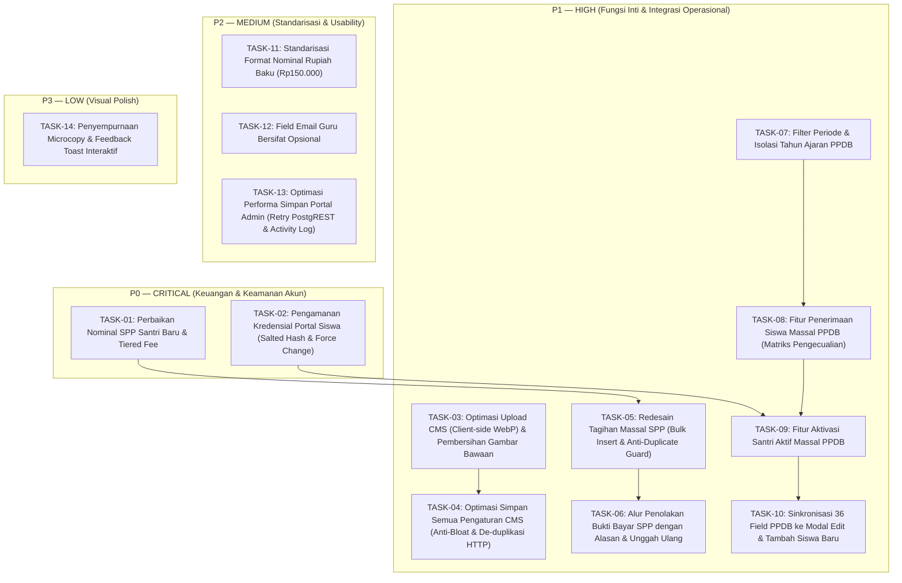

# MASTER IMPROVEMENT PLAN — WEBSITE SIYAYASAN
## Yayasan At Tarbiyyah Wijaya Kusuma Samarinda
**Rencana Induk Perbaikan Sistem, Urutan Implementasi, Mitigasi Risiko & Strategi Pengujian**  
**Tanggal:** 2 November 2026 | **Status:** Usulan Perencanaan (Menunggu Persetujuan Pengguna)

---

## 1. PENDAHULUAN & STRATEGI EKSEKUSI

Dokumen ini disusun sebagai cetak biru (*blueprint*) komprehensif untuk memandu pelaksanaan peningkatan mutu sistem informasi daring Yayasan At Tarbiyyah Wijaya Kusuma Samarinda.

Perbaikan dibagi menjadi 4 tingkatan prioritas operasional:
- **P0 — Critical:** Masalah yang mengancam integritas transaksi keuangan yayasan dan privasi data santri.
- **P1 — High:** Fitur operasional inti yang dibutuhkan sebelum penerimaan santri dan penagihan massal berjalan penuh.
- **P2 — Medium:** Standarisasi alur kerja, penghematan waktu staf tata usaha, dan kebersihan data.
- **P3 — Low:** Penyempurnaan antarmuka tambahan dan optimasi micro-interaction.

Setiap butir pekerjaan diuraikan secara terperinci dengan 10 atribut wajib sesuai arahan pengguna.

---

## 2. DAFTAR PEKERJAAN BERDASARKAN TINGKAT PRIORITAS

---

## 3. RINCIAN SPESIFIKASI PEKERJAAN (TASK SPECIFICATIONS)

### [TASK-01] Perbaikan Nominal SPP Santri Baru & Fleksibilitas Tarif Berjenjang
1. **Identitas Masalah:** Nominal SPP santri baru saat ini terkunci mati pada angka Rp150.000 dan tidak dapat diubah oleh admin saat aktivasi.
2. **Kondisi Sistem Saat Ini:** File `frontend/shared/js/api.js` baris 3010 menetapkan `amount: 150000` secara statis di dalam kode program saat santri PPDB dikonversi.
3. **Akar Masalah:** Tidak ada parameter penerima nominal SPP pada fungsi `ppdb/convert` dan tidak ada input tarif SPP di antarmuka modal aktivasi.
4. **Solusi yang Direkomendasikan:**
   - Tambahkan input `Nominal SPP Pertama & Bulanan` pada modal aktivasi PPDB (baik satuan maupun massal).
   - Berikan nilai default otomatis berdasarkan jenjang yang dipilih: PAUD Rp200.000, TPQ Pagi Rp150.000, Tahfidz Rp175.000 (dapat disesuaikan yayasan).
   - Simpan nilai nominal ini ke kolom baru `students.monthly_spp_amount` dan terapkan ke tagihan perdana `invoices.amount`.
5. **Komponen/File/Tabel Terdampak:**
   - File: `frontend/portal/admin/ppdb.html`, `frontend/shared/js/api.js`.
   - Tabel: `students` (tambah kolom `monthly_spp_amount`), `invoices`.
6. **Hubungan dengan Fitur Lain:** Berhubungan langsung dengan modul Keuangan SPP, Dashboard Keuangan Admin, dan Tagihan di Portal Siswa.
7. **Risiko Perubahan:** Kesalahan pembacaan tipe data nominal (string vs integer).
8. **Strategi Menjaga Kompatibilitas Data Lama:** Santri aktif lama yang sudah ada di database akan diberi nilai default `monthly_spp_amount = 150000` via migrasi database sehingga tagihan historis tidak terganggu.
9. **Metode Pengujian:** Lakukan aktivasi 1 santri baru PAUD dengan nominal Rp200.000 dan 1 santri beasiswa dengan nominal Rp0; pastikan invoice perdana tercatat persis sesuai nominal yang diinput.
10. **Prioritas:** **P0 — Critical** | **Urutan:** Tahap 1.

---

### [TASK-02] Pengamanan Kredensial Portal Siswa (Salted Hash & Mandatory Force Change)
1. **Identitas Masalah:** Kata sandi portal siswa disimpan dalam bentuk teks polos (plaintext), verifikasi login memakai komparasi string langsung, dan tidak ada proteksi bila seluruh siswa diberi kata sandi awal yang sama.
2. **Kondisi Sistem Saat Ini:** Kolom `users.password_hash` dan `ppdb_registrations.portal_password` menyimpan teks kata sandi tanpa hash.
3. **Akar Masalah:** Ketiadaan modul kriptografi satu arah pada proses autentikasi dan pembuatan akun siswa.
4. **Solusi yang Direkomendasikan:**
   - Terapkan Web Crypto API bawaan browser untuk membuat hash SHA-256 yang diperkuat dengan salt dinamis: `hash = SHA256(password + user_id + salt)`.
   - Tambahkan kolom `users.must_change_password` (BOOLEAN DEFAULT FALSE) dan `users.password_salt`.
   - Ketika siswa baru diaktivasi, akun diset dengan `must_change_password = true`.
   - Pada Portal Siswa (`frontend/portal/siswa/dashboard.html`), deteksi bendera ini: jika `true`, sistem menampilkan modal paksa ganti sandi dan memblokir navigasi lain hingga santri mengganti sandi pribadinya.
   - Hapus teks sandi asli dari kolom `portal_password` setelah aktivasi selesai. Admin hanya dapat mereset sandi ke default, bukan melihat sandi asli.
5. **Komponen/File/Tabel Terdampak:**
   - File: `frontend/shared/js/api.js` (fungsi auth & hash), `frontend/portal/siswa/dashboard.html`, `frontend/portal/admin/students.html`.
   - Tabel: `users` (tambah kolom `must_change_password`, `password_salt`).
6. **Hubungan dengan Fitur Lain:** Memengaruhi alur login siswa di `public/login.html` dan fitur reset sandi di portal admin.
7. **Risiko Perubahan:** Siswa lama yang sudah login berpotensi gagal login jika password lama tidak dimigrasikan secara mulus.
8. **Strategi Menjaga Kompatibilitas Data Lama:**
   - Fungsi autentikasi di `api.js` dibuat fleksibel (*dual-mode verifier*):
     Jika di database password pengguna belum memiliki salt (data lama), verifikasi menggunakan pencocokan legacy. Jika berhasil login, sistem langsung meng-upgrade password pengguna tersebut menjadi format hash ter-salt baru secara transparan (*lazy migration*).
9. **Metode Pengujian:** Uji login santri baru dengan sandi awal; pastikan modal wajib ganti sandi muncul dan memblokir dashboard; setelah diganti, pastikan database hanya mencatat string hash hexadecimal.
10. **Prioritas:** **P0 — Critical** | **Urutan:** Tahap 1.

---

### [TASK-03] Optimasi Upload Gambar CMS (Client-side WebP) & Pembersihan Gambar Bawaan
1. **Identitas Masalah:** Upload gambar slide hero di CMS Banner memakan waktu sangat lama, dan gambar bawaan lama (`hero_slide_...srz5t.jpg`) masih muncul sekelebat di website publik bagi pengunjung baru.
2. **Kondisi Sistem Saat Ini:**
   - File mentah hingga 10MB diunggah tanpa kompresi; jika gagal, diubah menjadi Base64 raksasa.
   - `frontend/public/index.html` baris 184 dan baris 596 memuat URL gambar statis hardcoded.
3. **Akar Masalah:**
   - Ketiadaan proses canvas resizing / WebP converter di browser admin sebelum file dikirim.
   - Gambar fallback hardcoded di HTML statis menimpa state kosong CMS.
4. **Solusi yang Direkomendasikan:**
   - Bangun helper kompresi gambar client-side di `frontend/shared/js/api.js` menggunakan HTML5 Canvas:
     Secara otomatis mengubah foto ukuran besar menjadi format WebP resolusi maksimal 1920x1080 piksel dengan kualitas 82% (ukuran file turun dari 8MB menjadi ~150KB dalam hitungan milidetik).
   - Bersihkan URL hardcoded `hero_slide_1792469386750_srz5t.jpg` dari `frontend/public/index.html`.
   - Jadikan tabel `web_settings.hero_images` sebagai sumber kebenaran tunggal (*single source of truth*). Jika belum ada slide, tampilkan placeholder netral yayasan atau foto kampus resmi `/images/school-campus.jpg` tanpa URL Supabase usang.
5. **Komponen/File/Tabel Terdampak:**
   - File: `frontend/portal/admin/cms_setting.html`, `frontend/public/index.html`, `frontend/shared/js/api.js`.
   - Storage: Bucket `siyayasan-uploads`.
6. **Hubungan dengan Fitur Lain:** Mempercepat seluruh fitur upload gambar (berita, galeri, avatar guru, bukti bayar).
7. **Risiko Perubahan:** Browser jadul yang tidak mendukung WebP (namun seluruh peramban modern > 2020 sudah mendukung WebP 100%). Sediakan fallback canvas JPEG.
8. **Strategi Menjaga Kompatibilitas Data Lama:** Gambar-gambar slide yang sudah tersimpan di Supabase Storage tetap dipertahankan dan dibaca normal.
9. **Metode Pengujian:** Unggah foto kamera resolusi tinggi 10MB melalui CMS; pastikan proses upload tuntas dalam < 2 detik dan ukuran file di storage < 200KB. Buka beranda dalam mode penyamaran (*incognito*) untuk memastikan gambar usang tidak muncul lagi.
10. **Prioritas:** **P1 — High** | **Urutan:** Tahap 2.

---

### [TASK-04] Optimasi Simpan Semua Pengaturan CMS (Anti-Bloat & De-duplikasi HTTP)
1. **Identitas Masalah:** Menekan tombol "Simpan Semua Pengaturan" di CMS Web membutuhkan waktu sangat lama (6–25 detik).
2. **Kondisi Sistem Saat Ini:** Menjalankan 7 permintaan HTTP sekuensial dan paralel ke Supabase PostgREST, serta menyalin JSON raksasa berulang kali ke tabel `web_settings` dan `schools`.
3. **Akar Masalah:** Redundansi arsitektur penyimpanan (dual-write ke `schools.wa_gateway_token` dan `web_settings.announcement_banner`) serta panggilan ganda `schools.update` di `cms_setting.html` baris 750.
4. **Solusi yang Direkomendasikan:**
   - Hilangkan panggilan ganda di `cms_setting.html`.
   - Satukan proses simpan pengaturan website ke endpoint `web_settings` saja, dan sinkronkan ke `schools` di background tanpa memblokir respon pengguna.
   - Bersihkan string Base64 dari array `hero_images` sebelum dikirim ke database.
   - Gunakan header PostgREST `Prefer: return=minimal` untuk mempercepat waktu respon server.
5. **Komponen/File/Tabel Terdampak:**
   - File: `frontend/portal/admin/cms_setting.html`, `frontend/shared/js/api.js`.
   - Tabel: `web_settings`, `schools`.
6. **Hubungan dengan Fitur Lain:** Mengubah cara penyimpanan identitas yayasan, kontak, dan footer background.
7. **Risiko Perubahan:** Data kontak di halaman Kontak (`kontak.html`) tidak terupdate jika sinkronisasi `schools` terputus.
8. **Strategi Menjaga Kompatibilitas Data Lama:** Memastikan seluruh field lama (`school_name`, `address`, `phone`, `operational_hours`, dll.) tetap tersimpan di kedua tabel secara konsisten.
9. **Metode Pengujian:** Lakukan perubahan teks tagline dan simpan; pastikan tombol simpan merespons dalam < 1 detik dengan notifikasi sukses.
10. **Prioritas:** **P1 — High** | **Urutan:** Tahap 2.

---

### [TASK-05] Redesain Tagihan Massal SPP (Bulk Insert & Anti-Duplicate Guard)
1. **Identitas Masalah:** Pembuatan tagihan massal per kelas berjalan sangat lambat karena menjalankan loop `POST` satu per satu untuk setiap siswa (60 request HTTP berurutan), serta rawan menciptakan tagihan ganda jika admin mengklik tombol dua kali.
2. **Kondisi Sistem Saat Ini:** File `frontend/shared/js/api.js` baris 1983–2015 mengeksekusi `await supabaseRest('invoices', 'POST', ...)` di dalam perulangan `for`.
3. **Akar Masalah:** Belum memanfaatkan fitur native batch insert pada Supabase PostgREST.
4. **Solusi yang Direkomendasikan:**
   - Ubah logika `invoices.create_bulk` menjadi penyusunan array objek di memori, kemudian lakukan **satu kali request HTTP batch insert**:
     `supabaseRest('invoices', 'POST', arrayOfInvoices)`.
   - Tambahkan pengecekan ketat sebelum insert: saring siswa yang sudah memiliki invoice pada kombinasi `student_id` + `month` + `period`.
   - Sediakan pilihan metode tarif: Tarif sesuai profil masing-masing siswa (`monthly_spp_amount`) atau tarif seragam.
5. **Komponen/File/Tabel Terdampak:**
   - File: `frontend/portal/admin/payments.html`, `frontend/shared/js/api.js`.
   - Tabel: `invoices`.
6. **Hubungan dengan Fitur Lain:** Modul Keuangan SPP Admin dan Halaman Tagihan Siswa.
7. **Risiko Perubahan:** Satu baris data invalid dapat menggagalkan seluruh batch insert jika validasi skema gagal.
8. **Strategi Menjaga Kompatibilitas Data Lama:** Format data invoice yang dihasilkan tetap 100% identik dengan skema tabel `invoices` yang sudah berjalan.
9. **Metode Pengujian:** Terbitkan tagihan massal untuk satu kelas berisi 30 siswa; ukur waktu eksekusi (harus selesai < 500 ms) dan coba klik terbitkan lagi untuk memastikan sistem menolak tagihan duplikat.
10. **Prioritas:** **P1 — High** | **Urutan:** Tahap 2.

---

### [TASK-06] Alur Penolakan Bukti Bayar SPP dengan Alasan & Fasilitas Unggah Ulang
1. **Identitas Masalah:** Ketika admin menolak bukti pembayaran di portal admin, sistem tidak meminta alasan penolakan. Di portal siswa, tagihan kembali berstatus "Belum Bayar" tanpa ada penjelasan mengapa bukti ditolak.
2. **Kondisi Sistem Saat Ini:** File `admin/payments.html` baris 722 hanya menjalankan `confirm()` sederhana tanpa form input alasan, dan `siswa/spp.html` baris 329 tidak merender catatan penolakan.
3. **Akar Masalah:** Ketiadaan antarmuka input alasan tolak di admin dan ketiadaan komponen penampil alasan tolak di portal siswa.
4. **Solusi yang Direkomendasikan:**
   - Tambahkan modal interaktif "Tolak Pembayaran" di `admin/payments.html` dengan pilihan alasan standar (foto buram, nominal kurang, rekening salah) dan catatan manual.
   - Simpan alasan penolakan ke kolom `payments.rejection_reason`.
   - Di `siswa/spp.html`, tampilkan kotak informasi peringatan:  
     `"Pembayaran Ditolak: [Alasan]. Mohon periksa kembali dan unggah bukti transfer yang benar."`
   - Sediakan tombol **"Upload Bukti Ulang"** yang memungkinkan siswa mengirimkan struk perbaikan.
5. **Komponen/File/Tabel Terdampak:**
   - File: `frontend/portal/admin/payments.html`, `frontend/portal/siswa/spp.html`, `frontend/shared/js/api.js`.
   - Tabel: `payments` (tambah kolom `rejection_reason`).
6. **Hubungan dengan Fitur Lain:** Integrasi verifikasi bendahara dan notifikasi status siswa.
7. **Risiko Perubahan:** Pembayaran lama yang pernah ditolak di masa lalu belum memiliki catatan alasan (`null`).
8. **Strategi Menjaga Kompatibilitas Data Lama:** Tangani `rejection_reason` null dengan fallback teks umum (*"Bukti pembayaran belum memenuhi ketentuan verifikasi"*).
9. **Metode Pengujian:** Unggah bukti bayar dari portal siswa, tolak bukti dari admin dengan alasan "Foto struk terpotong", lalu pastikan pesan tersebut langsung tampil di portal siswa dan siswa dapat mengunggah ulang.
10. **Prioritas:** **P1 — High** | **Urutan:** Tahap 3.

---

### [TASK-07] Filter Periode & Isolasi Tahun Ajaran PPDB
1. **Identitas Masalah:** Data calon siswa dari berbagai tahun ajaran bercampur dalam satu tabel pendaftaran PPDB admin tanpa pemisah periode yang jelas.
2. **Kondisi Sistem Saat Ini:** Tidak ada dropdown pemilihan tahun ajaran di bilah filter `admin/ppdb.html`, dan query `ppdb.list` tidak memfilter `academic_year`.
3. **Akar Masalah:** Ketiadaan kolom dan kontrol UI filter periode di halaman operasional PPDB.
4. **Solusi yang Direkomendasikan:**
   - Tambahkan dropdown pilihan Periode Tahun Ajaran di bagian atas halaman `admin/ppdb.html`.
   - Modifikasi fungsi `loadPpdb()` agar menyertakan parameter `academic_year` pada permintaan API.
   - Pisahkan pendaftar tahun berjalan (gelombang aktif) dengan arsip tahun lalu.
5. **Komponen/File/Tabel Terdampak:**
   - File: `frontend/portal/admin/ppdb.html`, `frontend/shared/js/api.js`.
   - Tabel: `ppdb_registrations` (kolom `academic_year`).
6. **Hubungan dengan Fitur Lain:** Manajemen Gelombang PPDB dan Cek Status Kelulusan di Halaman Publik.
7. **Risiko Perubahan:** Data pendaftar lama yang kolom `academic_year`-nya bernilai `null` berpotensi tidak muncul saat difilter.
8. **Strategi Menjaga Kompatibilitas Data Lama:** Berikan default otomatis `'2026/2027'` pada seluruh baris lama yang memiliki nilai null melalui skrip SQL patch.
9. **Metode Pengujian:** Ganti pilihan filter ke tahun ajaran sebelumnya; pastikan hanya data tahun tersebut yang muncul, dan beralih kembali ke periode aktif menampilkan pendaftar berjalan.
10. **Prioritas:** **P1 — High** | **Urutan:** Tahap 3.

---

### [TASK-08] Fitur Penerimaan Siswa Secara Massal (Bulk Acceptance)
1. **Identitas Masalah:** Admin harus mengklik tombol persetujuan (Approve) satu per satu untuk puluhan calon siswa, yang memakan waktu dan melelahkan.
2. **Kondisi Sistem Saat Ini:** Hanya ada tombol approve individual per baris tabel.
3. **Akar Masalah:** Ketiadaan antarmuka dan alur kerja pemrosesan seleksi massal.
4. **Solusi yang Direkomendasikan:**
   - Bangun modal alur kerja **Penerimaan Siswa Massal** di `admin/ppdb.html`.
   - Secara default seluruh calon siswa yang berstatus `pending` disiapkan untuk diterima.
   - Sediakan dua zona pengecualian yang dilengkapi toggle eksplisit **"Tidak Ada"**:
     1. Pengecualian: Siswa Tidak Diterima (dengan input alasan tolak).
     2. Pengecualian: Siswa Masih Dipertimbangkan.
   - Tampilkan ringkasan matriks keputusan sebelum tombol konfirmasi akhir dieksekusi.
5. **Komponen/File/Tabel Terdampak:**
   - File: `frontend/portal/admin/ppdb.html`, `frontend/shared/js/api.js`.
   - Tabel: `ppdb_registrations`.
6. **Hubungan dengan Fitur Lain:** Mengubah status pendaftar yang dapat dilihat orang tua di halaman Cek Status Publik.
7. **Risiko Perubahan:** Salah memilih pendaftar secara massal.
8. **Strategi Menjaga Kompatibilitas Data Lama:** Membatasi target hanya pada baris dengan `status = 'pending'`, serta menyediakan audit trail (`activity_logs`).
9. **Metode Pengujian:** Jalankan penerimaan massal pada 10 pendaftar pending dengan mengecualikan 1 siswa ditolak; periksa bahwa 9 siswa berstatus `accepted` dan 1 siswa berstatus `rejected`.
10. **Prioritas:** **P1 — High** | **Urutan:** Tahap 3.

---

### [TASK-09] Fitur Konversi Siswa Aktif Secara Massal (Bulk Student Activation)
1. **Identitas Masalah:** Setelah calon santri diterima, admin harus membuka popup konversi satu per satu untuk menerbitkan NIS, menetapkan kelas, dan membuat akun siswa.
2. **Kondisi Sistem Saat Ini:** Hanya ada modal konversi per siswa tunggal (`openConvertModal(id)`).
3. **Akar Masalah:** Belum tersedianya fitur batch activation di portal admin.
4. **Solusi yang Direkomendasikan:**
   - Bangun modal **Aktivasi Santri Massal** yang menampilkan seluruh siswa berstatus `accepted`.
   - Sertakan validasi kelengkapan data (nama, tanggal lahir, program).
   - Tentukan konfigurasi massal: penempatan kelas, penomoran NIS otomatis berurutan sesuai pola yayasan, penetapan nominal SPP perdana, dan skema sandi portal awal.
   - Eksekusi konversi secara batch dan tampilkan ringkasan hasil aktivasi dengan opsi cetak/ekspor slip akun.
5. **Komponen/File/Tabel Terdampak:**
   - File: `frontend/portal/admin/ppdb.html`, `frontend/shared/js/api.js`.
   - Tabel: `ppdb_registrations`, `students`, `users`, `invoices`.
6. **Hubungan dengan Fitur Lain:** Terkoneksi ke Data Siswa, Manajemen Pengguna, dan Tagihan SPP.
7. **Risiko Perubahan:** Pembuatan data siswa ganda jika koneksi terputus di tengah jalan.
8. **Strategi Menjaga Kompatibilitas Data Lama:** Menandai `ppdb_registrations.status = 'converted'` dan `is_converted = true` agar santri yang sudah aktif tidak dapat dikonversi ulang.
9. **Metode Pengujian:** Konversi 5 siswa diterima sekaligus; verifikasi bahwa kelima siswa langsung terdaftar di tabel `students`, akun mereka terbentuk di `users`, dan invoice SPP mereka terbit di `invoices`.
10. **Prioritas:** **P1 — High** | **Urutan:** Tahap 4.

---

### [TASK-10] Sinkronisasi 36 Field PPDB ke Modal Edit & Form Tambah Siswa Baru
1. **Identitas Masalah:** Modal edit data siswa di portal admin hanya menampilkan 11 field, sehingga rincian orang tua, NIK, pekerjaan, dan data buku induk dari PPDB tidak dapat dilihat atau diedit oleh admin. Form "Tambah Siswa Baru" manual juga memiliki struktur yang berbeda dengan form PPDB.
2. **Kondisi Sistem Saat Ini:** File `admin/students.html` baris 122–180 hanya merender 11 input dasar.
3. **Akar Masalah:** Antarmuka formulir di `students.html` belum diselaraskan dengan skema komprehensif `students.form_metadata`.
4. **Solusi yang Direkomendasikan:**
   - Rombak modal formulir siswa di `admin/students.html` menjadi antarmuka bertab rapi:
     - **Tab 1: Identitas Pribadi** (Nama, NIS, NIK, Tempat/Tgl Lahir, Jenis Kelamin, Agama, Anak ke-, Jumlah Saudara, Bahasa).
     - **Tab 2: Orang Tua & Wali** (Nama Ayah/Ibu, NIK, Pendidikan, Pekerjaan, Penghasilan, No WA, Nama Wali).
     - **Tab 3: Alamat & Tempat Tinggal** (Alamat Lengkap, Status Tinggal, Jarak ke Sekolah, Transportasi).
     - **Tab 4: Akademik & Penempatan** (Kelas/Kelompok, Tarif SPP Bulanan, Status Aktif).
     - **Tab 5: Dokumen Persyaratan** (Pratinjau Akta Kelahiran, Kartu Keluarga, dan Pas Foto).
   - Gunakan komponen formulir bertab yang persis sama untuk aksi **Edit Siswa** maupun aksi **Tambah Siswa Baru** agar standar data 100% seragam.
5. **Komponen/File/Tabel Terdampak:**
   - File: `frontend/portal/admin/students.html`, `frontend/shared/js/api.js`.
   - Tabel: `students` (sinkronisasi kolom utama dan JSON `form_metadata`).
6. **Hubungan dengan Fitur Lain:** Mempengaruhi halaman Cetak Buku Induk, Profil Siswa di Portal Siswa, dan ekspor data EMIS/Dapodik.
7. **Risiko Perubahan:** Data lama yang belum memiliki field tambahan menjadi rusak saat disimpan.
8. **Strategi Menjaga Kompatibilitas Data Lama:** Membaca metadata lama secara *safe merging* (`{ ...existingMeta, ...newInputs }`), sehingga field yang tidak disentuh tidak akan hilang.
9. **Metode Pengujian:** Buka siswa lulusan PPDB di modal edit admin; pastikan nama ayah, ibu, dan pekerjaan terisi otomatis; ubah nomor WA orang tua dan simpan; buka kembali untuk memastikan data tersimpan konsisten.
10. **Prioritas:** **P1 — High** | **Urutan:** Tahap 4.

---

### [TASK-11] Standarisasi Format Nominal Rupiah Baku (Rp150.000)
1. **Identitas Masalah:** Tampilan nominal belum seragam (sebagian memakai spasi `Rp 150.000`, sebagian angka polos) dan input angka tidak memiliki petunjuk format rupiah.
2. **Kondisi Sistem Saat Ini:** Fungsi `formatIDR` di `api.js` baris 3912 menghasilkan `'Rp ' + n.toLocaleString('id-ID')`.
3. **Akar Masalah:** Belum adanya standarisasi helper fungsi tunggal tanpa spasi.
4. **Solusi yang Direkomendasikan:**
   - Perbarui helper `formatIDR(n)` menjadi: `'Rp' + Number(n).toLocaleString('id-ID')`.
   - Tambahkan live preview label di seluruh form input keuangan (tagihan, pembayaran, modal aktivasi) agar admin melihat konfirmasi teks `Rp150.000` secara real-time saat mengetik angka.
5. **Komponen/File/Tabel Terdampak:**
   - File: `frontend/shared/js/api.js`, `frontend/portal/admin/payments.html`, `frontend/portal/siswa/spp.html`, `frontend/portal/admin/dashboard.html`.
6. **Hubungan dengan Fitur Lain:** Kwitansi cetak, slip pembayaran, dan dashboard keuangan.
7. **Risiko Perubahan:** Tidak ada risiko fungsional karena hanya menyentuh lapisan presentasi visual string.
8. **Strategi Menjaga Kompatibilitas Data Lama:** Kolom database tetap integer murni tanpa modifikasi format.
9. **Metode Pengujian:** Cek seluruh tabel keuangan, kwitansi, dan portal siswa; pastikan seluruh angka berawalan `Rp` rapat tanpa spasi.
10. **Prioritas:** **P2 — Medium** | **Urutan:** Tahap 5.

---

### [TASK-12] Field Email Guru Bersifat Opsional
1. **Identitas Masalah:** Formulir penambahan dan pengeditan guru mewajibkan pengisian email (`required`), menyulitkan TU jika ada pengajar yang belum memiliki email resmi.
2. **Kondisi Sistem Saat Ini:** File `frontend/portal/admin/teachers.html` baris 75 memiliki atribut `required` dan label `Email *`.
3. **Akar Masalah:** Sisa validasi awal yang tidak diselaraskan dengan kenyataan bahwa kolom `email` di tabel database `teachers` sudah bersifat nullable.
4. **Solusi yang Direkomendasikan:**
   - Hapus atribut `required` dan tanda bintang `*` pada input email di `admin/teachers.html`.
   - Tambahkan placeholder: `"opsional (dapat dikosongkan)"`.
   - Pastikan backend `api.js` menerima string kosong tanpa memicu error atau pencarian akun palsu.
5. **Komponen/File/Tabel Terdampak:**
   - File: `frontend/portal/admin/teachers.html`, `frontend/shared/js/api.js`.
   - Tabel: `teachers`.
6. **Hubungan dengan Fitur Lain:** Daftar Guru di Portal Admin dan Halaman Profil Guru Publik.
7. **Risiko Perubahan:** Sangat rendah.
8. **Strategi Menjaga Kompatibilitas Data Lama:** Data guru yang sudah memiliki email tetap tampil normal; yang kosong tampil tanda `-`.
9. **Metode Pengujian:** Tambahkan guru baru tanpa mengisi kolom email; pastikan guru berhasil tersimpan dan tampil di daftar guru.
10. **Prioritas:** **P2 — Medium** | **Urutan:** Tahap 5.

---

### [TASK-13] Optimasi Performa Simpan Portal Admin (Retry PostgREST & Activity Log)
1. **Identitas Masalah:** Secara umum proses penyimpanan data di portal admin terasa lambat.
2. **Kondisi Sistem Saat Ini:** Fungsi `supabaseRest` melakukan retry loop hingga 25 kali jika ada kolom yang tidak dikenal, serta menunggu eksekusi `recordActivityLog` secara sinkron (*blocking*).
3. **Akar Masalah:** Latensi jaringan bertingkat akibat auto-healing yang bekerja berulang kali dan logging sinkron.
4. **Solusi yang Direkomendasikan:**
   - Selaraskan seluruh payload frontend dengan skema database riil Supabase agar tidak memicu error kolom tidak dikenal (*zero-retry execution*).
   - Ubah pemanggilan `recordActivityLog` menjadi non-blocking asynchronous (`void recordActivityLog(...)` tanpa `await`), sehingga admin tidak perlu menunggu pencatatan log selesai sebelum menerima respon sukses.
5. **Komponen/File/Tabel Terdampak:**
   - File: `frontend/shared/js/api.js`.
6. **Hubungan dengan Fitur Lain:** Mempercepat seluruh operasi CRUD di portal admin.
7. **Risiko Perubahan:** Kesalahan log jika koneksi terputus di tengah jalan.
8. **Strategi Menjaga Kompatibilitas Data Lama:** Struktur tabel `activity_logs` tidak berubah.
9. **Metode Pengujian:** Lakukan operasi simpan profil sekolah dan update santri; ukur waktu respon UI yang kini di bawah 1 detik.
10. **Prioritas:** **P2 — Medium** | **Urutan:** Tahap 5.

---

### [TASK-14] Penyempurnaan Visual & Feedback Toast Interaktif
1. **Identitas Masalah:** Beberapa dialog feedback konfirmasi masih menggunakan alert browser bawaan (`alert()` / `confirm()`).
2. **Kondisi Sistem Saat Ini:** Terdapat campuran antara `showToast` dan dialog browser bawaan.
3. **Solusi yang Direkomendasikan:**
   - Standardisasi dialog konfirmasi tindakan penting (seperti tolak pembayaran, hapus data) menggunakan modal konfirmasi kustom bertema Tailwind yang ramah pengguna.
4. **Prioritas:** **P3 — Low** | **Urutan:** Tahap 6.

---

## 4. JADWAL & URUTAN IMPLEMENTASI SISTEMATIS

Pelaksanaan implementasi wajib dilakukan secara berurutan (*sequential phases*) untuk menjamin stabilitas sistem:

| Tahap | Fokus Pekerjaan | Daftar Task | Target Output |
|---|---|---|---|
| **Tahap 1** | Pondasi Keuangan & Keamanan Akun | TASK-01, TASK-02 | Nominal SPP fleksibel, Web Crypto Salted Hash aktif |
| **Tahap 2** | Optimasi CMS & Tagihan Massal | TASK-03, TASK-04, TASK-05 | Upload gambar cepat WebP, Simpan CMS instan, Bulk invoice cepat |
| **Tahap 3** | Workflow PPDB & Alur Tolak Bukti | TASK-06, TASK-07, TASK-08 | Filter periode PPDB, Penerimaan massal, Alasan tolak bayar |
| **Tahap 4** | Aktivasi Massal & Sinkronisasi Siswa | TASK-09, TASK-10 | Aktivasi massal PPDB, Form 36 field Data Siswa terpadu |
| **Tahap 5** | Standarisasi & Optimasi Admin | TASK-11, TASK-12, TASK-13 | Format Rupiah baku, Email guru opsional, Zero-retry latency |
| **Tahap 6** | Final Polish & Verifikasi Menyeluruh | TASK-14 | UI polish, pengujian regresi end-to-end, rilis produksi |

---

*Seluruh rencana pekerjaan di atas dirancang dengan prinsip non-destruktif dan menjaga integritas 100% data historis yayasan yang telah ada.*

