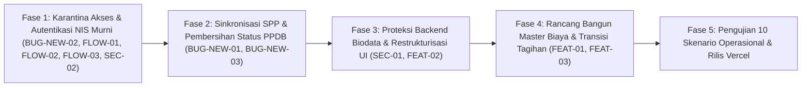

# PPDB, STUDENT PORTAL & SPP REMEDIATION ACTION PLAN
**Rencana Tindakan Komprehensif Perbaikan Alur Bisnis, Keamanan & Tata Kelola Keuangan**  
*Yayasan At Tarbiyyah Wijaya Kusuma Samarinda*

---

## 1. Taksonomi Temuan Berdasarkan Kategori & Prioritas

### A. Kategori 1: Bug Aktual (Cacat Fungsional)
| ID | Prioritas | Temuan | Berkas Terdampak | Dampak Fungsional |
| :--- | :---: | :--- | :--- | :--- |
| **BUG-NEW-01** | **Critical (P0)** | Keterangan "Besaran SPP" di Portal Siswa statik hardcoded `Rp 150.000` meskipun admin mengatur Rp50.000 | `frontend/portal/siswa/dashboard.html` (L221) | Informasi biaya bulanan tidak sinkron antara invoice dan profil murid |
| **BUG-NEW-02** | **Critical (P0)** | Calon siswa baru langsung dibuatkan akun di tabel `users` dan bisa login ke Portal Siswa | `frontend/shared/js/api.js` (L2624) & `frontend/shared/js/auth.js` (L40) | Pendaftar yang belum diverifikasi atau ditolak bisa mengakses portal siswa |
| **BUG-NEW-03** | **Medium (P2)** | Teks kata sandi di halaman cek status PPDB menampilkan string `[TERENKRIPSI]` | `frontend/public/ppdb/status.html` (L240) | Membingungkan pendaftar karena menyajikan placeholder teknis |

### B. Kategori 2: Ketidaksesuaian Alur Bisnis
| ID | Prioritas | Temuan | Berkas Terdampak | Alur yang Seharusnya |
| :--- | :---: | :--- | :--- | :--- |
| **FLOW-01** | **High (P1)** | Nomor Registrasi (`REG-xxxx`) digunakan sebagai alternatif login Portal Siswa | `frontend/shared/js/api.js` (L357) & `frontend/public/login.html` | Nomor registrasi HANYA untuk cek status PPDB; login siswa HANYA menggunakan NIS |
| **FLOW-02** | **High (P1)** | Penggunaan tanggal lahir sebagai jalan pintas password siswa | `frontend/shared/js/api.js` (L395-432) | Tanggal lahir tidak boleh menjadi password login portal; gunakan sandi awal dari admin yang wajib diubah saat login pertama |
| **FLOW-03** | **High (P1)** | Status `Approved` belum memisahkan hak akses dengan status `Converted` | `frontend/shared/js/api.js` & `auth.js` | Siswa `Approved` baru sebatas diterima; akses login BARU dibuka setelah admin mengeksekusi `Converted` |

### C. Kategori 3: Masalah Keamanan Data Siswa
| ID | Prioritas | Temuan | Berkas Terdampak | Resiko Keamanan |
| :--- | :---: | :--- | :--- | :--- |
| **SEC-01** | **Critical (P0)** | Endpoint `update_biodata` di backend tidak memfilter kolom akademik (`nis`, `class_id`, `level`, `status`) | `frontend/shared/js/api.js` (L1116-1199) | Siswa atau pihak luar dapat memanipulasi kelas, status keaktifan, dan jenjang via API |
| **SEC-02** | **Medium (P2)** | Generator email fiktif (`nis@siswa.yayasan.sch.id`) dipaksakan sebagai pengenal akun | `frontend/shared/js/api.js` (L3054) | Akun siswa terbebani alamat email yang tidak nyata; username login seharusnya murni NIS |

### D. Kategori 4: Usulan Pengembangan Fitur Baru
| ID | Prioritas | Usulan Peningkatan | Modul Terdampak | Tujuan Strategis |
| :--- | :---: | :--- | :--- | :--- |
| **FEAT-01** | **High (P1)** | Penghapusan form tagihan massal & individu manual, digantikan Master Biaya Jenjang/Kelas | `frontend/portal/admin/payments.html` & `api.js` | Mengeliminasi *human error* input tarif dan mencegah salah tagih pada santri |
| **FEAT-02** | **Medium (P2)** | Restrukturisasi tampilan biodata siswa: pemisahan mandiri Data Wali dan Keterangan Tambahan | `frontend/portal/siswa/biodata.html` | Struktur profil murid menjadi rapi, profesional, dan mudah dipahami wali murid |
| **FEAT-03** | **Medium (P2)** | Mekanisme penyesuaian biaya otomatis saat kenaikan kelas tanpa mengubah tagihan historis | `frontend/portal/admin/students.html` & `classes.html` | Tarif SPP menyesuaikan rombel baru secara akurat, histori pembayaran lama tetap aman |

---

## 2. Urutan Pelaksanaan Perbaikan (Phased Implementation Roadmap)

### Rincian Rencana per Fase:

#### Fase 1: Karantina Akses & Standarisasi Login NIS Murni (Prioritas P0 & P1)
1. **`frontend/shared/js/api.js` (`ppdb.submit`)**: Hapus penyisipan entri ke tabel `users`. Formulir pendaftaran hanya membuat record pendaftar baru berstatus `pending`.
2. **`frontend/shared/js/api.js` (`auth.login`)**:
   - Tolak tegas login menggunakan Nomor Registrasi (`REG-xxxx`).
   - Jadikan NIS sebagai *username* login tunggal untuk siswa aktif.
   - Hapus mekanisme bypass login menggunakan tanggal lahir.
3. **`frontend/shared/js/auth.js` (`requireAuth` & `getPortalRedirect`)**:
   - Hapus role `calon_siswa` dan `pendaftar` dari daftar `siswaRoles`.
   - Hanya izinkan pengguna dengan role `siswa_aktif` atau `siswa` yang berstatus `converted` untuk mengakses folder `/siswa/`.
4. **`frontend/shared/js/api.js` (`ppdb.convert`)**:
   - Pembuatan akun di tabel `users` **HANYA dilakukan di sini** saat admin mengeksekusi konversi siswa.
   - Akun dibuat dengan `username = NIS`, `role = 'siswa_aktif'`, dan `is_password_changed = false`.

#### Fase 2: Sinkronisasi SPP & Penyempurnaan Tampilan Status (Prioritas P0 & P2)
1. **`frontend/portal/siswa/dashboard.html`**:
   - Ganti elemen statik `Rp 150.000` dengan elemen dinamis ber-ID `...`.
   - Perbarui JavaScript `loadSPPData()` agar membaca langsung besaran SPP dari profil siswa (`student.monthly_spp_amount`) atau dari invoice aktif siswa.
   - Hilangkan seluruh fallback nominal angka mati di seluruh Portal Siswa.
2. **`frontend/public/ppdb/status.html`**:
   - Hilangkan tulisan `[TERENKRIPSI]`.
   - Jika status `Converted`, tampilkan NIS resmi dan panduan penggunaan password awal yang diberikan Tata Usaha.
   - Jika status `Approved`, tampilkan ucapan selamat diterima, tetapi informasikan bahwa penerbitan NIS dan kelas sedang diproses oleh admin.
   - Jika status `Pending`, tampilkan status berkas dalam proses verifikasi.
   - Jika status `Rejected`, tampilkan catatan resmi keputusan yayasan tanpa opsi login.

#### Fase 3: Proteksi Kolom Akademik Backend & UI Biodata (Prioritas P0 & P2)
1. **`frontend/shared/js/api.js` (`siswa.update_biodata`)**:
   - Tambahkan *blacklist / exclusion guard* terhadap kolom: `nis`, `nisn`, `class_id`, `class_name`, `kelas_sekarang`, `level`, `program`, `status`, `is_active`, `status_kelulusan`, `status_kenaikan`, `monthly_spp_amount`.
   - Kolom-kolom tersebut mutlak *read-only* bagi sesi siswa.
2. **`frontend/portal/siswa/biodata.html`**:
   - Pecah Section 3 menjadi dua bagian terpisah:
     * **Bagian 3: Data Wali Murid** (Nama, Hubungan, Pekerjaan, No. Telepon, Alamat).
     * **Bagian 4: Keterangan Tambahan & Informasi Penunjang** (Jarak ke sekolah, Moda transportasi, Bahasa sehari-hari, Catatan khusus santri).

#### Fase 4: Desain Master Biaya & Transisi Tagihan SPP (Prioritas P1 & P2)
1. Buat master data tarif biaya SPP per Jenjang & Rombel Kelas pada konfigurasi sistem.
2. Hubungkan form konversi pendaftar di `ppdb.html` agar otomatis memuat tarif dari master biaya saat kelas dipilih oleh admin.
3. Nonaktifkan form tagihan massal & tagihan individual manual dari antarmuka `payments.html` untuk memitigasi salah input nominal.
4. Pastikan mekanisme anti-retroaktif: pembaruan kelas baru tidak akan pernah mengubah nominal pada invoice bulan-bulan yang sudah lewat.

---

## 3. Matriks Simulasi 10 Skenario Pengujian Operasional

| No | Skenario Pengujian | Aksi Uji | Kriteria Keberhasilan (PASS) |
| :-: | :--- | :--- | :--- |
| **1** | **Pendaftar Baru** | Isi form PPDB publik, submit, catat No. Registrasi, coba login ke Portal Siswa | Login DITOLAK keras. Status di halaman cek status: `Pending`. Tidak ada akun aktif di portal. |
| **2** | **Status Pending** | Login admin TU, buka modul PPDB, periksa data pendaftar | Pendaftar berstatus Pending, dokumen dapat ditinjau, akses portal siswa tetap terkunci. |
| **3** | **Status Approved** | Admin klik "Setujui Pendaftaran", buka cek status pendaftar, coba login siswa | Halaman status menyatakan Diterima. Coba login siswa tetap DITOLAK karena belum dikonversi. |
| **4** | **Status Converted** | Admin klik "Konversi", tentukan NIS `2026xxxx`, kelas, password awal, nominal SPP Rp50.000 | Record masuk ke `students`, akun dibuat di `users` dengan username NIS, invoice Rp50.000 terbit. |
| **5** | **Login Perdana Siswa** | Login menggunakan NIS dan password awal dari admin | Muncul modal wajib ubah password awal. Setelah diubah, login kembali dengan sandi baru sukses. |
| **6** | **Konsistensi SPP** | Buka Portal Siswa (Dashboard & Halaman SPP) untuk santri bertarif Rp50.000 | Teks "Besaran SPP" menampilkan Rp50.000, invoice menampilkan Rp50.000 (tidak ada angka 150rb). |
| **7** | **Kenaikan / Pindah Kelas** | Pindahkan siswa dari Kelas A ke Kelas B (misal tarif baru Rp60.000) | Profil murid memuat tarif Rp60.000 untuk bulan berikutnya. Invoice bulan lalu tetap Rp50.000. |
| **8** | **Proteksi Biodata** | Siswa mencoba kirim request edit NIS atau kelas via form maupun script console | Server menolak perubahan kolom akademik; hanya biodata pribadi (alamat, telp) yang tersimpan. |
| **9** | **Validasi Status Ditolak** | Admin menolak pendaftar (Rejected) dengan alasan administrasi | Status di halaman pendaftar: Ditolak. Akses portal siswa tertutup permanen. |
| **10** | **Audit Kelola Pengguna** | Buka modul Pengguna di Admin, periksa daftar user santri | Username murni berupa nomor NIS. Tidak ada email buatan `@siswa.yayasan.sch.id`. |

---

## 4. Analisis Risiko Regresi & Prinsip Perlindungan Sistem

1. **Kompatibilitas Akun Siswa Aktif yang Sudah Ada**:
   Perubahan autentikasi tidak boleh memutus akun santri yang sudah aktif berjalan. Akun yang sudah memiliki NIS tetap dapat login menggunakan NIS mereka.
2. **Histori Keuangan & Invoice Tidak Boleh Terhapus**:
   Seluruh tabel `invoices` dan `payments` tetap dipertahankan 100%. Tidak ada invoice lama yang dihapus atau diubah angkanya.
3. **Penyimpanan Kode Asli (Backup Pre-Remediasi)**:
   Sebelum implementasi dieksekusi setelah persetujuan Anda, salinan cadangan snapshot kode akan disimpan di `backups/remediation-lifecycle/`.
