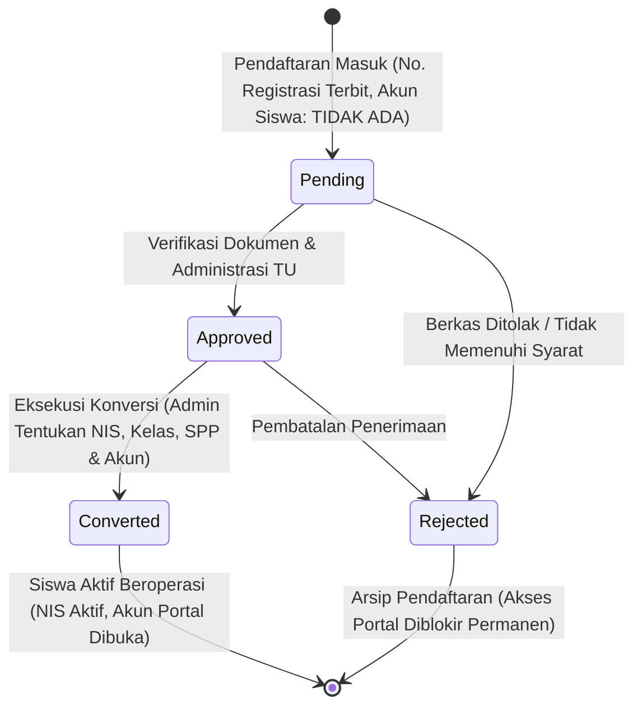

# PPDB & STUDENT LIFECYCLE AUDIT REPORT
**Siklus Hidup Siswa, Mekanisme Akun, Penerbitan NIS & Kontrol Akses Portal Siswa**  
*Yayasan At Tarbiyyah Wijaya Kusuma Samarinda*

---

## 1. Eksekutif Ringkasan Audit

Berdasarkan audit teknis mendalam terhadap kode sumber dan basis data operasional SIYAYASAN, **temuan manual yang Anda laporkan terbukti 100% benar secara faktual dan teknis**:

1. **Akses Prematur Portal Siswa**: Calon siswa baru yang berstatus `pending` (baru mendaftar) atau `approved` (diterima tapi belum diaktivasi) saat ini **secara otomatis dibuatkan akun login** dan **diberikan akses penuh ke Portal Siswa** (`/siswa/dashboard.html`).
2. **Penyebab Utama**: 
   - Pada `frontend/shared/js/api.js` baris 2624–2645, proses pendaftaran publik (`ppdb.submit`) langsung menyisipkan entri ke tabel `users` dengan `role: 'calon_siswa'`.
   - Pada `frontend/shared/js/auth.js` baris 40 & 66, role `'calon_siswa'` dimasukkan ke dalam daftar role yang sah untuk mengakses Portal Siswa (`siswaRoles = ['siswa', 'siswa_aktif', 'calon_siswa', 'pendaftar']`).
   - Pada `frontend/portal/siswa/dashboard.html` baris 328, pengecekan hak akses memvalidasi: `requireAuth('siswa,siswa_aktif,calon_siswa')`.
3. **Status Pendaftaran Belum Menjadi Sakelar Akses**: Pengecekan status pendaftaran saat ini hanya bersifat kosmetik di frontend, belum diterapkan sebagai filter otorisasi gerbang (*gatekeeper*) di backend autentikasi.

---

## 2. Pemetaan Alur: Kondisi Aktual vs Alur Ideal

```mermaid
flowchart TD
    subgraph AKTUAL["Alur Aktual Saat Ini (Mengandung Kelemahan Akses)"]
        A1["1. Calon Siswa Isi Form PPDB"] --> A2["2. Simpan ke ppdb_registrations"]
        A2 --> A3["3. Seketika Buat User di tabel users (role: calon_siswa) ⚠️"]
        A3 --> A4["4. Calon Siswa Login pakai No. Reg + Tgl Lahir ⚠️"]
        A4 --> A5["5. Masuk ke Portal Siswa (Sebelum Diterima/Dikonversi) ❌"]
    end

    subgraph SEHARUSNYA["Alur Operasional Baku yang Diharapkan"]
        B1["1. Calon Siswa Isi Form PPDB"] --> B2["2. Simpan Pendaftaran (Status: Pending)"]
        B2 --> B3["3. Terbitkan No. Registrasi (REG-2026-xxxx)"]
        B3 --> B4["4. HANYA Bisa Cek Status di Halaman Publik"]
        B4 --> B5["5. Login Portal Siswa DITOLAK KERAS (403 Forbidden)"]
        B5 --> B6["6. Admin TU Verifikasi Berkas (Approved)"]
        B6 --> B7["7. Admin Konversi Siswa (Converted)"]
        B7 --> B8["8. Terbitkan NIS, Kelas, SPP & Akun Siswa Aktif"]
        B8 --> B9["9. Siswa Login Perdana dengan NIS & Ubah Password"]
        B9 --> B10["10. Akses Portal Siswa Terbuka Penuh"]
    end
```



---

## 3. Investigasi Teknis Baris Kode (Root Cause Analysis)

### A. Titik Pembuatan Akun Prematur
Pada `frontend/shared/js/api.js` fungsi `action === 'submitPublic' || action === 'submit'`:
```javascript
// Baris 2624 - 2645
// MASALAH: Akun dibuat seketika saat orang tua/calon siswa baru menekan tombol daftar!
const newUser = {
  id: userId,
  email: emailForLogin,
  username: regNum, // Nomor registrasi dijadikan username login
  password_hash: userHashedPassword,
  password_salt: userSalt,
  full_name: studentName,
  role: 'calon_siswa', // Role calon_siswa diizinkan masuk portal
  role_label: 'Calon Siswa / Pendaftar',
  status: 'active', // Status akun langsung aktif!
  student_id: studentId,
  is_password_changed: true,
  created_at: new Date().toISOString()
};
await supabaseRest('users', 'POST', newUser);
```

### B. Titik Kebocoran Redirection & Middleware
Pada `frontend/shared/js/auth.js`:
```javascript
// Baris 35 - 44
function getPortalRedirect(roleCode) {
  const role = (roleCode || '').toLowerCase();
  ...
  // MASALAH: role 'calon_siswa' dan 'pendaftar' diarahkan ke dashboard siswa!
  if (role === 'siswa_aktif' || role === 'siswa' || role === 'calon_siswa' || role === 'pendaftar') {
    return '/siswa/dashboard.html';
  }
}

// Baris 66
const siswaRoles = ['siswa', 'siswa_aktif', 'calon_siswa', 'pendaftar'];
```

Pada seluruh halaman Portal Siswa (`frontend/portal/siswa/`):
- `dashboard.html` baris 328: `requireAuth('siswa,siswa_aktif,calon_siswa')`
- `biodata.html` baris 376: `requireAuth('siswa,siswa_aktif,calon_siswa')`
- `dokumen.html` baris 191: `requireAuth('siswa,siswa_aktif,calon_siswa')`

### C. Titik Bypass Autentikasi dengan Tanggal Lahir
Pada `frontend/shared/js/api.js` baris 395–432:
Jika akun belum terhubung di tabel `users`, sistem melakukan pencarian ke tabel `students` atau `ppdb_registrations`, kemudian mencocokkan password dengan tanggal lahir (`DDMMYYYY` atau `YYYY-MM-DD`). Jika cocok, sistem **secara otomatis membuatkan akun instan di tabel `users`** dan meloloskan login.

---

## 4. Audit Matriks 4 Status PPDB Utama

| Status PPDB | Hak Akses Portal Siswa Saat Ini | Hak Akses yang Seharusnya | Kondisi Data Database | Kerentanan / Masalah |
| :--- | :---: | :---: | :--- | :--- |
| **Pending** | **BISA LOGIN** ❌ | **DITOLAK TOTAL** (403) | `ppdb_registrations.status = 'pending'`, akun ada di `users` | Calon siswa bisa melihat dashboard, biodata, dan menu siswa padahal belum diverifikasi yayasan. |
| **Approved** | **BISA LOGIN** ❌ | **DITOLAK TOTAL** (403) | `ppdb_registrations.status = 'approved'`, belum ada NIS resmi | Status Approved hanya penanda kelulusan seleksi/berkas; belum memiliki NIS, rombel kelas, atau tagihan resmi. |
| **Converted** | BISA LOGIN ✅ | **BISA LOGIN** (Sah) | `ppdb_registrations.status = 'converted'`, record ada di `students`, NIS terbit | Status ini adalah **satu-satunya gerbang sah** penerbitan akun dan pembukaan akses portal. |
| **Rejected** | Tergantung password ⚠️ | **DITOLAK TOTAL** (403) | `ppdb_registrations.status = 'rejected'` | Jika akun di tabel `users` tidak dihapus/dinonaktifkan saat penolakan, calon siswa yang ditolak masih bisa login. |

---

## 5. Pemetaan Transisi Status (State Transition Machine)



### Aturan Transisi Baku:
1. **Dilarang Keras**: `Pending` langsung melompat ke `Converted` tanpa melalui keputusan `Approved`.
2. **Dilarang Keras**: `Rejected` berpindah ke `Converted`.
3. **Dilarang Keras**: `Converted` berpindah kembali ke `Pending` secara otomatis (hanya boleh melalui prosedur *revert/rollback* admin dengan pencatatan audit log).
4. **Idempotensi Konversi**: Pendaftar yang telah berstatus `converted` dilarang dikonversi ulang untuk mencegah duplikasi NIS atau duplikasi akun siswa aktif.

---

## 6. Rekomendasi Solusi Arsitektural

1. **Hapus Pembuatan Akun di Form PPDB**:
   Pendaftaran formulir publik (`ppdb.submit`) hanya menyisipkan satu baris ke tabel `ppdb_registrations`. Tidak boleh lagi menyisipkan data apapun ke tabel `users`.
2. **Pindahkan Pembuatan Akun Hanya pada Eksekusi Konversi (`ppdb.convert`)**:
   Akun login portal siswa hanya dibuat saat tombol "Terbitkan NIS & Konversi" ditekan oleh Admin TU, dengan username = NIS dan role = `siswa_aktif`.
3. **Karantina Role di Gerbang Login (`api.js` & `login.html`)**:
   - Hapus role `calon_siswa` dan `pendaftar` dari `siswaRoles`.
   - Tolak setiap upaya login yang menggunakan Nomor Registrasi dengan pesan edukatif:  
     *"Nomor registrasi hanya digunakan untuk memantau status seleksi PPDB. Akun Portal Siswa hanya dapat diakses setelah calon santri dinyatakan Diterima dan Dikonversi menjadi Santri Aktif oleh Yayasan."*
4. **Bersihkan Akun Calon Siswa Non-Aktif**:
   Jalankan query sanitasi untuk menonaktifkan atau membersihkan entri akun ber-role `calon_siswa` di tabel `users` yang belum pernah dikonversi menjadi siswa aktif.
