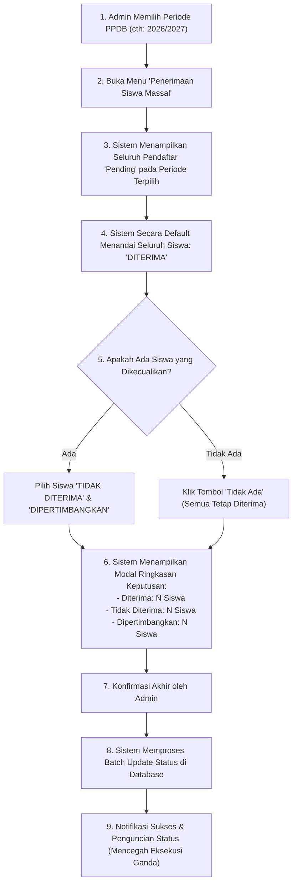
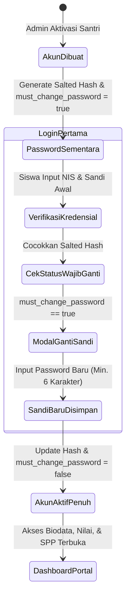

# REDESAIN ALUR OPERASIONAL & ARSITEKTUR PPDB
## Yayasan At Tarbiyyah Wijaya Kusuma Samarinda
**Dokumen Perancangan Periode PPDB, Penerimaan Massal, Aktivasi Siswa, NIS & Keamanan Akun (Read-Only Planning Phase)**  
**Tanggal:** 2 November 2026 | **Status:** Usulan Desain Operasional

---

## 1. PENDAHULUAN & RUANG LINGKUP

Penerimaan Peserta Didik Baru (PPDB) di Yayasan At Tarbiyyah Wijaya Kusuma Samarinda melayani 3 program utama:
1. **KB Ulinnuha (PAUD / Kelompok Bermain)**
2. **TPQ Ulinnuha Pagi**
3. **TPQ Ulinnuha Jenjang Tahfidz Al-Qur'an (Pra PTPT & PTPT)**

Proses PPDB merupakan pintu gerbang seluruh data institusi: dari biodata anak, profil orang tua, berkas akta/KK, hingga menjadi data induk siswa aktif dan akun akses Portal Siswa.
Dokumen ini merancang ulang alur kerja PPDB pada 4 aspek kunci:
- **Pemisahan dan Isolasi Periode / Tahun Ajaran**
- **Penerimaan Massal dengan Matriks Pengecualian (*Bulk Acceptance*)**
- **Aktivasi Santri Aktif Massal (*Bulk Student Activation*)**
- **Arsitektur Penomoran NIS dan Keamanan Kredensial Portal Siswa**

---

## 2. PENGELOLAAN PERIODE PPDB & ISOLASI DATA TAHUN AJARAN

### 2.1. Permasalahan Sistem Saat Ini
Saat ini, tabel `ppdb_registrations` menyimpan seluruh data calon santri tanpa pemfilteran periode yang ketat di antarmuka portal admin. Jika yayasan membuka periode pendaftaran tahun ajaran baru (misal `2027/2028`), pendaftar lama dari tahun `2025/2026` dan `2026/2027` tetap tercampur di tabel admin, memicu kerancuan dan risiko salah proses berkas.

### 2.2. Rancangan Filter Periode Terintegrasi
1. **Dropdown Periode Global di Header PPDB:**
   Pada halaman `admin/ppdb.html`, di samping tab status, ditambahkan pemilih periode utama:
   `[ Tahun Ajaran: 2026/2027 (Aktif) ▼ ]`
   Pilihan mencakup:
   - Periode Aktif: `2026/2027`
   - Arsip Riwayat: `2025/2026`, `2024/2025`
   - Opsi: `Semua Periode (Arsip Lengkap)`
2. **Isolasi Query di API:**
   Fungsi `apiCall('ppdb', 'list', params)` menerima parameter `academic_year`:
   - Jika admin memilih periode tertentu, PostgREST mengeksekusi:  
     `ppdb_registrations?academic_year=eq.2026/2027&...`
   - Data tahun-tahun sebelumnya tersimpan aman sebagai arsip historis dan tidak mengotori tabel operasional tahun berjalan.
3. **Penyelarasan dengan Status Publik:**
   Halaman formulir publik (`public/ppdb.html`) dan cek status (`public/ppdb/status.html`) otomatis membaca periode aktif dari tabel `ppdb_periods` (`status = 'open'`). Nomor registrasi yang di-generate pada tahun tersebut otomatis menyematkan kode tahun (contoh `REG-2026-xxxxx`).

---

## 3. FITUR PENERIMAAN SISWA SECARA MASSAL (BULK ACCEPTANCE)

Dalam tradisi seleksi PPDB yayasan, mayoritas calon santri yang berkasnya lengkap akan dinyatakan **Diterima**, sedangkan sebagian kecil mungkin berkasnya belum lengkap (**Dipertimbangkan**) atau tidak memenuhi kriteria usia (**Tidak Diterima**).

### 3.1. Rancangan Alur Kerja Seleksi Massal (9 Langkah)



### 3.2. Detail Spesifikasi Antarmuka & UX:
1. **Modal Penerimaan Massal:**
   - Menampilkan total pendaftar yang belum diputuskan (misal: 45 calon santri).
   - Di sisi kiri: Daftar seluruh pendaftar (tercentang hijau: "Diterima").
   - Di sisi kanan: Dua zona pengecualian:
     - **Zona 1: Siswa Tidak Diterima:**
       - Terdapat tombol toggle khusus: **`[x] Tidak Ada`**.
       - Jika uncheck, admin dapat memilih 1 atau beberapa nama siswa dan mengisi alasan penolakan.
     - **Zona 2: Siswa Masih Dipertimbangkan:**
       - Terdapat tombol toggle khusus: **`[x] Tidak Ada`**.
       - Jika uncheck, admin memilih siswa yang memerlukan verifikasi berkas susulan.
2. **Pencegahan Pemrosesan Ganda:**
   Query pembaruan hanya memfilter pendaftar dengan `status = 'pending'`. Siswa yang sudah berstatus `accepted`, `approved`, atau `converted` **tidak akan tersentuh** oleh operasi ini.

---

## 4. FITUR KONVERSI SISWA AKTIF SECARA MASSAL (BULK STUDENT ACTIVATION)

Setelah calon siswa dinyatakan diterima, panitia perlu mengaktifkan mereka menjadi santri resmi yang tercatat di Buku Induk (`students`), membuat akun login Portal Siswa (`users`), dan menerbitkan tagihan SPP bulan pertama (`invoices`).

### 4.1. Rancangan Alur Aktivasi Massal:
1. **Pemilihan Kandidat Aktivasi:**
   Admin memilih periode, lalu sistem menampilkan seluruh pendaftar yang berstatus `accepted` / `approved` namun kolom `is_converted` masih `false`.
2. **Pemeriksaan Kelengkapan Data Otomatis (Pre-Flight Check):**
   Sistem memvalidasi kelayakan setiap pendaftar:
   - Nama lengkap terisi? ✓
   - Tanggal lahir valid? ✓
   - Program studi jelas (PAUD / TPQ Pagi / Tahfidz)? ✓
   - Status berkas akta/KK terlampir? ✓
   Jika ada siswa yang datanya kurang, baris siswa diberi tanda kuning (*warning*) dan tidak dapat dicentang sebelum data dilengkapi.
3. **Formulir Konfigurasi Kolektif:**
   Sebelum memproses, admin menentukan:
   - **Penempatan Kelas / Kelompok Awal:**
     - Opsi A: Tetapkan kelas otomatis berdasarkan usia/program.
     - Opsi B: Pilih kelas seragam (misal: "Kelompok Bermain A").
   - **Tanggal Resmi Masuk (Entry Date):** Default tanggal pertama tahun ajaran baru (misal `2026-07-15`).
   - **Pengaturan Tagihan SPP Awal:**
     - Centang `[x] Terbitkan Tagihan SPP Bulan Pertama`.
     - Nominal SPP default: Mengikuti tarif program masing-masing santri.
   - **Kredensial Portal Siswa:**
     - Admin memilih skema password awal (lihat Bagian 5).
4. **Eksekusi Batch Transaction:**
   Sistem menjalankan proses konversi di backend dengan jaminan atomisitas:
   - Insert ke tabel `students` dengan biodata lengkap 36 field dari `form_metadata`.
   - Insert ke tabel `users` untuk akun login portal.
   - Insert ke tabel `invoices` untuk SPP perdana.
   - Update tabel `ppdb_registrations` menjadi `status = 'converted'`, `converted_at = NOW()`.
5. **Laporan Hasil Aktivasi:**
   Sistem menampilkan dialog hasil:
   `"40 santri berhasil diaktifkan menjadi siswa resmi. NIS dan sandi awal telah diterbitkan."`
   Tersedia tombol: **"Unduh Slip Kredensial Seluruh Siswa (PDF / Excel)"** untuk dibagikan saat orientasi santri baru.

---

## 5. EVALUASI WAKTU PENOMORAN NIS & KEAMANAN AKUN PORTAL SISWA

### 5.1. Evaluasi Waktu Pembuatan NIS (NIS Timing Evaluation)

Kami menganalisis 4 alternatif waktu penetapan NIS:

| Alternatif | Deskripsi Alur | Kelebihan | Risiko / Kelemahan | Kesimpulan |
|---|---|---|---|---|
| **Alternatif 1: Saat Calon Siswa Mendaftar** | NIS langsung dibuat begitu formulir web disubmit | Langsung punya nomor identitas | **Tinggi:** Merusak urutan nomor induk jika pendaftar membatalkan atau tidak lolos seleksi; terjadi *nomor bolong* (gaps) di buku induk resmi | **Ditolak** |
| **Alternatif 2: Saat Calon Siswa Diterima (Accepted)** | NIS diterbitkan begitu panitia mengklik "Diterima" | Calon siswa langsung tahu NIS saat cek kelulusan | **Sedang:** Banyak calon siswa diterima tetapi tidak melakukan daftar ulang / batal masuk sekolah. Nomor induk buku induk menjadi mubazir | **Kurang Tepat** |
| **Alternatif 3: Saat Konversi Menjadi Siswa Aktif (Direkomendasikan)** | NIS resmi diterbitkan **hanya ketika siswa resmi diaktivasi** (telah daftar ulang / membayar biaya masuk) | **Sangat Baik:** Menjamin buku induk 100% bersih, berurutan tanpa celah, dan hanya berisi santri yang benar-benar belajar di yayasan | Memerlukan nomor registrasi sementara (`REG-xxxx`) saat masih seleksi | **DIREKOMENDASIKAN** |
| **Alternatif 4: Penomoran Eksternal Manual** | Staf TU mengetik manual buku fisik baru ke web | Fleksibel untuk aturan manual lama | Lambat, rawan ketik ganda | Sebagai opsi edit saja |

#### Pola Penomoran Otomatis Yayasan (Format Baku):
Pola NIS yang direkomendasikan untuk Yayasan At Tarbiyyah Wijaya Kusuma Samarinda:
`[2 Digit Tahun Masuk][1 Digit Kode Program][3 Digit Nomor Urut]`
- Contoh PAUD (Kode 1): Angkatan 2026 -> `261001`, `261002`, ...
- Contoh TPQ Pagi (Kode 2): Angkatan 2026 -> `262001`, `262002`, ...
- Contoh Tahfidz (Kode 3): Angkatan 2026 -> `263001`, `263002`, ...

---

### 5.2. Evaluasi Keamanan Akun Portal Siswa & Kredensial Awal

Pengguna mengajukan skenario operasional berikut untuk dievaluasi:
- Admin menentukan satu password awal untuk seluruh siswa yang diaktivasi dalam satu proses.
- Password awal tersebut digunakan sebagai kredensial sementara.
- Setiap siswa diarahkan/diwajibkan mengganti password setelah login pertama.
- Password disimpan menggunakan mekanisme hashing yang aman.
- Admin tidak dapat melihat password asli siswa setelah akun dibuat.

#### Analisis Risiko Skenario Password Seragam (Shared Default Password):
> [!WARNING]
> Jika 50 siswa satu angkatan diberikan password awal yang sama (contoh `Santri2026!`), dan seluruh NIS berurutan (`261001`, `261002`, dll.), maka **siapapun siswa yang mengetahui NIS temannya dapat login ke akun temannya sebelum temannya tersebut login untuk pertama kali**. Siswa iseng dapat mengubah kata sandi temannya atau mengakses biodata dan dokumen KK/akta milik keluarga lain.

#### Solusi Arsitektur Kredensial yang Direkomendasikan: "Secured Forced-Reset Architecture"
Untuk memenuhi kemudahan operasional admin sekaligus menjamin keamanan tingkat tinggi, kami merancang mekanisme hibrida sebagai berikut:



#### Komponen Pengamanan Kredensial:
1. **Pilihan Kredensial Awal yang Fleksibel bagi Admin:**
   Admin pada modal aktivasi massal dapat memilih salah satu dari 2 opsi sandi awal:
   - **Opsi A (Paling Aman): Tanggal Lahir Santri (DDMMYYYY).**  
     Setiap santri memiliki sandi awal unik sesuai tanggal lahirnya (contoh: lahir 15 Mei 2020 -> `15052020`). Teman sekelas tidak mudah menebak.
   - **Opsi B (Praktis): Sandi Sementara Pilihan Admin (Custom Temp Password).**  
     Admin mengetik satu kata sandi sementara (contoh `Bismillah2026`).
2. **Kewajiban Mutlak Ganti Sandi di Login Pertama (*Mandatory Force-Change*):**
   - Kolom database `users.must_change_password` diset ke `true`.
   - Begitu santri/wali berhasil login pertama kali menggunakan sandi awal, sistem Portal Siswa **mengunci seluruh navigasi**.
   - Modal popup "Wajib Perbarui Kata Sandi Anda" muncul di layar dan tidak dapat ditutup sebelum pengguna memasukkan kata sandi pribadi yang baru.
   - Setelah sandi baru tersimpan, `must_change_password` diubah menjadi `false`.
3. **Mekanisme Hashing Satu Arah (One-Way Cryptographic Hashing):**
   - Menggunakan algoritma standar industri **Web Crypto API (SHA-256 dengan Salt Dinamis)** yang berjalan langsung di browser tanpa ketergantungan library luar:
     `hash = SHA256(password + user_id + salt)`
   - Password asli dalam bentuk teks polos **dihapus dari memori dan database**. Kolom `ppdb_registrations.portal_password` dikosongkan setelah konversi selesai.
   - Admin maupun developer **tidak dapat melihat password santri** di database, menjaga privasi santri 100%.
4. **Fitur Reset Password oleh Admin (Self-Service Recovery):**
   Jika santri lupa password yang telah diubahnya, admin TU memiliki tombol **"Reset Password ke Default (Tanggal Lahir / Sandi Sementara)"** pada halaman Data Siswa. Aksi ini mereset hash dan mengaktifkan kembali status `must_change_password = true`.

---

## 6. RANCANGAN STRUKTUR DATA (DATABASE SCHEMA ENHANCEMENT)

Skema database untuk mendukung alur PPDB baru:

```sql
-- 1. Dukungan Filter Periode pada Pendaftaran PPDB
ALTER TABLE ppdb_registrations 
ADD COLUMN IF NOT EXISTS academic_year VARCHAR(20) DEFAULT '2026/2027',
ADD COLUMN IF NOT EXISTS period_id VARCHAR(50);

CREATE INDEX IF NOT EXISTS idx_ppdb_academic_year 
ON ppdb_registrations (academic_year, status);

-- 2. Dukungan Seleksi Massal & Status Dipertimbangkan
-- Status valid: 'pending', 'considered', 'accepted', 'approved', 'rejected', 'converted'
ALTER TABLE ppdb_registrations 
ADD COLUMN IF NOT EXISTS decision_notes TEXT,
ADD COLUMN IF NOT EXISTS decided_at TIMESTAMP WITH TIME ZONE,
ADD COLUMN IF NOT EXISTS decided_by VARCHAR(100);

-- 3. Dukungan Keamanan Kredensial Portal Siswa
ALTER TABLE users 
ADD COLUMN IF NOT EXISTS must_change_password BOOLEAN DEFAULT FALSE,
ADD COLUMN IF NOT EXISTS password_salt VARCHAR(64);
```

---

*Desain ini menyederhanakan tugas panitia penerimaan siswa baru, memastikan data tahun ajaran terisolasi rapi, dan meningkatkan keamanan kredensial santri ke standar institusi modern.*

