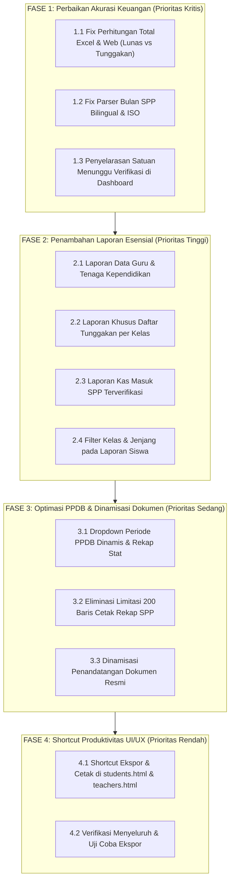

# MASTER IMPROVEMENT PLAN: SISTEM LAPORAN & REKAPITULASI
## Portal Admin SIYAYASAN — Yayasan At Tarbiyyah Wijaya Kusuma Samarinda

**Dokumen:** `REPORTING_IMPROVEMENT_PLAN.md`  
**Tanggal Penyusunan:** 2 November 2026  
**Status Dokumen:** USULAN RENCANA AKSI (Menunggu Persetujuan Pengguna Sebelum Eksekusi)  
**Kepatuhan:** Zero Modification Rule (Tidak ada kode atau database yang diubah pada fase perencanaan ini)

---

## 1. TUJUAN & PRINSIP PENGEMBANGAN

Berdasarkan temuan pada dokumen `REPORTING_AUDIT.md`, rencana pengembangan sistem pelaporan dan rekapitulasi Portal Admin dirancang untuk memenuhi 4 pilar utama:

1. **Integritas Akuntansi & Keuangan**: Pemisahan tegas dan absolut antara **Pendapatan Riil (Kas Masuk)**, **Target Tagihan (Piutang)**, dan **Tunggakan Siswa**. Penjumlahan total pada Excel dan cetak tidak boleh mencampuradukkan tagihan belum lunas sebagai kas masuk.
2. **Kelengkapan Ruang Lingkup Operasional**: Penambahan laporan data guru, laporan daftar tunggakan per kelas, dan rekapitulasi pendaftaran PPDB berbasis jenjang.
3. **Fleksibilitas Filter**: Memberikan filter kelas (rombel), jenjang (TPQ/KB), dan rentang waktu yang relevan pada setiap laporan tanpa mengharuskan admin memilah data secara manual.
4. **Produktivitas & Akses Cepat**: Memungkinkan ekspor dan cetak langsung dari halaman modul masing-masing (`students.html`, `teachers.html`, `ppdb.html`, `payments.html`) selain dari pusat laporan `reports.html`.

---

## 2. DAFTAR PEKERJAAN & STRUKTUR PENGEMBANGAN

```
RENCANA PENYEMPURNAAN SISTEM LAPORAN
 ├── FASE 1: PERBAIKAN AKURASI KEUANGAN & KALKULASI ESENSIAL (CRITICAL)
 │    ├── Fix-01: Pemisahan 3 Total pada Ekspor Excel & Ringkasan Laporan SPP
 │    ├── Fix-02: Normalisasi Parser Filter Bulan (Bilingual / ISO to Month Name)
 │    └── Fix-03: Penyelarasan Definisi Menunggu Verifikasi di Dashboard & Payments
 │
 ├── FASE 2: PENAMBAHAN LAPORAN YANG HILANG (HIGH PRIORITY)
 │    ├── Report-01: Laporan Data Guru & Tenaga Kependidikan (Excel, CSV, Cetak)
 │    ├── Report-02: Laporan Rekapitulasi Tunggakan Siswa per Kelas (Arrears Report)
 │    ├── Report-03: Laporan Kas Masuk SPP Terverifikasi (Cash-In Ledger)
 │    └── Report-04: Filter Kelas & Jenjang pada Laporan Data Siswa Aktif
 │
 ├── FASE 3: OPTIMASI PPDB, DINAMISASI DOKUMEN & INTEGRASI DATA (MEDIUM)
 │    ├── Opt-01: Penggantian Input Tahun PPDB Teks Menjadi Dropdown Periode Dinamis
 │    ├── Opt-02: Kartu Rekapitulasi Keputusan PPDB (Pending, Approved, Converted, Rejected)
 │    ├── Opt-03: Penghapusan Limitasi 200 Baris pada Cetak Rekap SPP
 │    └── Opt-04: Penandatangan Lembar Pengesahan Dinamis dari Profil Sekolah
 │
 └── FASE 4: PENINGKATAN PRODUKTIVITAS UI/UX & SHORTCUT EKSPOR (LOW / POLISH)
      ├── UI-01: Penambahan Tombol "Ekspor & Cetak" Langsung di students.html & teachers.html
      └── UI-02: Pratinjau Cepat Ringkasan Total Sebelum Pengunduhan Dokumen
```

---

## 3. RINCIAN TEKNIS RENCANA IMPLEMENTASI

### FASE 1: Perbaikan Akurasi Keuangan & Kalkulasi Esensial

#### 1.1. Pemisahan Total Ekspor Excel SPP (Fix-01)
- **Komponen:** `frontend/portal/admin/reports.html` (`exportCurrentReportToExcel()`)
- **Pekerjaan Teknis:**
  - Mengubah logika perhitungan baris total bawah Excel (sebelumnya hanya 1 baris total tunggal yang menjumlahkan kolom `r[4]`).
  - Menghitung 3 agregasi terpisah:
    ```javascript
    const totalBills = rows.reduce((acc, r) => acc + (Number(String(r[4]).replace(/[^0-9]/g, '')) || 0), 0);
    const paidAmount = rows.filter(r => String(r[6]).includes('LUNAS') && !String(r[6]).includes('BELUM'))
                           .reduce((acc, r) => acc + (Number(String(r[4]).replace(/[^0-9]/g, '')) || 0), 0);
    const unpaidAmount = rows.filter(r => String(r[6]).includes('BELUM LUNAS'))
                             .reduce((acc, r) => acc + (Number(String(r[4]).replace(/[^0-9]/g, '')) || 0), 0);
    const pendingAmount = rows.filter(r => String(r[6]).includes('VERIFIKASI'))
                              .reduce((acc, r) => acc + (Number(String(r[4]).replace(/[^0-9]/g, '')) || 0), 0);
    ```
  - Menampilkan 3 baris ringkasan resmi di lembar Excel:
    - **Total Kas Masuk Diterima (Lunas):** `Rp [paidAmount]`
    - **Total Piutang / Tunggakan Siswa (Belum Lunas):** `Rp [unpaidAmount]`
    - **Total Tagihan Diterbitkan:** `Rp [totalBills]`
  - Menambahkan kolom persentase pelunasan (*Collection Rate %*).

#### 1.2. Normalisasi Filter Bulan SPP (Fix-02)
- **Komponen:** `frontend/shared/js/api.js` (`module === 'reports'`, `action === 'generate'`, `repType === 'payments'`)
- **Pekerjaan Teknis:**
  - Mengonversi parameter bulan dari format input HTML `<input type="month">` (`"YYYY-MM"`, misal `"2026-10"`) menjadi nama bulan bahasa Indonesia (`"Oktober 2026"`).
  - Melakukan pencarian ganda (*two-way matching*) ke kolom `month`, `period`, `due_date`, maupun `created_at`.

#### 1.3. Penyelarasan Satuan Menunggu Verifikasi di Dashboard (Fix-03)
- **Komponen:** `frontend/portal/admin/dashboard.html` baris 232
- **Pekerjaan Teknis:**
  - Menampilkan keterangan satuan yang jelas: `Shell.setText('fin-pending', pendingVerify + ' Transaksi');`
  - Memberikan indikator tooltip bahwa angka tersebut adalah antrean bukti transfer yang perlu diverifikasi bendahara.

---

### FASE 2: Penambahan Laporan yang Hilang

#### 2.1. Laporan Data Guru & Tenaga Kependidikan (Report-01)
- **Frontend:**
  - Menambahkan kartu laporan ke-5 pada `reports.html`: **"Data Guru & Tenaga Pendidik"**.
  - Menyediakan filter: *Semua Guru*, *Guru Aktif Saja*, *Berdasarkan Jenjang Mengajar*.
- **Backend:**
  - Menambahkan penanganan `repType === 'teachers'` pada `frontend/shared/js/api.js`.
  - Mengambil data dari tabel `teachers?order=full_name.asc`.
  - Format kolom laporan:
    `['No', 'NIP / ID', 'Nama Lengkap & Gelar', 'Jenis Kelamin', 'Pendidikan Terakhir', 'Jabatan / Tugas', 'No. HP / WA', 'Status']`.
  - Dilengkapi fitur ekspor Excel (.xls), CSV (.csv), dan Cetak Resmi dengan Kop Surat yayasan.

#### 2.2. Laporan Khusus Tunggakan Siswa per Kelas (Report-02)
- **Tujuan Operasional:** Membantu bagian keuangan dan tata usaha mencetak daftar santri yang belum melunasi SPP untuk keperluan penagihan dan pembagian kartu ujian.
- **Frontend & Backend:**
  - Menambahkan opsi laporan: **"Rekapitulasi Tunggakan SPP Siswa"**.
  - Filter: Pilihan Kelas (Rombel), Bulan Tagihan.
  - Data yang ditampilkan hanya tagihan dengan status `unpaid`.
  - Menampilkan akumulasi tunggakan per siswa jika memiliki lebih dari 1 tagihan belum lunas.

#### 2.3. Laporan Kas Masuk SPP Terverifikasi (Report-03)
- **Tujuan Operasional:** Berfungsi sebagai **Buku Kas Penerimaan SPP Riil**.
- **Data Source:** Query tabel `payments` status `verified` yang direlasikan dengan `invoices` dan `students`.
- **Kolom Laporan:**
  `['No', 'Tgl Verifikasi', 'No. Kuitansi / Pembayaran', 'Nama Siswa', 'Kelas', 'Keterangan SPP', 'Nominal Diterima (Rp)', 'Metode', 'Diverifikasi Oleh']`.

#### 2.4. Filter Kelas & Jenjang pada Laporan Data Siswa (Report-04)
- **Komponen:** `frontend/portal/admin/reports.html` & `api.js`
- **Pekerjaan Teknis:**
  - Menambahkan dropdown pilihan kelas (`#rep-stu-class`) pada kartu Data Siswa.
  - Backend memfilter query: `if (params.class_id) query += '&class_id=eq.' + params.class_id`.

---

### FASE 3: Optimasi PPDB, Dinamisasi Dokumen & Integritas Data

#### 3.1. Dropdown Periode PPDB Dinamis (Opt-01 & Opt-02)
- Mengganti teks input tahun PPDB dengan `<select id="rep-ppdb-year">` yang otomatis diisi dari tabel `ppdb_registrations` (kolom `academic_year`) saat halaman dimuat.
- Menambahkan ringkasan statistik PPDB di atas tabel laporan:
  - *Total Pendaftar*, *Diterima*, *Menunggu Verifikasi*, *Ditolak*, *Dikonversi ke Siswa Aktif*.

#### 3.2. Penghapusan Limitasi 200 Baris pada Cetak Rekap SPP (Opt-03)
- Mengubah fungsi `printSppSummaryReport()` di `payments.html` agar melakukan fetch data lengkap (`per_page: 1000`) saat tombol cetak ditekan, bukan hanya mengandalkan `invoicesCache` halaman UI.

#### 3.3. Dinamisasi Nama Penandatangan Lembar Pengesahan (Opt-04)
- Mengambil nama Ketua Yayasan dan Bendahara secara dinamis dari tabel `schools` atau `web_settings` (kolom `ketua_yayasan` dan `bendahara`).
- Jika data kosong di database, menggunakan nama fallback resmi yayasan (*Makhrus* dan *Sri Pragawati*).

---

### FASE 4: Peningkatan Produktivitas UI/UX & Shortcut Ekspor

#### 4.1. Tombol Ekspor Cepat pada Halaman Master (UI-01)
- Pada `students.html`: Menambahkan tombol dropdown *"Ekspor Siswa"* (Unduh Excel / Cetak Dokumen Kelas) di baris atas tabel.
- Pada `teachers.html`: Menambahkan tombol *"Ekspor Data Guru"* (Excel / Cetak).
- Hal ini meningkatkan efisiensi kerja admin TU sehingga tidak perlu bolak-balik berpindah ke menu `reports.html` untuk tugas pencetakan rutin.

---

## 4. JADWAL & URUTAN IMPLEMENTASI BERDASARKAN DEPENDENSI



---

## 5. STRATEGI PENGUJIAN & VERIFIKASI PASCA IMPLEMENTASI

Setiap tahapan implementasi akan diverifikasi dengan protokol ketat:

1. **Uji Rekonsiliasi Matematika Keuangan**:
   - Memastikan `Total Tagihan = Total Kas Masuk (Lunas) + Total Tunggakan (Belum Lunas)`.
   - Menguji dokumen Excel yang diunduh dengan rumus SUM Excel bawaan untuk membuktikan angka di lembar spreadsheet 100% cocok dengan database.
2. **Uji Filter Laporan**:
   - Memilih filter kelas A: Memastikan tidak ada siswa kelas B yang bocor masuk ke tabel maupun dokumen cetak.
   - Memilih filter bulan Oktober: Memastikan hanya tagihan periode Oktober yang tercetak.
3. **Uji Dokumen Cetak Resmi (Print Preview)**:
   - Memeriksa kerapian Kop Surat, batas garis margin A4, pembagian halaman (*page break inside avoid*), dan posisi tanda tangan Ketua serta Bendahara Yayasan.
4. **Uji Kompatibilitas Excel Windows & Mac**:
   - Memastikan berkas `.xls` dan `.csv` terbuka rapi di Microsoft Excel tanpa peringatan file korup, dan nomor telepon/NIS tidak kehilangan angka nol di depan.

---

## 6. KESIMPULAN & LANGKAH SELANJUTNYA

Rencana pengembangan ini memprioritaskan validitas akuntansi keuangan dan pemenuhan kebutuhan pelaporan yayasan yang sebelumnya belum terakomodasi.

> [!IMPORTANT]
> **Status Tindakan:**  
> Seluruh analisis dan rencana telah selesai didokumentasikan dalam `REPORTING_AUDIT.md` dan `REPORTING_IMPROVEMENT_PLAN.md`.  
> Sesuai instruksi batasan pekerjaan, **tidak ada perubahan kode atau sistem yang dieksekusi**.  
> Kami menunggu persetujuan Anda sebelum memulai tahapan implementasi Fase 1.

