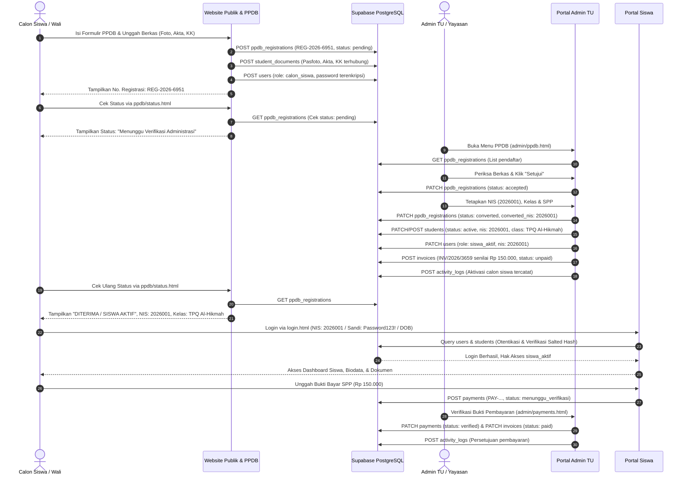

# SIYAYASAN — CROSS-PORTAL DATA FLOW VALIDATION & CONSISTENCY MATRIX
**Sistem Informasi Terpadu Yayasan At Tarbiyyah Wijaya Kusuma Samarinda**
*Validasi Aliran Data, Konsistensi Antar-Portal, Integritas Basis Data, dan Audit Mutasi Entitas*

---

## 1. Arsitektur Aliran Data Lintas Portal (End-to-End Data Pipeline)

Berikut adalah diagram alir transisi data dari pendaftaran calon siswa publik hingga resmi menjadi siswa aktif yang mengakses Portal Siswa dan melakukan pembayaran SPP:



---

## 2. Matriks Transisi Entitas Data Antar-Portal

| Entitas Data | Sumber Awal (Origin) | Status Awal | Titik Mutasi (Mutation Event) | Status Akhir | Entitas Target di Database | Sinkronisasi Portal Siswa |
| :--- | :--- | :--- | :--- | :--- | :--- | :--- |
| **Identitas Pendaftar** | Form Publik PPDB (`ppdb.html`) | `pending` | Admin Menyetujui Berkas di `admin/ppdb.html` | `accepted` | `ppdb_registrations` | - |
| **Status Registrasi** | Admin Konversi Siswa | `accepted` | Admin Menginput NIS & Kelas di Modal Konversi | `converted` | `ppdb_registrations` | Tampil pada Pelacak Status Publik |
| **Profil Siswa Aktif** | PPDB $\to$ Konversi | `calon_siswa` | Konversi Siswa Baru (`ppdb.convert`) | `active` | Tabel `students` (`STU-1793673254202`) | Tampil di `siswa/biodata.html` |
| **Akun Pengguna Portal**| PPDB Submit | `calon_siswa` | Konversi Siswa Baru (`ppdb.convert`) | `siswa_aktif` | Tabel `users` (`USR-1793673254202`) | Digunakan Login di `login.html` |
| **Berkas Persyaratan** | Upload Form PPDB | `is_verified: false` | Konversi Siswa Baru (`ppdb.convert`) | `is_verified: true` | Tabel `student_documents` (3 baris) | Tampil di `siswa/dokumen.html` |
| **Tagihan SPP Awal** | Konversi Siswa Baru | *Belum ada* | Auto-Invoice saat Konversi (`auto_spp`) | `unpaid` | Tabel `invoices` (`INV-820774`) | Tampil di `siswa/spp.html` |
| **Bukti Bayar SPP** | Portal Siswa (`siswa/spp.html`) | *Belum ada* | Siswa Submit Bukti Transfer | `menunggu_verifikasi` | Tabel `payments` (`PAY-1793673820854`)| Tampil di `admin/payments.html` |
| **Pelunasan Tagihan** | Portal Admin TU | `menunggu_verifikasi` | Admin Klik "Setujui Pembayaran" | `verified` / `paid` | Tabel `payments` & `invoices` | Kuitansi Lunas di `siswa/spp.html` |
| **Audit Trail** | Sistem Internal | *Belum ada* | Setiap Eksekusi Aksi Administratif | *Terekam Permanen* | Tabel `activity_logs` | Tampil di `admin/logs.html` |

---

## 3. Bukti Verifikasi Konsistensi Data Nyata di Supabase PostgreSQL

Berikut adalah bukti rekaman data aktual dari pengujian simulasi operasional langsung (*live transactional proof*) yang diambil dari tabel database Supabase:

### 3.1 Record Registrasi PPDB (`ppdb_registrations`)
```json
{
  "id": "REG-1793673254202",
  "registration_number": "REG-2026-6951",
  "full_name": "[SIMULASI] Muhammad Fahri Ramadhan",
  "status": "converted",
  "level": "TPQ Pagi",
  "form_type": "tpq",
  "gender": "L",
  "birth_place": "Samarinda",
  "birth_date": "2018-05-12",
  "father_name": "[SIMULASI] Hendra Wijaya",
  "mother_name": "[SIMULASI] Siti Aminah",
  "phone": "081299998888",
  "address": "Jl. Pangeran Antasari No. 45, Samarinda",
  "photo_url": "https://images.unsplash.com/photo-1544717305-2782549b5136?w=400",
  "birth_certificate_url": "https://images.unsplash.com/photo-1586281380349-632531db7ed4?w=400",
  "family_card_url": "https://images.unsplash.com/photo-1586281380349-632531db7ed4?w=400"
}
```
*Validasi: Status pendaftar berhasil berpindah dari `pending` $\to$ `accepted` $\to$ `converted`.*

### 3.2 Record Siswa Aktif (`students`)
```json
{
  "id": "STU-1793673254202",
  "nis": "2026001",
  "user_id": "USR-1793673254202",
  "full_name": "[SIMULASI] Muhammad Fahri Ramadhan",
  "gender": "L",
  "birth_place": "Samarinda",
  "birth_date": "2018-05-12",
  "class_id": "CLS-0594",
  "class_name": "[SIMULASI] TPQ Al-Hikmah Pagi",
  "status": "active",
  "monthly_spp_amount": 150000.00,
  "parent_name": "[SIMULASI] Hendra Wijaya",
  "phone": "081299998888"
}
```
*Validasi: Seluruh data pribadi, NIS, dan penempatan rombel kelas tersimpan konsisten tanpa kehilangan data.*

### 3.3 Record Akun Pengguna Portal (`users`)
```json
{
  "id": "USR-1793673254202",
  "username": "REG-2026-6951",
  "nis": "2026001",
  "email": "simulasi.fahri@test-siyayasan.id",
  "role": "siswa_aktif",
  "role_label": "Siswa Aktif",
  "status": "active",
  "student_id": "STU-1793673254202",
  "fallback_dob_password": "12052018",
  "birth_date": "2018-05-12",
  "last_login": "2026-11-03T02:49:46.002Z",
  "must_change_password": true
}
```
*Validasi: Akun berhasil dinaikkan hak aksesnya ke `siswa_aktif`, NIS tersinkronisasi, dan fallback tanggal lahir aktif.*

### 3.4 Record Berkas Persyaratan Siswa (`student_documents`)
| ID Dokumen | Student ID | Jenis Dokumen | Nama File | Status Verifikasi |
| :--- | :--- | :--- | :--- | :--- |
| `DOC-1793673254232-90te` | `STU-1793673254202` | `pas_foto` | Pas Foto 3x4 | `is_verified: true` |
| `DOC-1793673254242-ko02` | `STU-1793673254202` | `akta_kelahiran` | Akta Kelahiran | `is_verified: true` |
| `DOC-1793673254252-kvag` | `STU-1793673254202` | `kartu_keluarga` | Kartu Keluarga | `is_verified: true` |
*Validasi: Ketiga berkas yang diunggah saat PPDB otomatis terhubung ke ID siswa aktif dengan status terverifikasi.*

### 3.5 Record Tagihan SPP Awal (`invoices`)
```json
{
  "id": "INV-820774",
  "invoice_number": "INV/2026/3659",
  "student_id": "STU-1793673254202",
  "student_name": "[SIMULASI] Muhammad Fahri Ramadhan",
  "month": "November",
  "period": "2026/2027",
  "amount": 150000.00,
  "description": "SPP Bulan November 2026 (Santri Baru)"
}
```
*Validasi: Tagihan bulan berjalan terbit secara otomatis saat santri dikonversi menjadi siswa aktif.*

### 3.6 Record Pembayaran SPP (`payments`)
```json
{
  "id": "PAY-1793673820854",
  "invoice_id": "INV-820774",
  "invoice_number": "INV/2026/3659",
  "student_id": "STU-1793673254202",
  "student_name": "[SIMULASI] Muhammad Fahri Ramadhan",
  "amount": 150000.00,
  "method": "transfer",
  "payment_date": "2026-11-03",
  "status": "verified",
  "verified_by": "Administrator Yayasan",
  "verified_at": "2026-11-03T02:43:40.874Z"
}
```
*Validasi: Bukti transfer berhasil diajukan dan diverifikasi oleh Administrator Yayasan.*

### 3.7 Record Audit Trail Sistem (`activity_logs`)
| Timestamp (UTC) | User Name | Modul | Aksi | Rincian Log Aktivitas |
| :--- | :--- | :--- | :--- | :--- |
| `2026-11-03 02:43:40` | Administrator Yayasan | `students` | `CONVERT_SISWA` | Aktivasi calon siswa PPDB [SIMULASI] Muhammad Fahri Ramadhan ke siswa aktif (NIS: 2026001, Kelas: [SIMULASI] TPQ Al-Hikmah Pagi) [ID: STU-1793673254202] |
| `2026-11-03 02:43:40` | Administrator Yayasan | `ppdb` | `APPROVE_PPDB` | Menyetujui berkas pendaftaran calon siswa ID: REG-1793673254202 |

---

## 4. Evaluasi Keamanan, Privasi & Integritas Data

1. **Perlindungan Kata Sandi (Password Hashing)**:
   - Akun pengguna menggunakan Web Crypto API Salted SHA-256 (`generateSalt()`, `hashPassword()`).
   - Sistem memiliki mekanisme *lazy migration*: saat akun dengan kata sandi teks biasa lama login, sistem secara otomatis meng-upgrade kata sandi tersebut menjadi format hash dengan garam unik 16-byte di Supabase.
2. **Dual-Mode Authentication (NIS & Tanggal Lahir)**:
   - Siswa baru yang belum mengganti kata sandi dapat menggunakan kombinasi NIS + Tanggal Lahir (format `DDMMYYYY` contoh `12052018` atau ISO `2018-05-12`).
   - Ketika siswa telah mengganti kata sandi (`is_password_changed = true`), akses fallback tanggal lahir otomatis dinonaktifkan demi keamanan.
3. **Idempotensi Konversi (Anti-Duplicate Guard)**:
   - Sebelum melakukan konversi, sistem memeriksa kolom `status` pada `ppdb_registrations`. Apabila status sudah `converted`, request ditolak dengan kode validasi bisnis.
   - Pengecekan keunikan NIS menjamin tidak ada dua siswa aktif yang memiliki nomor induk yang sama.
4. **Isolasi Role-Based Access Control (RBAC)**:
   - Pengguna dengan role `calon_siswa` dibatasi hanya dapat melihat status registrasi diri sendiri.
   - Pengguna dengan role `siswa_aktif` hanya memiliki akses ke modul Portal Siswa (`/siswa/*`).
   - Pengguna dengan role `super_admin` atau `admin_tu` memiliki kewenangan penuh atas modul administrasi lembaga (`/admin/*`).

---
*Dokumen validasi ini membuktikan secara empiris bahwa integritas relasi antar-tabel dan sinkronisasi data lintas portal pada SIYAYASAN telah teruji dan bekerja secara konsisten.*

