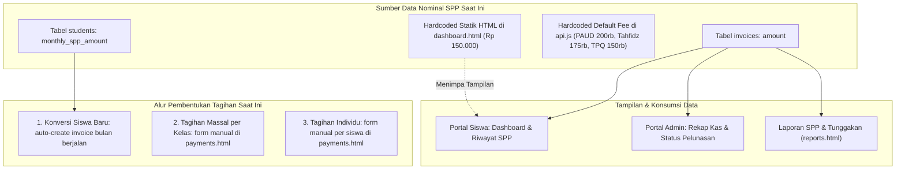

# SPP SYSTEM & ACADEMIC BILLING AUDIT REPORT
**Audit Integrasi Nominal SPP, Alur Tagihan, Evaluasi Tagihan Manual & Rancang Bangun Master Biaya**  
*Yayasan At Tarbiyyah Wijaya Kusuma Samarinda*

---

## 1. Temuan Utama: Akar Masalah Inkonsistensi Nominal SPP

Berdasarkan pengujian langsung yang Anda lakukan terhadap akun santri `Riky Rivaldi` (NIS: `20266051`):
- Nominal SPP saat konversi diatur menjadi: **Rp50.000**
- Nominal tagihan invoice yang terbit: **Rp50.000** (Benar)
- Nilai `monthly_spp_amount` pada tabel database `students`: **50000** (Benar)
- **Namun keterangan "Besaran SPP" di Portal Siswa tetap menampilkan Rp150.000**.

### Investigasi Teknis:
Akar masalahnya ditemukan secara presisi pada berkas [`frontend/portal/siswa/dashboard.html`](file:///d:/Source_code_yayasan/frontend/portal/siswa/dashboard.html#L220-L223):

```html
<!-- frontend/portal/siswa/dashboard.html baris 220-223 -->
<div class="p-3 bg-slate-50 rounded-xl border border-slate-100 min-w-[130px]">
  <span class="text-[11px] font-semibold text-slate-500 block mb-1">Besaran SPP</span>
  <span class="text-base font-bold text-slate-900">Rp 150.000</span> <!-- ⚠️ HARDCODED STATIK! -->
  <span class="text-[10px] text-slate-400 block mt-0.5">Per bulan</span>
</div>
```

Elemen teks tersebut **tertanam secara mati (*hardcoded*) di dalam struktur HTML**, tidak memiliki atribut `id` (seperti `id="dash-monthly-spp"`), dan fungsi JavaScript `loadSPPData()` di baris 533 sama sekali tidak pernah memperbarui teks tersebut dari profil siswa maupun tagihan.

Selain itu, ditemukan beberapa titik fallback nominal Rp150.000 lain di frontend:
1. `frontend/portal/siswa/spp.html` baris 354 & 414: `${formatIDR(inv.amount || 150000)}`
2. `frontend/portal/admin/payments.html` baris 224: `placeholder="150000"`
3. `frontend/portal/admin/payments.html` baris 293: `value="150000"`

---

## 2. Struktur Pengelolaan SPP Saat Ini



### Karakteristik Arsitektur Saat Ini:
1. **Tabel `students`**: Menyimpan `monthly_spp_amount` (NUMERIC). Kolom ini sudah benar menyimpan tarif individual siswa hasil input admin saat konversi atau pembaruan profil murid.
2. **Tabel `invoices`**: Menyimpan histori penagihan per periode (`id`, `invoice_number`, `student_id`, `month`, `period`, `amount`, `due_date`, `status`, `paid_at`).
3. **Tabel `payments`**: Menyimpan bukti konfirmasi transfer santri beserta verifikasi admin TU.

---

## 3. Evaluasi Penghapusan Fitur Tagihan Massal & Tagihan Individual

Anda mengusulkan untuk **menghapus fitur tagihan massal dan tagihan individual manual** dan menggantikannya dengan sistem penentuan biaya otomatis berbasis jenjang dan kelas.

### A. Analisis Risiko Operasional Fitur Manual Saat Ini:
- **Human Error Penginputan**: Admin berisiko salah mengetikkan nominal (misal Rp500.000 alih-alih Rp50.000).
- **Duplikasi Tagihan Bulan Berjalan**: Mengklik tombol tagihan massal dua kali untuk bulan yang sama berpotensi menghasilkan dua invoice jika constraint database tidak tertangani sempurna.
- **Inkonsistensi Tarif Siswa**: Tagihan manual seragam per kelas dapat menabrak santri yang memiliki beasiswa atau tarif khusus hasil kebijakan pimpinan yayasan.

### B. Analisis Ketergantungan (Dependency Impact Map):

| Modul / Komponen | Ketergantungan Terhadap Mekanisme Tagihan Saat Ini | Dampak Jika Tombol Manual Dihapus | Solusi Mitigasi |
| :--- | :--- | :--- | :--- |
| **Tabel `invoices`** | Data riwayat tagihan lama tersimpan di tabel ini | **NOL (Tidak Terganggu)** jika struktur tabel dipertahankan | Tabel `invoices` tetap menjadi buku besar penagihan; yang diubah hanya cara penerbitannya |
| **Portal Siswa (`spp.html`)** | Membaca daftar invoice berdasarkan `student_id` | **NOL (Aman)** | Siswa tetap membaca record invoice seperti biasa |
| **Laporan SPP (`reports.html`)** | Mengelompokkan invoice berdasarkan status dan kelas | **NOL (Aman)** | Rekapitulasi laporan tetap menghitung kolom `amount` pada tabel `invoices` |
| **Dashboard Kas (`payments.html`)** | Menghitung total kas masuk dari invoice berstatus `paid` | **NOL (Aman)** | Logika kalkulasi kas dan tunggakan tidak berubah |

### C. Rekomendasi Evaluasi:
**Sangat Disarankan Disetujui**:
Tombol "Tagihan Massal per Kelas" dan "Buat Tagihan Individu" manual dapat **dinonaktifkan/dihapus dari antarmuka `payments.html`**, dan digantikan dengan **Mesin Penerbitan Tagihan Otomatis Bulanan (Scheduled / Automated Billing Engine)** yang merujuk pada Master Biaya Jenjang/Kelas.

---

## 4. Desain Rancang Bangun Master Biaya SPP Berdasarkan Jenjang & Kelas

Agar sistem penentuan biaya memiliki satu sumber kebenaran (*single source of truth*), diusulkan arsitektur **Master Biaya SPP (Fee Structure Matrix)**.

### A. Skema Data Master Biaya (`fee_structures`):
```sql
CREATE TABLE IF NOT EXISTS fee_structures (
    id VARCHAR(50) PRIMARY KEY,              -- cth: 'FEE-PAUD-A', 'FEE-TPQ-PAGI'
    jenjang VARCHAR(50) NOT NULL,            -- 'PAUD', 'TPQ', 'TAHFIDZ'
    class_name_pattern VARCHAR(100) NOT NULL,-- cth: 'Kelompok A', 'TPQ Pagi', 'Pra PTPT'
    academic_year VARCHAR(20) NOT NULL,      -- '2026/2027'
    monthly_fee NUMERIC(12, 2) NOT NULL,     -- Nominal biaya SPP resmi
    effective_from DATE NOT NULL,            -- Mulai berlaku
    effective_until DATE,                    -- Sampai dengan (opsional)
    status VARCHAR(20) DEFAULT 'active',     -- 'active' | 'archived'
    created_at TIMESTAMPTZ DEFAULT NOW(),
    updated_at TIMESTAMPTZ DEFAULT NOW()
);
```

### B. Matriks Acuan Biaya Resmi Yayasan (Konseptual):
| Kode Biaya | Jenjang | Nama Kelas / Rombel | Tahun Ajaran | Rekomendasi Biaya Bulanan |
| :--- | :---: | :--- | :---: | :---:|
| `FEE-KB-A` | **PAUD** | KB Ulinnuha (Kelompok A) | 2026/2027 | *Sesuai Ketetapan Yayasan* |
| `FEE-KB-B` | **PAUD** | KB Ulinnuha (Kelompok B) | 2026/2027 | *Sesuai Ketetapan Yayasan* |
| `FEE-TPQ-PAGI` | **TPQ** | TPQ Ulinnuha (Pagi) | 2026/2027 | *Sesuai Ketetapan Yayasan* |
| `FEE-TPQ-SORE` | **TPQ** | TPQ Ulinnuha (Sore) | 2026/2027 | *Sesuai Ketetapan Yayasan* |
| `FEE-TFZ-PRA` | **TAHFIDZ** | Tahfidz - Pra PTPT | 2026/2027 | *Sesuai Ketetapan Yayasan* |
| `FEE-TFZ-PTPT` | **TAHFIDZ** | Tahfidz - PTPT (Kelas 1-6) | 2026/2027 | *Sesuai Ketetapan Yayasan* |

---

## 5. Alur Operasional Baru yang Diusulkan

### A. Alur 1: Penetapan SPP Saat Konversi Siswa Baru
1. Admin memilih pendaftar yang berstatus `Approved`.
2. Admin memilih rombongan belajar / kelas tujuan.
3. Sistem secara otomatis mengambil nominal resmi dari Master Biaya sesuai kelas tersebut dan menampilkannya di form modal konversi.
4. Admin dapat mengonfirmasi nominal tersebut, atau mengisi nominal penyesuaian khusus (disertai catatan alasan keringanan/kebijakan).
5. Nilai nominal tersebut disimpan ke kolom `monthly_spp_amount` di profil santri dan menjadi dasar pembuatan invoice bulan berjalan.

### B. Alur 2: Penyesuaian SPP Saat Kenaikan Kelas (Class Promotion)
1. Admin membuka modul Kenaikan Kelas / Penempatan Rombel Baru.
2. Ketika siswa dipindahkan dari (misalnya) *Kelompok A* ke *Kelompok B*, sistem otomatis mencocokkan master tarif baru untuk *Kelompok B*.
3. Kolom `monthly_spp_amount` pada santri diperbarui terhitung sejak tanggal/periode tahun ajaran baru berlaku.
4. **Prinsip Anti-Retroaktif (Kekebalan Tagihan Lama)**: Seluruh invoice dan catatan pembayaran bulan-bulan sebelumnya **TIDAK AKAN PERNAH BERUBAH** karena setiap record pada tabel `invoices` menyimpan snapshot nominal historis pada saat tagihan diterbitkan.
