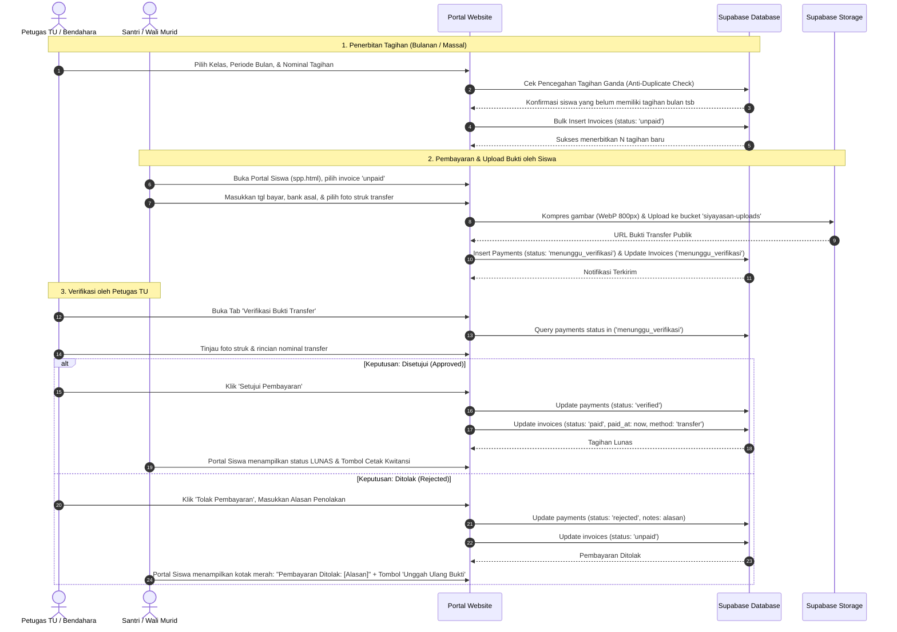

# REDESAIN ALUR OPERASIONAL & ARSITEKTUR SISTEM SPP
## Yayasan At Tarbiyyah Wijaya Kusuma Samarinda
**Dokumen Perancangan Alur Keuangan & Administrasi SPP (Read-Only Planning Phase)**  
**Tanggal:** 2 November 2026 | **Status:** Usulan Desain Operasional

---

## 1. PENDAHULUAN & PRINSIP DASAR KEUANGAN YAYASAN

Sistem SPP dan pembayaran pada lembaga pendidikan Islam terpadu (KB Ulinnuha / PAUD, TPQ Ulinnuha Pagi, dan Tahfidz Al-Qur'an) memegang peranan krusial sebagai urat nadi operasional yayasan.
Berdasarkan hasil audit sistem, alur SPP yang ada saat ini memerlukan pembenahan mendasar agar memenuhi 4 prinsip tata kelola keuangan yang sehat:

1. **Akurasi & Integritas Data (Zero Discrepancy):** Tidak boleh ada tagihan ganda (*duplicate invoices*) atau pembayaran tercatat dua kali (*duplicate payments*).
2. **Kemandirian Tagihan Historis (Immutability of Invoices):** Perubahan kebijakan nominal SPP di masa depan **tidak boleh mengubah nilai tagihan atau riwayat transaksi masa lalu**.
3. **Fleksibilitas Berjenjang (Hierarchical Fee Policy):** Yayasan memiliki jenjang dan kondisi santri yang beragam (Reguler PAUD, TPQ, Tahfidz, Santri Yatim/Dhuafa/Beasiswa), sehingga penetapan nominal harus fleksibel tanpa menghilangkan otomasi.
4. **Transparansi Dua Arah (Siswa <-> Bendahara/TU):** Siswa/wali murid dapat mengunggah bukti transfer resmi, memantau verifikasi real-time, dan menerima alasan yang jelas jika bukti ditolak untuk kemudian mengunggah ulang bukti yang sah.

---

## 2. EVALUASI DAN PERANCANGAN PENGATURAN NOMINAL SPP

### 2.1. Masalah pada Sistem Saat Ini
Pada implementasi berjalan, nominal SPP santri baru ditetapkan mati (*hardcoded*) pada angka **Rp150.000** di file [`frontend/shared/js/api.js`](file:///d:/Source_code_yayasan/frontend/shared/js/api.js#L3010). Petugas TU tidak memiliki pilihan untuk menentukan tarif yang berbeda pada saat verifikasi/konversi santri baru.

### 2.2. Rekomendasi Struktur Pengaturan Nominal: "Tiered Default with Individual Override"
Kami mengevaluasi 4 alternatif model penentuan SPP:
- **Alternatif 1: Ditetapkan Hanya per Tahun Ajaran** (Kelemahan: Kaku, tidak membedakan jenjang PAUD dan TPQ).
- **Alternatif 2: Ditetapkan Hanya per Kelas** (Kelemahan: Terlalu terfragmentasi jika kelas sering dirombak).
- **Alternatif 3: Ditetapkan Murni Individual per Siswa** (Kelemahan: Membebani admin yang harus mengetik angka untuk ratusan siswa).
- **Alternatif 4 (Direkomendasikan): Struktur Bertingkat (Program/Jenjang Baseline + Individual Override).**

#### Desain Model Tingkat Kebijakan:
1. **Tier 1 — Master Tarif Jenjang (Default Setting):**
   Disimpan di tabel `web_settings` / `fee_structures`:
   - Jenjang PAUD (KB Ulinnuha): Default Rp200.000 / bulan
   - Jenjang TPQ Ulinnuha Pagi: Default Rp150.000 / bulan
   - Jenjang Tahfidz Al-Qur'an: Default Rp175.000 / bulan
2. **Tier 2 — Individual Student Override (`students.monthly_spp_amount`):**
   Setiap siswa memiliki kolom `monthly_spp_amount` di tabel `students`.
   - Secara default terisi nilai dari Tier 1 sesuai program yang dipilih.
   - Namun, petugas TU dapat mengubah nominal ini secara individual sewaktu-waktu pada halaman edit data siswa (misalnya jika santri mendapatkan potongan beasiswa yatim menjadi Rp0 atau diskon saudara kandung menjadi Rp100.000).
3. **Tier 3 — Konfirmasi Saat Konversi PPDB:**
   Pada modal aktivasi PPDB massal maupun perorangan, sistem menampilkan kolom input:
   `Nominal SPP Pertama & Bulanan: [ Rp 150.000 ]` (otomatis terisi default sesuai program santri, namun dapat diedit sebelum menekan tombol Aktivasi).

---

## 3. STANDARISASI FORMAT RUPIAH INDONESIA

### 3.1. Spesifikasi Format Tampilan
Seluruh antarmuka publik, portal siswa, kwitansi, invoice, dashboard, dan laporan keuangan wajib mengikuti format baku Rupiah Indonesia:
- **Format Teks:** `Rp` + angka ribuan dengan pemisah titik (`.`) tanpa spasi, tanpa desimal `,00` (kecuali pada neraca perbankan).
  - Contoh: `Rp150.000` (Bukan `Rp 150.000` dan bukan `150000`).
  - Contoh: `Rp250.000`
  - Contoh: `Rp1.200.000`

### 3.2. Implementasi Dual-Layer (Storage Numeric vs Presentation Formatted)
- **Di Database (`invoices.amount`, `payments.amount`):**  
  Tipe data wajib tetap berupa angka murni (`INTEGER` atau `NUMERIC(12,2)`), contoh: `150000`. Dilarang menyimpan simbol `Rp` atau string berformat ke kolom angka database.
- **Di Lapisan Fungsi (`frontend/shared/js/api.js`):**
  ```javascript
  function formatIDR(n) {
    if (n === null || n === undefined || isNaN(n)) return 'Rp0';
    return 'Rp' + Number(n).toLocaleString('id-ID');
  }
  ```
- **Di Form Input Admin / Siswa:**  
  Input angka nominal dilengkapi dengan atribut input numerik atau live masking:
  `<input type="number" step="1000" id="single-amount" oninput="updateRupiahHint(this)">`  
  Dengan bantuan label dinamis di bawahnya:  
  `<span class="text-xs text-primary-700 font-semibold" id="hint-amount">Terbaca: Rp150.000</span>`

---

## 4. REDESAIN ALUR OPERASIONAL SPP END-TO-END



---

## 5. DETAIL ALUR KERJA OPERASIONAL SPP

### 5.1. Alur 1: Tagihan Santri Baru (PPDB Conversion)
1. Calon santri yang berstatus `approved` dikonversi menjadi santri aktif.
2. Form aktivasi menampilkan pilihan:
   - Centang opsi: `[x] Terbitkan Tagihan SPP Bulan Pertama`.
   - Nominal SPP: Default terisi sesuai program santri (PAUD / TPQ / Tahfidz), admin dapat mengubah nilai tersebut.
   - Pilihan bulan jatuh tempo: Bulan berjalan atau bulan pertama tahun ajaran baru.
3. Sistem membuat tagihan `invoices` berstatus `unpaid`.

### 5.2. Alur 2: Penerbitan Tagihan Massal Siswa Aktif (Bulk Invoicing)
Untuk menghindari loop lambat 60 request sekuensial pada sistem lama:
1. Admin membuka menu Keuangan SPP -> tombol **"Tagihan Massal per Kelas / Angkatan"**.
2. Admin memilih:
   - **Tingkat / Kelas:** Misal "Semua Kelas", atau kelas tertentu seperti "Kelompok Belajar A (PAUD)", "Kelas 1 TPQ Pagi".
   - **Bulan & Tahun Tagihan:** Pilihan dropdown bulan (Januari – Desember) dan tahun berjalan.
   - **Metode Nominal:**
     - *Opsi A (Rekomendasi):* Gunakan Tarif Masing-masing Siswa (membaca `students.monthly_spp_amount`).
     - *Opsi B:* Terapkan Nominal Sama Rata (input manual nominal rupiah).
   - **Tanggal Jatuh Tempo:** Otomatis tanggal 10 bulan berjalan (dapat diubah).
3. **Mekanisme Anti Tagihan Ganda (Anti-Duplicate Guard):**
   Sebelum membuat tagihan, sistem mengecek seluruh invoice yang telah terbit untuk kombinasi `student_id` + `month` + `period`.
   Jika siswa sudah memiliki tagihan pada bulan tersebut, siswa dilewati (*skipped*) secara otomatis.
4. **Eksekusi Bulk Insert:**
   Sistem mengirimkan **satu array JSON tunggal** ke Supabase PostgREST:
   `POST /rest/v1/invoices` dengan body `[ { ...inv1 }, { ...inv2 }, ... ]`.
   Waktu eksekusi memakan waktu kurang dari **300 milidetik** untuk seluruh angkatan.
5. Sistem menampilkan rekapitulasi:
   `"Berhasil menerbitkan 58 tagihan baru untuk bulan Oktober 2026. 2 siswa dilewati karena sudah memiliki tagihan."`

### 5.3. Alur 3: Unggah Bukti Transfer di Portal Siswa
1. Santri atau orang tua login ke Portal Siswa dan masuk ke menu **Tagihan SPP** (`siswa/spp.html`).
2. Siswa melihat tabel tagihan:
   - Tagihan yang belum dibayar berstatus **"Belum Bayar"** dengan tombol biru **"Upload Bukti"**.
3. Saat diklik, modal upload muncul:
   - Menampilkan ringkasan nomor rekening resmi yayasan (BSI / BRI / Bank Kaltimtara).
   - Input tanggal transfer dan nama pemilik rekening pengirim.
   - Input file foto/screenshot bukti transfer (didukung kompresi otomatis client-side ke WebP maksimal 800px untuk menghemat kuota wali murid dan mempercepat pengunggahan).
4. **Pencegahan Upload Ganda:**
   Jika status invoice sudah `menunggu_verifikasi`, tombol "Upload Bukti" dinonaktifkan dan diganti dengan status informatif:
   `"Sedang Diverifikasi oleh Tata Usaha Yayasan"`.
5. Data tersimpan ke tabel `payments` dengan `status = 'menunggu_verifikasi'`.

### 5.4. Alur 4: Verifikasi & Penolakan Pembayaran oleh Tata Usaha
1. Pada Portal Admin (`payments.html`), terdapat tab khusus **"Verifikasi Bukti Transfer"** dengan indikator *badge counter* jumlah bukti yang belum diperiksa.
2. Petugas TU membuka baris yang menunggu verifikasi:
   - Klik thumbnail untuk memperbesar foto struk transfer.
   - Memeriksa nama santri, tanggal transfer, bank, dan nominal yang tertera pada struk.
3. **Tindakan Persetujuan (Approve):**
   - Petugas mengklik tombol hijau **"Setujui"**.
   - Sistem memperbarui tabel `payments` (`status: 'verified'`) dan `invoices` (`status: 'paid'`, `paid_at: NOW()`, `payment_method: 'transfer'`).
   - Portal siswa langsung menampilkan badge hijau **"Lunas"** dan tombol cetak **Kwitansi Resmi**.
4. **Tindakan Penolakan (Reject):**
   - Petugas mengklik tombol merah **"Tolak"**.
   - Sistem menampilkan modal konfirmasi penolakan dengan dropdown & input wajib:
     - *Alasan Penolakan:*
       1. Foto bukti transfer buram / tidak terbaca
       2. Nominal transfer tidak sesuai dengan jumlah tagihan
       3. Nomor rekening tujuan salah / bukan rekening yayasan
       4. Bukti transfer terindikasi duplikat / palsu
       5. Lainnya (tulis keterangan manual)
     - *Catatan Tambahan untuk Wali Murid* (opsional).
   - Sistem menyimpan alasan ini ke `payments.rejection_reason` dan mengembalikan `invoices.status = 'unpaid'`.
   - **Tampilan di Portal Siswa:**
     Pada baris tagihan siswa, muncul kotak peringatan merah:
     `"Pembayaran Ditolak: [Foto bukti buram]. Silakan unggah ulang bukti transfer yang jelas."`
     Tombol **"Upload Bukti Ulang"** kembali aktif bagi siswa.

### 5.5. Alur 5: Pembayaran Tunai di Kantor Tata Usaha (Kasir Offline)
1. Orang tua murid yang membayar langsung secara tunai di kantor yayasan tidak perlu mengunggah bukti via portal.
2. Petugas TU membuka menu Data Tagihan SPP, mencari nama santri, lalu mengklik tombol **"Bayar Tunai / Kasir"**.
3. Sistem membuat baris di tabel `payments` dengan `method: 'tunai'`, `status: 'verified'`, dan langsung menandai `invoices.status = 'paid'`.
4. Petugas TU dapat langsung mencetak kwitansi fisik untuk diserahkan kepada orang tua santri.

---

## 6. PENCEGAHAN ANOMALI & AUDIT FINANCIAL SAFETY

| Potensi Anomali Keuangan | Penyebab Sistem Lama | Solusi Desain Baru |
|---|---|---|
| **Tagihan Ganda (Double Invoicing)** | Admin mengklik buat tagihan massal 2x untuk bulan yang sama | Validasi `UNIQUE INDEX` pada kombinasi `(student_id, month, academic_year)` serta pra-penyaringan query sebelum insert |
| **Pembayaran Tercatat 2x** | Siswa mengirim berkas transfer berkali-kali | Kunci form upload jika invoice berstatus `menunggu_verifikasi` atau `paid` |
| **Salah Periode Tagihan** | Format string bulan tidak baku (`Oktober` vs `Okt 2026`) | Standarisasi enum bulan (1–12) dan tahun ajaran resmi (`2026/2027`) |
| **Perubahan SPP Merusak Data Lama** | Nominal tagihan membaca langsung relasi kelas/master secara dinamis | **Snapshot Pattern:** Nominal tagihan disimpan permanen pada baris `invoices.amount` saat diterbitkan; perubahan master tarif hanya berlaku untuk tagihan bulan mendatang |
| **Tunggakan Tidak Terdeteksi** | Tagihan bulan lalu yang belum lunas tertutup tagihan baru | Fitur rekapitulasi tunggakan kumulatif per santri di dashboard admin dan portal siswa |

---

## 7. RANCANGAN STRUKTUR DATA (DATABASE SCHEMA ENHANCEMENT)

Perubahan ini bersifat *backward-compatible* (tidak merusak data lama, melainkan melengkapi kolom yang ada):

```sql
-- 1. Penambahan Kolom Tarif SPP Bulanan per Siswa (Tier Override)
ALTER TABLE students 
ADD COLUMN IF NOT EXISTS monthly_spp_amount INTEGER DEFAULT 150000;

-- 2. Penambahan Kolom Alasan Penolakan pada Tabel Pembayaran
ALTER TABLE payments 
ADD COLUMN IF NOT EXISTS rejection_reason TEXT,
ADD COLUMN IF NOT EXISTS verified_by VARCHAR(100),
ADD COLUMN IF NOT EXISTS verified_at TIMESTAMP WITH TIME ZONE;

-- 3. Constraint Pencegahan Tagihan Duplikat per Periode
CREATE UNIQUE INDEX IF NOT EXISTS uq_invoice_student_month_period 
ON invoices (student_id, month, period);
```

---

*Desain ini memberikan kepastian hukum pencatatan keuangan, menghilangkan kesalahan nominal hardcoded, dan mempermudah komunikasi antara pihak administrasi yayasan dengan wali murid.*

