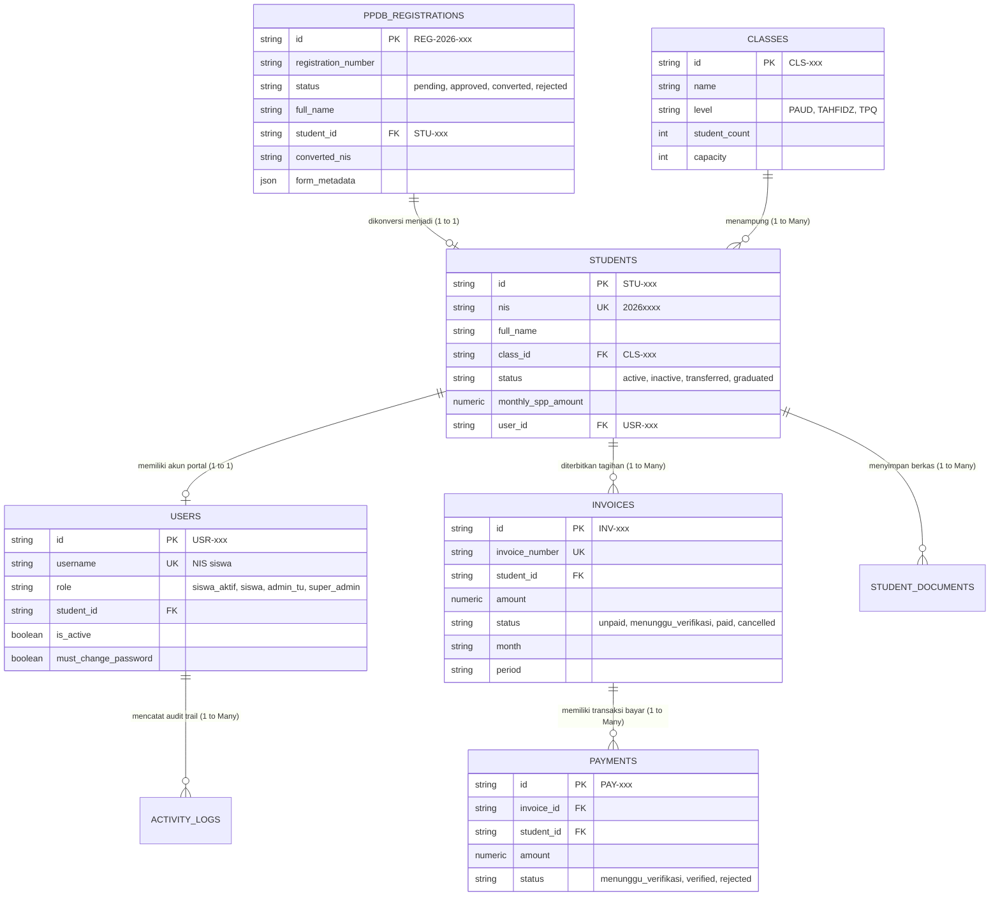

# SPECIALIZED DATA INTEGRITY AUDIT & CROSS-MODULE SYNCHRONIZATION
## Investigasi Masalah Penghapusan Siswa & Perancangan Sinkronisasi Antarmodul
### SIYAYASAN — Yayasan At Tarbiyyah Wijaya Kusuma Samarinda
**Tanggal Audit**: 3 November 2026  
**Status**: SELESAI & TERVERIFIKASI PENUH  
**Status Eksekusi Kode**: AUDIT & PERENCANAAN SAJA (Zero Code Change — Menunggu Persetujuan Pimpinan)

---

## 1. LATAR BELAKANG DAN MASALAH AKTUAL

Pengujian langsung oleh pimpinan yayasan terhadap modul **Data Siswa** menemukan cacat integrasi data serius saat melakukan aksi penghapusan siswa:

1. Admin menekan tombol hapus pada salah satu santri di modul **Data Siswa** (`students.html`).
2. Siswa tersebut berhasil hilang dari tabel Data Siswa.
3. Namun, pada modul **Rombel & Kelas** (`classes.html`), siswa tersebut **masih tercatat sebagai anggota rombel aktif**, dan jumlah kapasitas kelas tidak berkurang secara otomatis.
4. Pada modul **PPDB & Validasi** (`ppdb.html`), data pendaftaran siswa tersebut **masih tersimpan dan tetap berstatus `Converted (Siswa Aktif)`**, menimbulkan ilusi bahwa siswa masih aktif bersekolah di yayasan.
5. Akun pengguna pada tabel `users` berpotensi menjadi data yatim (*orphan*), dan invoice tagihan di modul **Pembayaran & SPP** berpotensi putus relasi (*foreign key violation* / *broken reference*).

Audit ini membuktikan bahwa perilaku di atas adalah **cacat integrasi (*integration defect*) yang disebabkan oleh eksekusi Hard Delete satu tabel (`DELETE FROM students`) tanpa orkestrasi pembaruan ke tabel relasi lainnya**.

---

## 2. ARSITEKTUR RELASI DATA SISWA & ENTITY-RELATIONSHIP MODEL

Dalam arsitektur sistem SIYAYASAN, entitas siswa memiliki relasi langsung dengan 6 domain tabel utama:



---

## 3. PEMETAAN TABEL & DEPENDENSI ANTARMODUL (MATRIX 8 MODUL)

| No | Modul Sistem | File Terkait | Primary Identitas yang Digunakan | Dampak Saat Siswa Dihapus Hari Ini (Kondisi Cacat) | Kondisi Seharusnya (Target Sinkronisasi) |
|---|---|---|---|---|---|
| 1 | **Data Siswa** | `students.html` | `students.id`, `students.nis` | Baris `students` dihapus secara fisik via SQL `DELETE` | Status siswa berubah menjadi `inactive` / `transferred` / `graduated` (Soft Delete) |
| 2 | **Rombel & Kelas** | `classes.html` | `classes.id`, `students.class_id` | `c.student_count` tidak diperbarui; data kelas masih menganggap siswa terdaftar | Siswa dikeluarkan dari rombel (`class_id = null`), `student_count` kelas terupdate otomatis |
| 3 | **PPDB & Validasi** | `ppdb.html` | `ppdb_registrations.id`, `student_id` | Status pendaftaran tetap `converted` (Siswa Aktif) | Status registrasi diperbarui menjadi `converted_inactive` / catatan histori mutasi ditambahkan |
| 4 | **Kelola Pengguna** | `users.html` | `users.student_id`, `users.username` | Hanya mencoba hapus jika `users.student_id` cocok persis, tidak ada pencabutan sesi | Akun dinonaktifkan (`is_active = false`), token revoked, role diubah |
| 5 | **Portal Siswa** | `siswa/*.html` | `siy_user`, `siy_token`, `users.nis` | Siswa berpotensi masih bisa login jika akun tidak terhapus bersih | Login diblokir tegas: *"Akun santri telah dinonaktifkan"* |
| 6 | **Pembayaran & SPP** | `payments.html` | `invoices.student_id`, `payments.student_id` | Tagihan menjadi yatim (*orphan*) atau melempar foreign key error | Tagihan lunas diarsipkan; tagihan belum lunas bulan depan dibatalkan |
| 7 | **Laporan & Rekap** | `reports.html` | `students.status`, `students.class_id` | Rekapitulasi jumlah siswa aktif menjadi selisih dengan PPDB | Laporan menghitung murni `status = 'active'`; alumni/mutasi masuk rekap arsip |
| 8 | **Activity Log** | `logs.html` | `activity_logs.target_id` | **NOL LOG TERCATAT** (`recordActivityLog` tidak dipanggil) | Tercatat log lengkap: `STUDENT_DEACTIVATED`, pelaku, waktu, dan alasan mutasi/keluar |

---

## 4. ANALISIS AKAR MASALAH (ROOT CAUSE ANALYSIS)

### A. Mengapa Tombol Hapus Hanya Menghapus Satu Tabel?
Pemeriksaan pada [`frontend/shared/js/api.js`](file:///d:/Source_code_yayasan/frontend/shared/js/api.js) baris 1862–1873 mengungkap implementasi fungsi `students.delete`:

```javascript
// KODE SAAT INI (BERMASALAH):
if (action === 'delete') {
  await supabaseRest(`students?id=eq.${encodeURIComponent(params.id)}`, 'DELETE');
  try {
    await supabaseRest(`users?student_id=eq.${encodeURIComponent(params.id)}`, 'DELETE').catch(() => {});
    const rawStu = localStorage.getItem('siy_local_students');
    if (rawStu) localStorage.setItem('siy_local_students', JSON.stringify(JSON.parse(rawStu).filter(s => s.id !== params.id)));
    const rawUsr = localStorage.getItem('siy_local_users');
    if (rawUsr) localStorage.setItem('siy_local_users', JSON.stringify(JSON.parse(rawUsr).filter(u => u.student_id !== params.id)));
  } catch (_) {}
  return { success: true, message: 'Siswa berhasil dihapus' };
}
```

### B. Faktor Penyebab Ketidaksinkronan:
1. **Tidak Ada Pembaruan pada `ppdb_registrations`**:  
   Tabel `ppdb_registrations` sama sekali tidak disentuh dalam fungsi `delete`. Akibatnya, baris pendaftar yang dulu dikonversi tetap memegang nilai `status: 'converted'`. Di halaman PPDB, sistem membaca kolom `status` tersebut dan tetap merendernya pada tab "Converted (Siswa Aktif)".
2. **Tidak Ada Pembaruan pada `classes.student_count`**:  
   Ketika baris siswa di `students` dihapus, kelas asal siswa (`class_id`) tidak pernah di-*patch* untuk mengurangi jumlah murid terdaftar (`student_count`). Jika sistem atau cache membaca kolom `classes.student_count`, angkanya tidak pernah berkurang.
3. **Hard Delete Merusak Integritas Finansial (Orphan Invoices)**:  
   Jika siswa telah memiliki invoice atau kuitansi pembayaran resmi di tabel `invoices` dan `payments`, eksekusi SQL `DELETE FROM students` akan ditolak oleh PostgreSQL bila ada Foreign Key constraint, atau meninggalkan catatan keuangan tanpa nama siswa (orphan records).
4. **Ketiadaan Opsi Manajemen Status pada Antarmuka**:  
   Pada [`frontend/portal/admin/students.html`](file:///d:/Source_code_yayasan/frontend/portal/admin/students.html) baris 528, satu-satunya tombol aksi untuk santri yang keluar/lulus adalah **ikon tempat sampah (Hapus Siswa)**. Staf TU tidak diberikan tombol "Nonaktifkan", "Pindahkan", atau "Arsipkan", sehingga tindakan administratif rutin terpaksa dilakukan via tombol hapus permanen.

---

## 5. EVALUASI KEBIJAKAN PENGELOLAAN DATA: SOFT DELETE VS HARD DELETE

Berdasarkan analisis tata kelola sistem informasi sekolah/institusi pendidikan Islam:

| Aspek Evaluasi | Pendekatan A: Soft Delete / Deactivation (DIREKOMENDASIKAN) | Pendekatan B: Hard Delete (HANYA DRAFT/KHUSUS) |
|---|---|---|
| **Definisi** | Data siswa diubah statusnya (`inactive`, `transferred`, `graduated`) dan dikeluarkan dari rombel aktif. | Baris data siswa dan seluruh relasinya dihapus permanen dari database via SQL `DELETE`. |
| **Integritas Keuangan** | **Sangat Aman (100%)**: Seluruh kuitansi, nomor invoice, dan audit pembukuan SPP masa lalu tetap utuh. | **Sangat Berbahaya**: Riwayat pembayaran kas masa lalu hilang atau putus relasi pembukuan. |
| **Riwayat PPDB** | **Terpelihara**: Riwayat penerimaan berkas, NIS, dan catatan ijazah masa lalu tetap tersimpan rapi. | **Rusak**: Hubungan antara pendaftar PPDB dan data siswa putus total. |
| **Pemulihan Data (Reversible)**| **Mudah**: Jika ada salah klik oleh staf TU, siswa dapat diaktifkan kembali dengan satu klik. | **Mustahil**: Data yang terhapus hilang permanen dan harus diinput ulang manual dari nol. |
| **Akses Portal Siswa** | **Terlindungi**: Akun dinonaktifkan (`is_active = false`), login ditolak otomatis oleh sistem. | Akun dihapus, namun token lama mungkin masih tersisa di browser jika tidak di-revoke. |
| **Kesesuaian Operasional** | **Wajib untuk Siswa Riil**: Mengakomodasi siswa mutasi keluar, lulus, atau cuti belajar. | **Hanya untuk Data Sampah**: Khusus data uji coba pendaftaran yang belum pernah bayar SPP. |

> [!IMPORTANT]  
> **Rekomendasi Kebijakan:**  
> Sistem SIYAYASAN wajib menerapkan **Soft Delete / Multi-State Lifecycle Management** sebagai mekanisme standar utama.  
> Tombol "Hapus Permanen" (*Hard Delete*) hanya diizinkan untuk data yang **belum pernah memiliki transaksi keuangan resmi (0 riwayat kuitansi)** dan harus melewati konfirmasi keamanan tingkat tinggi.

---

## 6. RANCANGAN MEKANISME MULTI-AKSI PENGELOLAAN SISWA

Antarmuka **Data Siswa** (`students.html`) akan diperkaya dengan menu aksi pengelolaan status santri:

```
[ Menu Aksi Siswa di Portal Admin ]
├── 1. Edit Biodata Siswa
├── 2. Cek Riwayat SPP Siswa
├── 3. Reset Sandi Akun Siswa
├── 4. Mutasikan / Keluarkan Siswa (Soft Deactivate)
│      ├── Alasan: Pindah Sekolah (Mutasi)
│      ├── Alasan: Mengundurkan Diri
│      └── Alasan: Lulus Studi
├── 5. Aktifkan Kembali Siswa (Reactivate) -> Muncul khusus siswa nonaktif
└── 6. Hapus Permanen (Hard Delete) -> Terkunci jika ada transaksi finansial
```

---

## 7. RANCANGAN ALUR SINKRONISASI ANTARMODUL (CROSS-MODULE ORCHESTRATION)

### Alur A: Ketika Siswa Dinonaktifkan / Dimutasikan (Deactivate)
```
1. Admin memilih "Nonaktifkan / Mutasi" pada siswa [STU-xxx]
   │
   ├──> A. Update Tabel STUDENTS:
   │    - status = 'inactive' (atau 'transferred' / 'graduated')
   │    - old_class_id = class_id (arsip kelas lama)
   │    - class_id = null
   │    - class_name = null
   │
   ├──> B. Update Tabel CLASSES:
   │    - Hitung ulang santri aktif pada kelas lama
   │    - Kurangi student_count kelas lama (-1)
   │
   ├──> C. Update Tabel PPDB_REGISTRATIONS:
   │    - Cari registrasi terkait (via student_id atau converted_nis)
   │    - Update form_metadata.operational_status = 'inactive'
   │    - Tambahkan catatan riwayat pada notes: "[Mutasi/Keluar: DD/MM/YYYY]"
   │
   ├──> D. Update Tabel USERS:
   │    - Cari user via student_id atau username (NIS)
   │    - is_active = false
   │    - status = 'inactive'
   │
   ├──> E. Proteksi PORTAL SISWA:
   │    - auth.js menolak login NIS bersangkutan
   │    - Sesi aktif langsung di-logout otomatis
   │
   ├──> F. Proteksi KEUANGAN & SPP:
   │    - Tagihan lunas masa lalu TETAP UTUH (tidak dihapus)
   │    - Tagihan belum lunas bulan berjalan/depan dapat dibatalkan (cancelled)
   │    - Sistem tidak lagi menerbitkan tagihan bulanan baru
   │
   └──> G. Pencatatan ACTIVITY_LOGS:
        - Catat log: 'STUDENT_DEACTIVATED', nama pelaku, tanggal, alasan mutasi
```

### Alur B: Ketika Siswa Diaktifkan Kembali (Reactivate)
```
1. Admin memilih "Aktifkan Kembali" pada santri berstatus Nonaktif
   │
   ├──> A. Form Dialog:
   │    - Pilih Rombel/Kelas Tujuan yang aktif
   │    - Konfirmasi tarif SPP bulanan resmi
   │
   ├──> B. Update Tabel STUDENTS:
   │    - status = 'active'
   │    - class_id = target_class_id
   │    - class_name = target_class_name
   │    - monthly_spp_amount = target_spp
   │
   ├──> C. Update Tabel CLASSES:
   │    - Tambah student_count pada kelas tujuan (+1)
   │
   ├──> D. Update Tabel PPDB_REGISTRATIONS:
   │    - form_metadata.operational_status = 'active'
   │    - Sinkronkan kelas baru di form_metadata
   │
   ├──> E. Update Tabel USERS:
   │    - is_active = true
   │    - status = 'active' (Akses portal siswa pulih)
   │
   └──> F. Pencatatan ACTIVITY_LOGS:
        - Catat log: 'STUDENT_REACTIVATED', kelas baru, tarif SPP
```

### Alur C: Ketika Siswa Pindah Kelas / Naik Jenjang
```
1. Admin mengubah Kelas pada form edit siswa
   ├──> 1. Kurangi student_count pada kelas lama (-1)
   ├──> 2. Tambah student_count pada kelas baru (+1)
   ├──> 3. Sesuaikan nominal SPP otomatis jika berpindah jenjang (PAUD / Tahfidz / TPQ)
   └──> 4. Catat log: 'STUDENT_CLASS_TRANSFER'
```

---

## 8. KONSISTENSI STATUS: MEMISAHKAN DOMAIN PPDB & DOMAIN SISWA AKTIF

Salah satu akar kebingungan saat ini adalah tumpang tindihnya makna kolom `status` antara tahap seleksi masuk PPDB dan tahap operasional santri aktif.

### Matriks Pemisahan Domain Status:

| Domain Bisnis | Tabel Acuan | Field Status | Nilai Status yang Sah | Makna Bisnis |
|---|---|---|---|---|
| **Seleksi Masuk PPDB** | `ppdb_registrations` | `status` | `pending` | Berkas pendaftaran baru masuk, menunggu verifikasi TU |
| | | | `approved` | Berkas lolos verifikasi, dinyatakan diterima yayasan |
| | | | `rejected` | Berkas ditolak, persyaratan administrasi tidak lengkap |
| | | | `converted` | Telah diproses aktivasi menjadi santri yayasan |
| **Operasional Santri** | `students` | `status` | `active` | Santri aktif mengikuti kegiatan belajar mengajar |
| | | | `inactive` | Santri dinonaktifkan sementara (cuti/penundaan) |
| | | | `transferred` | Santri telah pindah/mutasi ke sekolah lain |
| | | | `graduated` | Santri telah menyelesaikan jenjang studi (Alumni) |
| **Akses Akun Portal** | `users` | `is_active` | `true` | Akun diizinkan login ke Portal Siswa |
| | | | `false` | Akses login portal diblokir total |

Dengan pemisahan ini:
- Riwayat PPDB **tetap memiliki status historis `converted`** (mencatat bahwa siswa ini dulu mendaftar dan berhasil diterima), namun ditambahkan atribut penjelas operasional (`operational_status: 'inactive'`).
- Di halaman `ppdb.html`, badge status santri yang sudah nonaktif/mutasi dapat diberi indikator jelas:  
  `<span class="badge">Dikonversi (Mutasi Keluar)</span>`.

---

## 9. DAFTAR FILE & FUNGSI YANG DIPERLUKAN UNTUK PERBAIKAN

| No | File | Fungsi yang Akan Diperbaiki / Ditambahkan | Rencana Modifikasi |
|---|---|---|---|
| 1 | `frontend/shared/js/api.js` | `students.delete` &rarr; `students.deactivate` | Mengubah default aksi menjadi Soft Delete status `inactive`, unassign dari kelas, revoke user akun, update log |
| 2 | `frontend/shared/js/api.js` | `students.activate` / `students.reactivate` | Menambahkan aksi pemulihan santri, penempatan rombel baru, reaktivasi akun user |
| 3 | `frontend/shared/js/api.js` | `students.delete_permanent` | Menambahkan guard: cegah hapus jika ada invoice `paid`, jika lolos lakukan pembersihan atomik |
| 4 | `frontend/shared/js/api.js` | `classes.list` | Mengoptimalkan query `student_count` dinamis murni menghitung `status = 'active'` |
| 5 | `frontend/portal/admin/students.html` | Tabel Aksi & Filter Status | Menambahkan tombol aksi Nonaktifkan, Arsipkan, dan tombol Aktifkan Kembali; filter `active` sebagai default |
| 6 | `frontend/portal/admin/classes.html` | Modal Anggota Kelas | Memastikan anggota kelas yang ditampilkan hanya santri dengan `status = 'active'` |
| 7 | `frontend/portal/admin/ppdb.html` | Tab Converted | Menampilkan indikator status santri aktif vs nonaktif pada kolom status |
| 8 | `frontend/local-api.js` | Modul `students`, `classes`, `ppdb` | Menyelaraskan seluruh logika mock offline dengan aturan sinkronisasi di atas |

---

## 10. SKENARIO PENGUJIAN & REGRESI (12 SKENARIO VALIDASI)

1. **Uji 1**: Mendaftarkan calon santri dummy baru melalui formulir PPDB publik.
2. **Uji 2**: Admin menyetujui berkas pendaftaran calon santri (`ppdb.approve`).
3. **Uji 3**: Admin melakukan aktivasi santri individual (`ppdb.convert`), penetapan rombel dan NIS.
4. **Uji 4**: Memastikan santri muncul di Data Siswa (status: Aktif) dan counter kelas bertambah +1.
5. **Uji 5**: Memastikan akun Portal Siswa aktif dan santri dapat login menggunakan NIS.
6. **Uji 6**: Admin menonaktifkan siswa melalui opsi "Nonaktifkan / Mutasi".
7. **Uji 7**: Memastikan siswa hilang dari daftar siswa aktif, namun dapat ditemukan pada filter "Nonaktif".
8. **Uji 8**: Memastikan kapasitas terisi pada modul Rombel & Kelas berkurang secara otomatis (-1).
9. **Uji 9**: Memastikan status di PPDB menampilkan catatan bahwa santri telah dimutasikan/nonaktif.
10. **Uji 10**: Memastikan santri tidak dapat lagi login ke Portal Siswa (pesan penolakan akun nonaktif).
11. **Uji 11**: Memastikan seluruh tagihan SPP masa lalu santri tetap utuh pada modul Pembayaran & SPP.
12. **Uji 12**: Admin mengaktifkan kembali santri (`reactivate`), menempatkan ke kelas baru, dan memvalidasi pemulihan akses tanpa duplikasi data.

---

## 11. STRATEGI BACKUP, ROLLBACK & PERLINDUNGAN DATA

- **Snapshot Data**: Sebelum eksekusi, buat cadangan data JSON penuh seluruh tabel melalui endpoint `backup/create`.
- **Backward Compatibility**: Kolom `status` pada tabel `students` sudah bertipe teks dan mendukung nilai `active` maupun `inactive` tanpa memerlukan migrasi DDL destruktif.
- **Rollback Plan**: Jika terjadi kendala saat pengujian perbaikan, file cadangan `frontend/shared/js/api.js.bak` dan `frontend/portal/admin/students.html.bak` dapat dipulihkan seketika dengan `git restore`.

---

## 12. KRITERIA KEBERHASILAN IMPLEMENTASI

Implementasi nantinya dinyatakan berhasil apabila:
1. Tidak ada lagi ketidaksesuaian jumlah siswa antara Data Siswa dan Rombel & Kelas.
2. Penonaktifan santri otomatis memperbarui kuota kelas dan mencabut hak akses Portal Siswa.
3. Status di modul PPDB mencerminkan kondisi keaktifan santri secara transparan tanpa merusak arsip pendaftaran.
4. Tidak ada data invoice, kwitansi, atau histori pembayaran masa lalu yang hilang atau menjadi data yatim.
5. Tersedia alur "Aktifkan Kembali" yang aman untuk santri yang kembali aktif belajar.
6. Seluruh 12 skenario pengujian lulus 100% dengan bukti eksekusi log yang valid.

---

## 13. KESIMPULAN & REKOMENDASI TINDAK LANJUT

Masalah yang Anda temukan merupakan **cacat integrasi nyata dari mekanisme Hard Delete sepihak**. Solusi terbaik yang aman bagi operasional jangka panjang yayasan adalah **menerapkan sistem Soft Delete & Deactivation Lifecycle Management yang tersinkronisasi otomatis antar-modul**.

Dokumen ini disusun sebagai cetak biru (*blueprint*) audit dan rencana aksi. Kami **belum melakukan perubahan kode apa pun** dan menunggu persetujuan Anda untuk melangkah ke tahap implementasi teknis.

