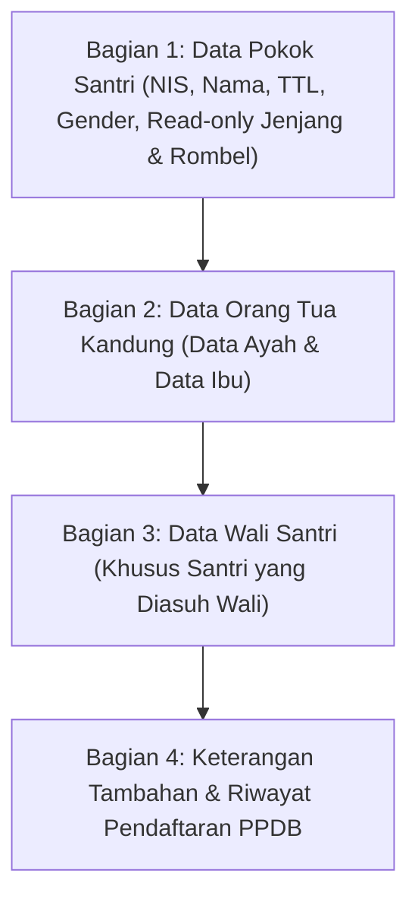

# STUDENT PORTAL ACCESS, AUTHENTICATION & BIODATA AUDIT REPORT
**Audit Sistem Autentikasi NIS Murni, Perlindungan Kolom Akademik & Restrukturisasi Tampilan Biodata**  
*Yayasan At Tarbiyyah Wijaya Kusuma Samarinda*

---

## 1. Audit Sistem Autentikasi: Mengapa Ada Email Buatan & Login Ganda?

### A. Temuan Email Fiktif (`20266051@siswa.yayasan.sch.id`)
Berdasarkan pemeriksaan baris kode `frontend/shared/js/api.js` (baris 412, 2635, 3054):
```javascript
// Baris 3054
const studentEmail = reg.email || reg.parent_email || (cleanPhone ? `${studentNis}@siswa.yayasan.sch.id` : `siswa_${studentNis}@yayasan.sch.id`);
```
**Mengapa ini terjadi sebelumnya?**
- Arsitektur bawaan modul autentikasi awal meniru pola Supabase Auth standar yang mewajibkan kolom `email` sebagai pengenal primer unik (*primary identity*).
- Untuk mengakomodasi santri PAUD/TPQ yang belum memiliki email pribadi, pengembang terdahulu membuat skrip generator email buatan berbasis NIS (`NIS@siswa.yayasan.sch.id`).

### B. Masalah yang Ditimbulkan:
1. Membingungkan orang tua santri dan pengurus yayasan yang mengira email tersebut adalah akun email Google Workspace/Microsoft aktif.
2. Membuka celah login ganda (sebagian santri login via email fiktif, sebagian via NIS, sebagian via nomor registrasi).

### C. Solusi Standarisasi: NIS Sebagai Identitas Login Murni (Single Identifier)
- Tabel `users` pada basis data Supabase memiliki kolom `username` dan `nis`. Keduanya sudah mendukung pencarian langsung tanpa memerlukan format `@domain`.
- **Ketentuan Baru**:
  1. Username resmi siswa aktif adalah **NIS** (cth: `20266051`).
  2. Field `email` pada tabel `users` dikembalikan ke fungsi aslinya sebagai field kontak opsional (hanya diisi jika orang tua memiliki email asli). Jika tidak ada, kolom email dibiarkan kosong (`NULL`) atau diisi email riil orang tua.
  3. Nomor registrasi (`REG-2026-XXXX`) **dihapus sepenuhnya dari daftar identitas login Portal Siswa**. Nomor registrasi hanya berlaku untuk pencarian status di halaman publik PPDB.

---

## 2. Audit Password Awal & Tampilan Status PPDB

### A. Mengapa di Halaman Cek Status Muncul Tulisan `[TERENKRIPSI]`?
Pada audit perbaikan BUG-005 sebelumnya, kami membersihkan seluruh teks kata sandi terbuka (*plaintext password*) dari kolom `notes` dan `form_metadata` demi kepatuhan keamanan data. Sebagai penggantinya, field metadata diisi string penanda `[TERENKRIPSI]`.

Namun, pada berkas [`frontend/public/ppdb/status.html`](file:///d:/Source_code_yayasan/frontend/public/ppdb/status.html#L240):
```javascript
${r.portal_password ? `<strong>Sandi Portal Siswa:</strong> <span class="font-mono font-bold bg-white/20 px-1.5 py-0.5 rounded text-white">${escapeHtml(r.portal_password)}</span><br>` : ...}
```
Halaman status membaca properti tersebut secara mentah, sehingga layar menampilkan tulisan harfiah:  
`Sandi Portal Siswa: [TERENKRIPSI]`

### B. Rekomendasi Solusi Halaman Status PPDB:
Sesuai arahan Anda, konsep informasi tersebut disempurnakan:
1. **Dilarang Menampilkan Hash / Enkripsi**: Halaman tidak boleh menampilkan hash string SHA-256 maupun teks placeholder `[TERENKRIPSI]`.
2. **Tampilkan NIS Sebagai Username Resmi**: Begitu calon siswa berstatus `Converted`, NIS ditampilkan dengan tombol salin.
3. **Petunjuk Kata Sandi Edukatif**:
   Tampilkan instruksi ramah:  
   *"Silakan masuk ke Portal Siswa menggunakan Nomor Induk Siswa (NIS) di atas dan Kata Sandi Awal yang telah diterbitkan oleh Tata Usaha Yayasan saat verifikasi pendaftaran."*
4. **Alur Wajib Ganti Password**:
   Ketika siswa pertama kali berhasil login menggunakan kata sandi awal tersebut, modal sistem di `login.html` (baris 526–532) langsung mengunci navigasi dan **mewajibkan santri/orang tua membuat password baru** sebelum dapat mengakses dashboard akademik.

---

## 3. Celah Keamanan Backend: Perlindungan Kolom Identitas Akademik

### A. Temuan Kerentanan di `apiCall('siswa', 'update_biodata')`
Pada [`frontend/shared/js/api.js`](file:///d:/Source_code_yayasan/frontend/shared/js/api.js#L1116-L1199):
```javascript
// Baris 1116 - 1126
const validStuCols = [
  'nis', 'nisn', 'full_name', 'name', 'child_name', 'nickname', 'nik',
  'gender', 'birth_place', 'birth_date', 'class_id', 'class_name',
  'kelas_sekarang', 'semester_sekarang', 'status_kenaikan', 'status_kelulusan',
  'status_pendaftaran', 'parent_id', 'parent_name', 'father_name', 'mother_name',
  ...
  'program', 'level', 'registration_number', 'reg_number', 'status', 'is_active',
  'form_metadata', 'notes'
];

// Baris 1195 - 1199
for (const k of Object.keys(payload)) {
  if (!validStuCols.includes(k)) delete payload[k];
}
delete payload.id;
const res = await supabaseRest(`students?id=eq.${encodeURIComponent(id)}`, 'PATCH', payload);
```

### B. Analisis Resiko:
Daftar `validStuCols` menyertakan kolom identitas akademik tingkat yayasan:
- `nis` dan `nisn`
- `class_id`, `class_name`, `kelas_sekarang`
- `level` dan `program`
- `status` dan `is_active`
- `status_kelulusan` dan `status_kenaikan`

Jika seorang santri atau pihak luar yang memiliki token login siswa mengirimkan request HTTP manual:
```json
POST /api/v1/siswa/update_biodata
{
  "class_name": "Kelas Unggulan",
  "level": "Tahfidz",
  "status": "graduated"
}
```
Engine backend Supabase REST akan meloloskan request tersebut dan memperbarui database `students`!

### C. Solusi Proteksi Backend (Strict Whitelist):
Pada modul `siswa` action `update_biodata`, buat penyaringan tegas:
```javascript
// Hapus paksa seluruh field akademik yang dipegang yayasan
const FORBIDDEN_STUDENT_FIELDS = [
  'id', 'nis', 'nisn', 'class_id', 'class_name', 'kelas_sekarang',
  'level', 'program', 'status', 'is_active', 'status_kelulusan',
  'status_kenaikan', 'status_pendaftaran', 'registration_number',
  'monthly_spp_amount', 'user_id'
];
FORBIDDEN_STUDENT_FIELDS.forEach(f => delete payload[f]);
```
Dengan mekanisme ini, siswa hanya berhak memperbarui biodata personal murni (nama panggilan, hobi, cita-cita, bahasa sehari-hari, nomor kontak darurat).

---

## 4. Penataan Ulang Tampilan Biodata: Pemisahan Data Wali & Keterangan Tambahan

### A. Kondisi Tampilan Saat Ini:
Pada [`frontend/portal/siswa/biodata.html`](file:///d:/Source_code_yayasan/frontend/portal/siswa/biodata.html#L297-L360), bagian 3 diberi judul **"Data Wali & Keterangan Tambahan"**. Di dalamnya terdapat:
- Nama Lengkap Wali, Hubungan Keluarga, Pekerjaan, No. Telepon
- **Campur aduk langsung dengan**: Sarana transportasi sekolah, jarak ke sekolah, bahasa harian anak, dan catatan khusus santri.

### B. Struktur Rapi Baru yang Diusulkan:



1. **Bagian 3: Data Wali Santri**:
   - Khusus memuat informasi figur wali: Nama Lengkap Wali, Hubungan Kekeluargaan, Pekerjaan Wali, Alamat Tinggal Wali, dan Nomor Kontak/WA Wali.
2. **Bagian 4: Keterangan Tambahan & Informasi Penunjang**:
   - Khusus memuat informasi operasional santri: Jarak Tempat Tinggal ke Yayasan (km), Moda Transportasi ke Sekolah, Bahasa Sehari-hari di Rumah, Catatan Kebutuhan Khusus / Alergi / Karakteristik Santri.
   - Bersifat rapi, modular, dan tidak tumpang tindih.
