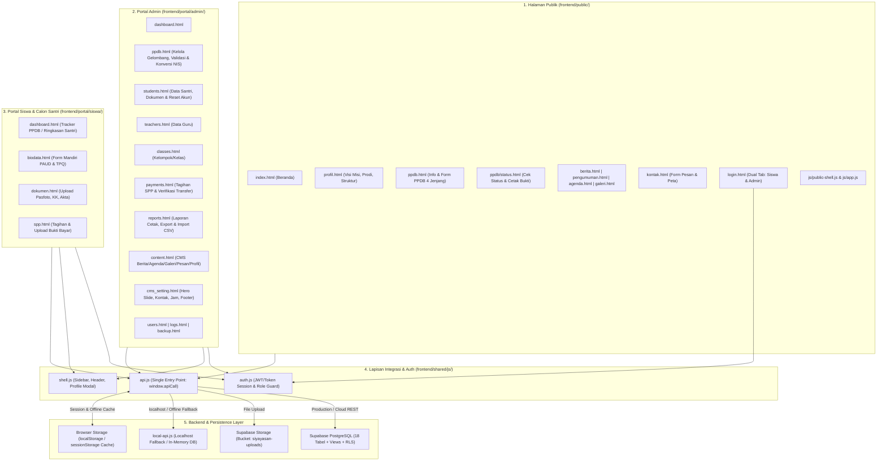
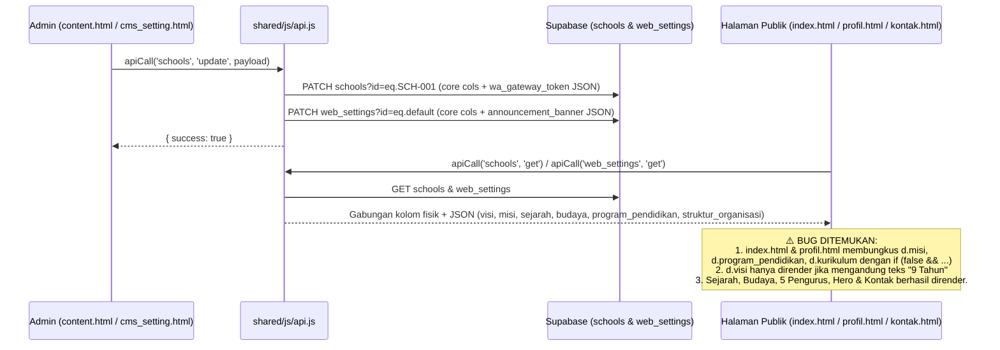
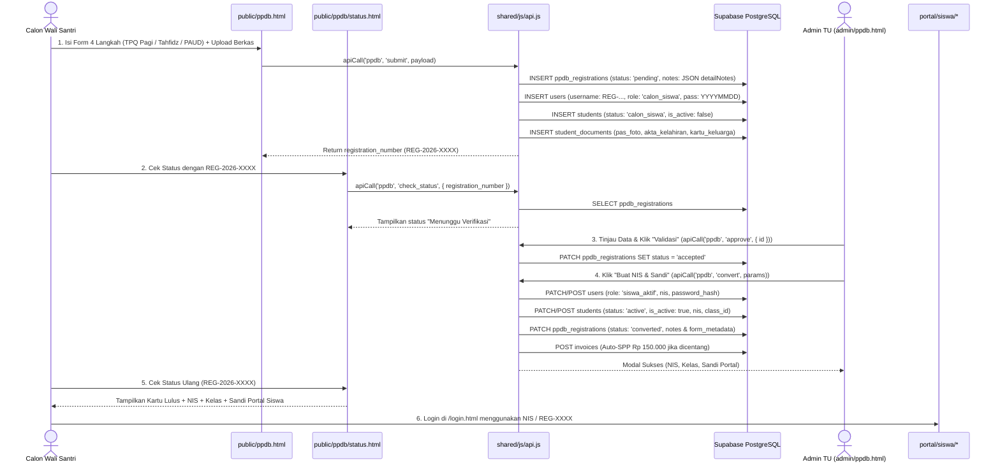
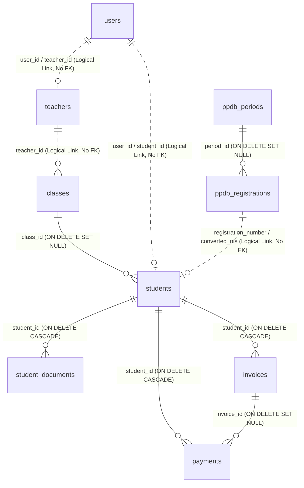
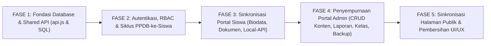

# FULL SYSTEM AUDIT & INTEGRATION ANALYSIS — SIYAYASAN V2
**Yayasan At Tarbiyyah Wijaya Kusuma Samarinda**  
**Tanggal Audit:** 2 November 2026  
**Metode Audit:** Read-Only End-to-End Architecture & Data Flow Audit  
**Status Kode Saat Audit:** Clean Working Tree (`commit b072361` — `origin/main`) — *Tidak ada perubahan kode yang dilakukan selama audit ini.*

---

## DAFTAR ISI DOKUMEN
1. **[BAGIAN 1: DOKUMENTASI ARSITEKTUR & INTEGRASI SISTEM](#bagian-1-dokumentasi-arsitektur--integrasi-sistem)**
   - 1.1 Gambaran Arsitektur Keseluruhan Sistem
   - 1.2 Inventarisasi Seluruh Modul & Fitur Sistem
   - 1.3 Pemetaan Hubungan Antarmodul (Cross-Module Dependency Matrix)
   - 1.4 Alur Integrasi Data End-to-End (Halaman Publik ↔ Database ↔ Admin)
   - 1.5 Alur Siklus Hidup PPDB (Pendaftaran → Verifikasi → Konversi Siswa Aktif)
   - 1.6 Alur Komunikasi Portal Admin dengan Portal Siswa
   - 1.7 Pemetaan API, Endpoint, Tabel Database, Relasi Foreign Key & Dependensi
   - 1.8 Ringkasan Titik Integrasi yang Bermasalah & Potensi Risiko Stabilitas
2. **[BAGIAN 2: LAPORAN AUDIT PORTAL ADMIN (12 MODUL + SHARED AUTH/SHELL)](#bagian-2-laporan-audit-portal-admin)**
3. **[BAGIAN 3: DAFTAR TEMUAN AUDIT (CRITICAL, HIGH, MEDIUM, LOW)](#bagian-3-daftar-temuan-audit)**
4. **[BAGIAN 4: MASTER IMPROVEMENT PLAN (RENCANA PERBAIKAN TERSTRUKTUR)](#bagian-4-master-improvement-plan)**
5. **[BAGIAN 5: SYSTEM READINESS ASSESSMENT (PENILAIAN KESIAPAN OPERASIONAL)](#bagian-5-system-readiness-assessment)**

---

# BAGIAN 1: DOKUMENTASI ARSITEKTUR & INTEGRASI SISTEM

## 1.1 Gambaran Arsitektur Keseluruhan Sistem

Sistem **SIYAYASAN V2** dibangun menggunakan arsitektur **Multi-Page Application (MPA) berbasis HTML5 + Tailwind CSS + Vanilla JavaScript Modular** yang berkomunikasi melalui satu lapisan abstraksi API terpusat (`window.apiCall(module, action, params, method)` di [api.js](file:///d:/Source_code_yayasan/frontend/shared/js/api.js)).

Lapisan API tersebut memiliki **Dual-Backend Routing Strategy** ([api.js](file:///d:/Source_code_yayasan/frontend/shared/js/api.js#L220-L230)):
1. **Mode Produksi / Cloud (Supabase Direct REST & Storage):**  
   Secara default di domain publik (mis. Vercel), `api.js` memanggil **Supabase PostgREST API** (`/rest/v1/<table>`) menggunakan `supabaseRest()` ([api.js](file:///d:/Source_code_yayasan/frontend/shared/js/api.js#L71-L132)) dan mengunggah berkas ke **Supabase Storage Bucket** `siyayasan-uploads` melalui `uploadToSupabaseStorage()` ([api.js](file:///d:/Source_code_yayasan/frontend/shared/js/api.js#L137-L197)) dengan fallback otomatis ke Base64 DataURL jika unggahan bucket gagal.
2. **Mode Lokal / Offline Fallback (`dev-server.js` + `local-api.js` + `localStorage`):**  
   Ketika diakses melalui `localhost` / `127.0.0.1` atau saat `isSupabaseOffline === true` ([api.js](file:///d:/Source_code_yayasan/frontend/shared/js/api.js#L224-L229)), `apiCall()` terlebih dahulu mencegat request ke endpoint lokal `/api/v1/:module/:action` yang dilayani oleh [dev-server.js](file:///d:/Source_code_yayasan/frontend/dev-server.js#L138-L180) dan diproses oleh mesin database JSON in-memory/file di [local-api.js](file:///d:/Source_code_yayasan/frontend/local-api.js#L336-L2460).

---

## 1.2 Inventarisasi Seluruh Modul & Fitur Sistem

| Area Sistem | File / Modul | Fungsi Utama | Peran Pengguna (Role) |
|---|---|---|---|
| **Halaman Publik** | [index.html](file:///d:/Source_code_yayasan/frontend/public/index.html) | Hero carousel dinamis, ringkasan Visi & Misi, 3 Kartu Program Studi (TPQ Pagi, Tahfidz, KB Ulinnuha PAUD), berita terbaru, banner CTA PPDB | Publik (Anonim) |
| **Halaman Publik** | [profil.html](file:///d:/Source_code_yayasan/frontend/public/profil.html) | Sejarah yayasan, Visi & Misi, Budaya, Kurikulum, Program Pendidikan, 5 Kartu Struktur Organisasi, Legalitas & Perizinan | Publik (Anonim) |
| **Halaman Publik** | [ppdb.html](file:///d:/Source_code_yayasan/frontend/public/ppdb.html) | Jadwal & alur PPDB dinamis, syarat pendaftaran, formulir pendaftaran multi-step (4 unit: `TPQ Pagi`, `Tahfidz Pra PTPT`, `Tahfidz PTPT`, `KB Ulinnuha (PAUD)`), kartu bukti registrasi & cetak | Publik / Calon Wali Santri |
| **Halaman Publik** | [ppdb/status.html](file:///d:/Source_code_yayasan/frontend/public/ppdb/status.html) | Pencarian status PPDB (`REG-YYYY-XXXX`), tampilkan status seleksi (`pending`, `approved`, `converted`, `rejected`), kredensial NIS & Sandi Portal, cetak surat bukti resmi | Publik / Calon Wali Santri |
| **Halaman Publik** | [login.html](file:///d:/Source_code_yayasan/frontend/public/login.html) | Autentikasi 2 tab (`Siswa` dengan NIS/No. Registrasi & `Admin` dengan Email), modal ganti password saat login pertama (`is_password_changed === false`) | Semua Pengguna |
| **Halaman Publik** | [berita.html](file:///d:/Source_code_yayasan/frontend/public/berita.html) & [berita/detail.html](file:///d:/Source_code_yayasan/frontend/public/berita/detail.html) | Daftar artikel berita dengan filter kategori (`kegiatan`, `prestasi`, `parenting`), pencarian, dan halaman baca berita penuh + berita terkait | Publik (Anonim) |
| **Halaman Publik** | [pengumuman.html](file:///d:/Source_code_yayasan/frontend/public/pengumuman.html), [agenda.html](file:///d:/Source_code_yayasan/frontend/public/agenda.html), [galeri.html](file:///d:/Source_code_yayasan/frontend/public/galeri.html) | Daftar pengumuman resmi (pinned & badge target), agenda kegiatan yayasan, serta galeri foto dokumentasi dengan lightbox | Publik (Anonim) |
| **Halaman Publik** | [kontak.html](file:///d:/Source_code_yayasan/frontend/public/kontak.html) | Informasi alamat, telepon/WA, jam operasional, peta Google Maps interaktif, dan formulir kirim pesan konsultasi (tersimpan ke DB + redirect WA) | Publik (Anonim) |
| **Shared Public** | [public-shell.js](file:///d:/Source_code_yayasan/frontend/public/js/public-shell.js) & [app.js](file:///d:/Source_code_yayasan/frontend/public/js/app.js) | Injeksi header/navbar dropdown, footer, tombol WA melayang, hidrasi identitas sekolah dari `web_settings`/`schools`, dan loader berita beranda | Publik (Anonim) |
| **Portal Admin** | [dashboard.html](file:///d:/Source_code_yayasan/frontend/portal/admin/dashboard.html) | Ringkasan statistik siswa, kelas, guru, PPDB, keuangan SPP, tombol aksi cepat, dan log aktivitas terbaru | `super_admin`, `admin_tu` |
| **Portal Admin** | [ppdb.html](file:///d:/Source_code_yayasan/frontend/portal/admin/ppdb.html) | Pengaturan buka/tutup & jadwal periode PPDB, daftar pendaftar, pratinjau detail & berkas PAUD/TPQ, edit data pendaftar, validasi (`approve`), tolak (`reject`), konversi jadi siswa aktif (`convert` -> terbit NIS, kelas, sandi portal, tagihan SPP awal) | `super_admin`, `admin_tu` |
| **Portal Admin** | [students.html](file:///d:/Source_code_yayasan/frontend/portal/admin/students.html) | CRUD data siswa aktif, pratinjau dokumen siswa, pintasan cek SPP siswa, reset password akun portal siswa ke tanggal lahir + kirim via WA | `super_admin`, `admin_tu` |
| **Portal Admin** | [teachers.html](file:///d:/Source_code_yayasan/frontend/portal/admin/teachers.html) | CRUD data guru/tenaga pendidik, aktivasi/nonaktivasi status mengajar | `super_admin`, `admin_tu` |
| **Portal Admin** | [classes.html](file:///d:/Source_code_yayasan/frontend/portal/admin/classes.html) | CRUD data kelompok/kelas belajar, penetapan wali kelas (`teachers`), kapasitas, dan pintasan lihat daftar siswa per kelas | `super_admin`, `admin_tu` |
| **Portal Admin** | [payments.html](file:///d:/Source_code_yayasan/frontend/portal/admin/payments.html) | KPI keuangan, buat tagihan SPP individu & massal per kelas, pelunasan tunai (`mark_paid`), kirim pengingat WA, cetak kuitansi & rekap SPP, verifikasi bukti transfer dari Portal Siswa | `super_admin`, `admin_tu` |
| **Portal Admin** | [reports.html](file:///d:/Source_code_yayasan/frontend/portal/admin/reports.html) | Generator 4 laporan resmi (Siswa, Keuangan SPP, PPDB, Eksekutif), cetak ber-kop surat, ekspor `.xls` & `.csv`, serta import massal CSV untuk Siswa & Tagihan SPP | `super_admin`, `admin_tu` |
| **Portal Admin** | [content.html](file:///d:/Source_code_yayasan/frontend/portal/admin/content.html) | 6 Tab: CRUD Berita, Pengumuman, Agenda, Galeri, Pesan Kontak Masuk (balas WA & hapus), serta Pengaturan Identitas & Profil Lengkap Sekolah (Visi, Misi, Sejarah, Budaya, Prodi, 5 Pengurus Organisasi) | `super_admin`, `admin_tu` |
| **Portal Admin** | [cms_setting.html](file:///d:/Source_code_yayasan/frontend/portal/admin/cms_setting.html) | Manajemen gambar Hero Carousel Beranda, informasi kontak & peta, jam operasional, tautan media sosial, dan foto latar footer/login | `super_admin`, `admin_tu` |
| **Portal Admin** | [users.html](file:///d:/Source_code_yayasan/frontend/portal/admin/users.html), [logs.html](file:///d:/Source_code_yayasan/frontend/portal/admin/logs.html), [backup.html](file:///d:/Source_code_yayasan/frontend/portal/admin/backup.html) | Manajemen akun pengguna sistem, peninjauan jejak audit (`activity_logs`), serta pencadangan & pemulihan database JSON penuh (14 tabel) | `super_admin`, `admin_tu` |
| **Portal Siswa** | [dashboard.html](file:///d:/Source_code_yayasan/frontend/portal/siswa/dashboard.html) | Tampilan adaptif: Step Tracker PPDB 4 tahap untuk `calon_siswa` atau Kartu Identitas + Ringkasan SPP untuk `siswa_aktif`, disertai papan pengumuman | `siswa_aktif`, `calon_siswa` |
| **Portal Siswa** | [biodata.html](file:///d:/Source_code_yayasan/frontend/portal/siswa/biodata.html) | Formulir pembaruan biodata mandiri (36 field mencakup field khusus KB Ulinnuha PAUD & TPQ Ulinnuha) | `siswa_aktif`, `calon_siswa` |
| **Portal Siswa** | [dokumen.html](file:///d:/Source_code_yayasan/frontend/portal/siswa/dokumen.html) | Unggah & pratinjau 3 dokumen utama (`foto` Pasfoto 3x4, `kk` Kartu Keluarga, `akte` Akta Kelahiran) ke Supabase Storage | `siswa_aktif`, `calon_siswa` |
| **Portal Siswa** | [spp.html](file:///d:/Source_code_yayasan/frontend/portal/siswa/spp.html) | Daftar tagihan SPP santri, unggah bukti transfer pembayaran, riwayat pembayaran, dan cetak kuitansi pembayaran mandiri | `siswa_aktif` (Diblokir untuk `calon_siswa`) |

---

## 1.3 Pemetaan Hubungan Antarmodul (Cross-Module Dependency Matrix)

Tabel berikut memetakan bagaimana perubahan pada satu modul memengaruhi modul lainnya di seluruh ekosistem SIYAYASAN:

| Modul Sumber (Producer) | Data / Entitas yang Diubah | Modul Tujuan yang Bergantung (Consumer) | Status Integrasi Saat Ini |
|---|---|---|---|
| **Admin: `content.html` (Tab Identitas Sekolah)** | `schools` & `web_settings` (`sejarah`, `budaya`, `struktur_organisasi`, `address`, `phone`, `whatsapp`, `maps_embed_url`) | **Publik:** `profil.html` (Sejarah, Budaya, 5 Pengurus), `kontak.html`, `public-shell.js` (Header/Footer/WA) | **PARSIAL** — Sejarah, Budaya, Struktur Organisasi, Kontak & WA tersinkronisasi; **TETAPI** `visi`, `misi`, `program_pendidikan`, dan `kurikulum` **terkunci mati** oleh `if (false && ...)` di `index.html` & `profil.html`! Nama Yayasan di Header/Footer juga di-hardcode di `public-shell.js`. |
| **Admin: `content.html` (Tab Berita, Pengumuman, Agenda, Galeri)** | Tabel `news`, `announcements`, `events`, `galleries` | **Publik:** `index.html`, `berita.html`, `berita/detail.html`, `pengumuman.html`, `agenda.html`, `galeri.html` **Portal Siswa:** `siswa/dashboard.html` (Pengumuman) | **BERMASALAH PADA DRAFT & AGENDA** — `agenda.html` mengalami crash JS (`injectEventSchema is not defined`); `pengumuman.html` & `agenda.html` menampilkan item berstatus `draft` ke publik; `content.html` tidak memiliki tombol Edit untuk item yang sudah dibuat. |
| **Admin: `cms_setting.html`** | `web_settings` (`hero_images`, `operational_hours`, `footer_bg_url`, `maps_url`, medsos) | **Publik:** `index.html` (Hero Carousel), `kontak.html` (Jam kerja & Peta), `login.html` (Background), `public-shell.js` (Footer BG) | **TERVERIFIKASI BERFUNGSI** — Tersinkronisasi ke `web_settings` dan `schools` (melalui JSON container `announcement_banner` & `wa_gateway_token`). |
| **Admin: `ppdb.html` (Pengaturan Periode)** | `ppdb_periods` (`status`, `academic_year`, jadwal pendaftaran, `notes`) | **Publik:** `index.html` (Banner CTA), `profil.html` (CTA), `ppdb.html` (Buka/Tutup Formulir & Tabel Jadwal) | **TERVERIFIKASI BERFUNGSI (DENGAN RISIKO DB)** — Berfungsi jika baris `PER-2026-1` sudah ada di DB; namun jika tabel `ppdb_periods` kosong, `POST` fallback di `api.js` gagal karena tidak mengirim `start_date` & `end_date` (`NOT NULL`). |
| **Publik: `ppdb.html` (Submit Formulir PPDB)** | `ppdb_registrations`, `users` (`calon_siswa`), `students` (`calon_siswa`), `student_documents` | **Publik:** `ppdb/status.html` **Admin:** `ppdb.html`, `dashboard.html`, `reports.html`, `students.html` **Siswa:** `siswa/dashboard.html`, `biodata.html`, `dokumen.html` | **BERMASALAH (HIGH/CRITICAL)** — 1) `nik` tidak dikirim di top-level payload sehingga kosong di DB; 2) `detailNotes` hanya disimpan di kolom `notes` (bukan `form_metadata`), rawan terhapus saat Admin menolak/mengedit; 3) `students` yang dibuat berstatus `'calon_siswa'` bocor ke daftar siswa aktif di `admin/students.html`; 4) Session `localStorage` Admin tertimpa otomatis jika Admin mengetes form PPDB. |
| **Admin: `ppdb.html` (`Validasi` / `Tolak` / `Konversi NIS`)** | `ppdb_registrations`, `students` (`active`), `users` (`siswa_aktif`), `classes`, `invoices` (Auto-SPP) | **Publik:** `ppdb/status.html` (Kartu Lulus + NIS + Sandi), `login.html` **Admin:** `students.html`, `payments.html` **Siswa:** `siswa/dashboard.html`, `biodata.html`, `spp.html` | **BERMASALAH PADA METADATA & LOGIN** —Saat konversi di `api.js`, 20+ field detail PAUD/TPQ tidak disalin ke tabel `students`; `users.birth_date` tidak diisi sehingga login fallback Tanggal Lahir gagal; jika Admin mengisi `portal_password` kustom, ringkasan teks tetap menampilkan tanggal lahir. |
| **Portal Siswa: `biodata.html` & `dokumen.html`** | `students`, `ppdb_registrations`, `student_documents` | **Admin:** `ppdb.html` (Tinjau Data & Berkas), `students.html` (Edit Siswa & Dokumen) | **RUSAK KRITIS DI SUPABASE (`biodata.html`) & LOCALHOST (`calon_siswa`)** — `biodata.html` mengirim 22 kolom yang tidak ada di skema SQL `students`, melampaui batas retry 8 kolom di `supabaseRest()` sehingga gagal total (HTTP 400)! Di mode `local-api.js`, `calon_siswa` justru mengedit data `STU-001`. |
| **Portal Siswa: `spp.html` ↔ Admin: `payments.html`** | `invoices` (`unpaid` -> `menunggu_verifikasi` -> `paid`), `payments` (`proof_image_url`, `status`) | **Admin:** `payments.html` (Tab Verifikasi Bukti Transfer & KPI), `dashboard.html`, `reports.html` **Siswa:** `spp.html`, `siswa/dashboard.html` | **TERVERIFIKASI BERFUNGSI DI SUPABASE** — Alur buat tagihan -> siswa unggah bukti -> status tagihan menjadi `menunggu_verifikasi` -> Admin verifikasi -> status `paid` berjalan konsisten di Supabase. (Di `local-api.js`, tagihan dummy otomatis dibuat jika tagihan kosong). |

---

## 1.4 Alur Integrasi Data End-to-End (Halaman Publik ↔ Database ↔ Admin)

### A. Alur Pengaturan Identitas, Visi & Misi, Program Studi, dan CMS

### B. Temuan Penting pada Integrasi Halaman Publik (Visi & Misi, Program Studi, PPDB)
1. **Visi & Misi (`index.html` & `profil.html` ↔ `admin/content.html`)**:
   - Di Portal Admin ([content.html](file:///d:/Source_code_yayasan/frontend/portal/admin/content.html#L769-L796)), Admin memiliki form editor lengkap untuk mengubah **Visi** (`#sch-visi`), **Misi** (`#sch-misi`), dan **Budaya** (`#sch-budaya`), yang berhasil disimpan oleh `api.js` ke dalam JSON container `schools.wa_gateway_token` dan `web_settings.announcement_banner`.
   - Namun, di [index.html](file:///d:/Source_code_yayasan/frontend/public/index.html#L706-L725) dan [profil.html](file:///d:/Source_code_yayasan/frontend/public/profil.html#L504-L523), kode pembaruan DOM dikunci dengan:
     - `if (d.visi && d.visi.includes('9 Tahun'))` — jika Admin mengubah kalimat Visi tanpa frasa `"9 Tahun"`, perubahan tidak pernah tampil di publik.
     - `if (false && d.misi)` — blok render Misi dinonaktifkan secara permanen dengan `false &&`, sehingga perubahan Misi dari Admin tidak pernah tampil di halaman publik.
2. **Program Studi / Unit Pendidikan (`index.html`, `profil.html`, `ppdb.html` ↔ `admin/content.html`, `admin/classes.html`)**:
   - Halaman publik telah diperbarui menggunakan struktur unit pendidikan terbaru:
     - **TPQ Ulinnuha — Jenjang TPQ Pagi**
     - **TPQ Ulinnuha — Jenjang Tahfidz (Pra PTPT & PTPT)**
     - **KB Ulinnuha (PAUD)**
   - Namun di [index.html](file:///d:/Source_code_yayasan/frontend/public/index.html#L726-L748) dan [profil.html](file:///d:/Source_code_yayasan/frontend/public/profil.html#L528-L548), sinkronisasi `d.program_pendidikan` dan `d.kurikulum` juga dikunci dengan `if (false && ...)`.
   - Selain itu, form editor di Portal Admin ([content.html](file:///d:/Source_code_yayasan/frontend/portal/admin/content.html#L814-L826)) masih menampilkan 3 kotak input lama: **Program PAUD (KB)** (`#sch-program-paud`), **Program TK (A & B)** (`#sch-program-tk`), dan **Program TPQ** (`#sch-program-tpq`).

---

## 1.5 Alur Siklus Hidup PPDB (Pendaftaran → Verifikasi → Konversi Siswa Aktif)

### Titik Kritis pada Siklus Hidup PPDB yang Ditemukan dalam Audit:
1. **Kehilangan `nik` dan Metadata Detail di `form_metadata` Saat Submit (`ppdb.html` -> `api.js`)**:
   - `ppdb.html` ([ppdb.html](file:///d:/Source_code_yayasan/frontend/public/ppdb.html#L2038-L2090)) membungkus seluruh data spesifik PAUD & TPQ (`nik`, `child_order`, `siblings_count`, `mutasi`, `full_address`, `father`, `mother`, `guardian`) ke dalam JSON string `payload.notes = JSON.stringify(detailNotes)`, dan **tidak** menyertakan `nik` di top-level `payload`.
   - Di [api.js](file:///d:/Source_code_yayasan/frontend/shared/js/api.js#L2096-L2106), `cleanMeta` dibuat dari `{ ...params }` lalu `delete cleanMeta.notes` dijalankan **sebelum** menggabungkan isi `parsedNotes` ke dalam `cleanMeta`! Akibatnya, kolom `ppdb_registrations.form_metadata` tidak menyimpan objek `detailNotes`, dan kolom `ppdb_registrations.nik` serta `students.nik` bernilai string kosong `''`.
2. **Kerentanan Penghapusan Metadata JSON di Kolom `notes`**:
   - Karena `detailNotes` hanya tersimpan di kolom `notes` (sebagai string JSON), ketika Admin menolak pendaftaran (`ppdb/reject` di [api.js](file:///d:/Source_code_yayasan/frontend/shared/js/api.js#L2506)), `api.js` menimpa kolom `notes` dengan teks alasan penolakan (`notes: params.reason || ''`), sehingga seluruh data JSON biodata pendaftar di kolom `notes` hilang permanen.
3. **Kebocoran Data `calon_siswa` ke Daftar Siswa Aktif (`admin/students.html`)**:
   - Saat pendaftar mengisi form PPDB publik, `api.js` ([api.js](file:///d:/Source_code_yayasan/frontend/shared/js/api.js#L2245)) membuat baris bayangan di tabel `students` dengan `status: 'calon_siswa'`.
   - Namun ketika Admin membuka menu **Manajemen Siswa** ([students.html](file:///d:/Source_code_yayasan/frontend/portal/admin/students.html#L316)), `apiCall('students', 'list')` di [api.js](file:///d:/Source_code_yayasan/frontend/shared/js/api.js#L1465) memfilter dengan `status=neq.pending`. Karena `'calon_siswa' !== 'pending'`, seluruh pendaftar PPDB yang belum diterima ikut muncul di daftar Siswa Aktif dengan label status `"Aktif"`!

---

## 1.6 Alur Komunikasi Portal Admin dengan Portal Siswa

1. **Sinkronisasi Biodata (`portal/siswa/biodata.html` ↔ `admin/students.html` & `admin/ppdb.html`)**:
   - Siswa/Wali mengedit 36 field biodata di [biodata.html](file:///d:/Source_code_yayasan/frontend/portal/siswa/biodata.html#L478-L522) dan memanggil `apiCall('siswa', 'update_biodata', payload)`.
   - **Kegagalan Kritis di Supabase**: Tabel `students` di PostgreSQL ([MASTER_SUPABASE_SETUP_V2.sql](file:///d:/Source_code_yayasan/database/MASTER_SUPABASE_SETUP_V2.sql#L152-L187)) hanya memiliki kolom dasar dan **tidak memiliki 22 kolom tambahan PAUD/TPQ** (`citizenship`, `child_order`, `child_status`, `siblings_count`, `siblings_step`, `siblings_adopted`, `daily_language`, `special_traits`, `father_job`, `father_education`, `father_ttl`, `phone_2`, `father_phone_office`, `mother_job`, `mother_education`, `mother_ttl`, `guardian_name`, `guardian_relation`, `guardian_job`, `guardian_phone`, `distance_km`, `transport_mode`).
   - Fungsi `supabaseRest()` ([api.js](file:///d:/Source_code_yayasan/frontend/shared/js/api.js#L107)) hanya mampu menghapus 1 kolom tak dikenal per percobaan ulang hingga maksimal **8 kali (`_retryCount < 8`)**. Pada kolom ke-9, request `PATCH students` berhenti dan melempar error HTTP 400 (`Could not find the '...' column of 'students' in the schema cache`).
2. **Sinkronisasi Dokumen (`portal/siswa/dokumen.html` ↔ `admin/ppdb.html` & `admin/students.html`)**:
   - Siswa mengunggah Pasfoto (`foto`), KK (`kk`), dan Akta (`akte`) di [dokumen.html](file:///d:/Source_code_yayasan/frontend/portal/siswa/dokumen.html#L266).
   - `api.js` ([api.js](file:///d:/Source_code_yayasan/frontend/shared/js/api.js#L967-L1053)) menyimpan berkas ke tabel `student_documents` (dengan tipe ternormalisasi `pas_foto`, `kartu_keluarga`, `akta_kelahiran`) dan memperbarui `students.photo_url` serta `ppdb_registrations`.
   - Namun, sinkronisasi ke `ppdb_registrations` di [api.js](file:///d:/Source_code_yayasan/frontend/shared/js/api.js#L1044) mencari berdasarkan `full_name=eq.${nameMatch}` (bukan `registration_number`), sehingga rawan gagal jika nama diubah atau ada nama kembar.
3. **Sinkronisasi Tagihan & Pembayaran SPP (`admin/payments.html` ↔ `portal/siswa/spp.html`)**:
   - Admin menerbitkan tagihan di `payments.html` (`invoices/create` atau `invoices/create_bulk`) -> muncul di `siswa/spp.html` dan `siswa/dashboard.html` melalui `apiCall('siswa', 'get_spp')`.
   - Siswa mengunggah bukti transfer di `siswa/spp.html` (`payments/create`) -> `api.js` ([api.js](file:///d:/Source_code_yayasan/frontend/shared/js/api.js#L1898-L1913)) membuat baris di `payments` dengan `status: 'menunggu_verifikasi'` dan mengubah `invoices.status` menjadi `'menunggu_verifikasi'`.
   - Admin memverifikasi bukti di tab **Verifikasi Bukti Transfer** (`payments/verify` atau `payments/reject`) -> `api.js` mengubah `payments.status = 'verified'` dan `invoices.status = 'paid'`.

---

## 1.7 Pemetaan API, Endpoint, Tabel Database, Relasi Foreign Key & Dependensi

### A. Matriks Modul API (`api.js` & `local-api.js`) terhadap Tabel Supabase PostgreSQL

| Modul `apiCall` | Action yang Tersedia | Tabel Supabase Terkait | Operasi REST | Catatan Integrasi / Ketergantungan |
|---|---|---|---|---|
| `auth` | `login`, `register`, `change_password`, `update_profile`, `me` | `users`, `students`, `ppdb_registrations` | `GET`, `POST`, `PATCH` | Mendukung login Email, NIS, dan `REG-YYYY-XXXX`. Fallback ke `SEED_USERS` & `localStorage`. |
| `web_settings` | `get`, `update` | `web_settings`, `schools` | `GET`, `POST`, `PATCH` | Menyimpan field tambahan di JSON `web_settings.announcement_banner` & menyinkronkan ke `schools.wa_gateway_token`. |
| `schools` | `get`, `update` | `schools`, `web_settings` | `GET`, `POST`, `PATCH` | Menyimpan profil lengkap yayasan (Visi, Misi, Sejarah, Budaya, 5 Pengurus) dan menyinkronkan ke `web_settings`. |
| `siswa` | `get_profile`, `update_biodata`, `get_documents`, `upload_document`, `get_spp` | `students`, `ppdb_registrations`, `student_documents`, `invoices`, `payments`, `classes` | `GET`, `POST`, `PATCH` | Menggunakan helper `resolveCurrentStudentRecord()` ([api.js](file:///d:/Source_code_yayasan/frontend/shared/js/api.js#L609-L664)). |
| `dashboard` | `index` / `stats` | `students`, `classes`, `teachers`, `ppdb_registrations`, `invoices`, `payments` | `GET` (6 tabel paralel) | Menghitung KPI siswa aktif, kelas, guru, pendaftar PPDB, dan keuangan SPP secara real-time. |
| `users` | `list`, `get`, `create`, `update`, `activate`, `deactivate`, `delete` | `users` | `GET`, `POST`, `PATCH`, `DELETE` | Mengelola akun login sistem (`super_admin`, `admin_tu`, `siswa_aktif`, `calon_siswa`). |
| `teachers` | `list`, `get`, `create`, `update`, `activate`, `deactivate`, `delete` | `teachers` | `GET`, `POST`, `PATCH`, `DELETE` | Digunakan oleh `admin/teachers.html` dan dropdown wali kelas di `admin/classes.html`. |
| `classes` | `list`, `get`, `create`, `update`, `delete` | `classes`, `students`, `teachers` | `GET`, `POST`, `PATCH`, `DELETE` | `classes/list` menghitung jumlah siswa aktif (`student_count`) secara dinamis dari tabel `students`. |
| `students` | `list`, `get`, `create`, `update`, `reset_password`, `documents`, `delete` | `students`, `classes`, `users`, `student_documents`, `ppdb_registrations` | `GET`, `POST`, `PATCH`, `DELETE` | `students/documents` menggabungkan berkas dari `student_documents` dan fallback `ppdb_registrations`. |
| `invoices` | `list`, `create`, `create_bulk`, `mark_paid`, `delete` | `invoices`, `students`, `classes`, `payments` | `GET`, `POST`, `PATCH`, `DELETE` | `mark_paid` melunasi tagihan dan otomatis mencatat transaksi tunai di tabel `payments`. |
| `payments` | `summary`, `list`, `create`, `verify`, `reject` | `payments`, `invoices`, `students` | `GET`, `POST`, `PATCH` | Mengelola pembayaran SPP dan verifikasi bukti transfer wali santri. |
| `ppdb` | `list`, `get`, `submit`, `check_status`, `period`, `update_period`, `update`, `delete`, `approve`, `reject`, `convert` | `ppdb_registrations`, `ppdb_periods`, `users`, `students`, `student_documents`, `classes`, `invoices` | `GET`, `POST`, `PATCH`, `DELETE` | Modul paling kompleks yang menghubungkan pendaftaran publik, verifikasi admin, pembuatan akun portal siswa, dan tagihan SPP perdana. |
| `news` | `list`, `get`, `create`, `update`, `remove`/`delete` | `news` | `GET`, `POST`, `PATCH`, `DELETE` | Mendukung pencarian berdasarkan `slug` atau `id`. |
| `announcements` | `list`, `create`, `update`, `remove`/`delete` | `announcements` | `GET`, `POST`, `PATCH`, `DELETE` | Mendukung filter `target_role` / `target_audience` dan `is_pinned`. |
| `events` | `list`, `create`, `update`, `remove`/`delete` | `events` | `GET`, `POST`, `PATCH`, `DELETE` | Menyimpan agenda kegiatan di kolom `date` & `event_date`. |
| `gallery` / `galleries` | `list`, `create`, `update`, `remove`/`delete` | `galleries` (dan view `gallery`) | `GET`, `POST`, `PATCH`, `DELETE` | Menyimpan foto dokumentasi di `image_url`. |
| `logs` | `list` | `activity_logs` (dan view `logs`) | `GET`, `POST` | Dicatat otomatis oleh `recordActivityLog()` pada aksi-aksi krusial. |
| `reports` | `generate`, `import_invoices`, `import_students` | `students`, `invoices`, `ppdb_registrations`, `classes` | `GET`, `POST` | Menghasilkan struktur tabel laporan dan mengimpor baris CSV ke Supabase. |
| `backup` | `backups`/`list`, `create`, `restore`, `delete` | 14 Tabel Utama + `web_settings` | `GET`, `POST`, `PATCH` | Mengunduh snapshot JSON 14 tabel dan memulihkan via `Prefer: resolution=merge-duplicates`. |
| `contact` / `contact_messages` | `list`, `create`, `mark_read`/`update`, `delete` | `contact_messages` | `GET`, `POST`, `PATCH`, `DELETE` | Menampung pesan dari `public/kontak.html` untuk ditinjau di `admin/content.html`. |

### B. Skema Relasi Foreign Key & Kesenjangan Kolom Database (`MASTER_SUPABASE_SETUP_V2.sql` & `patch_missing_columns.sql`)

#### Kesenjangan Skema Database terhadap Kebutuhan Frontend Terbaru:
1. **Tabel `students`**:
   - **Belum memiliki kolom `form_metadata JSONB` atau `notes TEXT`**, serta belum memiliki 22 kolom spesifik PAUD/TPQ yang dikirim oleh `portal/siswa/biodata.html`.
   - Nama kolom pekerjaan orang tua di SQL adalah `father_occupation` dan `mother_occupation` ([MASTER_SUPABASE_SETUP_V2.sql](file:///d:/Source_code_yayasan/database/MASTER_SUPABASE_SETUP_V2.sql#L457-L458)), sedangkan `ppdb.html` dan `biodata.html` mengirim `father_job` dan `mother_job`.
2. **Tabel `ppdb_registrations`**:
   - Belum memiliki kolom fisik `student_id VARCHAR(50)`, `portal_password VARCHAR(255)`, `entry_date DATE`, dan `class_id VARCHAR(50)` (meskipun sudah memiliki `form_metadata JSONB`, `converted_nis VARCHAR(50)`, dan `class_name VARCHAR(100)`).
3. **Tabel `schools` & `announcements`**:
   - `api.js` ([api.js](file:///d:/Source_code_yayasan/frontend/shared/js/api.js#L3146)) mengirim kolom `website` dan `logo_url` ke tabel `schools`, serta mengirim kolom `category` ke tabel `announcements` ([api.js](file:///d:/Source_code_yayasan/frontend/shared/js/api.js#L2877)). Ketiga kolom tersebut **tidak ada** di skema SQL, sehingga setiap penyimpanan memicu error HTTP 400 terlebih dahulu sebelum di-retry oleh `supabaseRest()`.
4. **Kebijakan Keamanan RLS (Row Level Security)**:
   - Di [MASTER_SUPABASE_SETUP_V2.sql](file:///d:/Source_code_yayasan/database/MASTER_SUPABASE_SETUP_V2.sql#L510-L524), seluruh 18 tabel menggunakan policy `"Public Full Access on <table_name>" FOR ALL TO anon, authenticated USING (true) WITH CHECK (true)`, dan password disimpan sebagai plaintext di `users.password_hash` karena arsitektur saat ini memanggil PostgREST langsung dari browser menggunakan `anonKey`.

---

## 1.8 Ringkasan Titik Integrasi yang Bermasalah & Potensi Risiko Stabilitas

1. **Risiko Kegagalan Update Biodata Siswa (`CRITICAL`)**: Pengiriman 22 kolom non-skema oleh `biodata.html` ke tabel `students` melampaui batas retry 8 kolom di `supabaseRest()`, menyebabkan fitur simpan biodata di Portal Siswa gagal total di produksi.
2. **Risiko Dead-Code Lock pada CMS Visi, Misi, Program Pendidikan & Kurikulum (`HIGH`)**: Penguncian `if (false && ...)` di `index.html` dan `profil.html` membuat perubahan konten profil oleh Admin tidak berdampak pada tampilan publik.
3. **Risiko Crash JavaScript pada Halaman Agenda Publik (`HIGH`)**: Pemanggilan `injectEventSchema(items)` yang tidak terdefinisi di `agenda.html` menghentikan eksekusi script setelah daftar agenda dimuat.
4. **Risiko Infinite Redirect Loop pada Role `'admin'` & `'guru'` (`HIGH`)**: Ketidaksesuaian daftar role di `users.html` (`admin`), `auth.js`, dan guard halaman admin (`requireAuth('super_admin,admin_tu')`) menyebabkan user dengan role `'admin'` atau `'guru'` terjebak dalam redirect loop.
5. **Risiko Kebocoran Data & Kehilangan Metadata PPDB (`HIGH`)**: Baris `students` berstatus `'calon_siswa'` bocor ke tabel Siswa Aktif di Admin, sementara metadata detail PPDB di `notes` rawan terhapus jika tidak disimpan ke `form_metadata`.

---

# BAGIAN 2: LAPORAN AUDIT PORTAL ADMIN

Berikut adalah hasil inventarisasi dan analisis menyeluruh terhadap **seluruh 12 halaman Portal Admin** beserta modul autentikasi & navigasi bersama (`auth.js` & `shell.js`).

## 2.0 Modul Bersama: `shared/js/auth.js` & `shared/js/shell.js`
- **Lokasi File**: [auth.js](file:///d:/Source_code_yayasan/frontend/shared/js/auth.js#L1-L94), [shell.js](file:///d:/Source_code_yayasan/frontend/shared/js/shell.js#L1-L507)
- **Fungsi & Mekanisme**:
  - `auth.js` mengelola sesi pengguna di `localStorage` (`siy_token` dan `siy_user`), menyediakan `requireAuth(allowedRoles)` untuk proteksi halaman, serta `getPortalRedirect(roleCode)` untuk mengarahkan pengguna ke portal yang sesuai.
  - `shell.js` merender sidebar desktop, drawer navigasi mobile (`#siy-mobile-nav`), header halaman, tombol Refresh, dan Modal Edit Profil Admin (`openProfileModal`, `saveProfile` -> `apiCall('auth', 'update_profile')`).
- **Temuan Masalah**:
  1. **Bug Infinite Redirect untuk Role `'admin'`, `'kepala_sekolah'`, dan `'staff'` ([auth.js](file:///d:/Source_code_yayasan/frontend/shared/js/auth.js#L37-L78))**: Seluruh 12 halaman admin memanggil `requireAuth('super_admin,admin_tu')`. Di `auth.js` baris 68, normalisasi hanya berjalan jika `allowed.includes('admin')` bernilai `true`. Karena parameter yang dikirim adalah `'super_admin,admin_tu'` (tidak memuat string `'admin'`), pengguna dengan `role = 'admin'` ditolak oleh `requireAuth`, lalu diarahkan ke `getPortalRedirect('admin')` yang mengembalikan `'/admin/dashboard.html'`, menciptakan **infinite redirect loop**!
  2. **Tidak Ada Pembatasan Menu Berdasarkan Role di Sidebar ([shell.js](file:///d:/Source_code_yayasan/frontend/shared/js/shell.js#L34-L95))**: `ADMIN_MENU` menampilkan ke-12 menu secara identik baik untuk `super_admin` maupun `admin_tu` (termasuk menu sensitif `Manajemen User`, `Activity Log`, dan `Backup & Restore`).

---

## 2.1 Modul 1: Dashboard Admin (`portal/admin/dashboard.html`)
- **Lokasi File**: [dashboard.html](file:///d:/Source_code_yayasan/frontend/portal/admin/dashboard.html#L1-L275)
- **Hak Akses**: `requireAuth('super_admin,admin_tu')` (Baris 171)
- **Inventaris Fitur, Kartu, & Tombol**:
  - **4 Kartu KPI Utama**: Total Siswa & Siswa Aktif (`#stat-students`, `#stat-students-active`), Total Kelas (`#stat-classes`), Total Guru & Guru Aktif (`#stat-teachers`, `#stat-teachers-active`), Pendaftar PPDB Menunggu & Total (`#stat-ppdb-pending`, `#stat-ppdb-sub`).
  - **Kartu Ringkasan PPDB**: Total Pendaftar (`#ppdb-total`), Pending (`#ppdb-pending`), Approved (`#ppdb-approved`), Bulan Ini (`#ppdb-month`).
  - **Kartu Ringkasan Keuangan**: Total Tagihan (`#fin-invoice`), Sudah Dibayar (`#fin-paid`), Tunggakan (`#fin-outstanding`), Menunggu Verifikasi (`#fin-pending`).
  - **4 Tombol Aksi Cepat**: Pintasan ke `ppdb.html`, `payments.html`, `students.html`, dan `content.html`.
  - **Feed Aktivitas Terbaru (`#activity-feed`)**: Menampilkan 5 log aktivitas terakhir.
- **Komunikasi API**: `apiCall('dashboard', 'index')` (Baris 205), `apiCall('logs', 'list', { per_page: 5 })` (Baris 244).
- **Status & Permasalahan**:
  - **Berfungsi**, namun terdapat **inkonsistensi perhitungan Siswa Aktif di `dashboard/index` ([api.js](file:///d:/Source_code_yayasan/frontend/shared/js/api.js#L1068))**: `api.js` menghitung `totalStudents = (students || []).length` termasuk baris `students` bayangan berstatus `'calon_siswa'` yang dibuat saat pendaftaran PPDB.
  - **Field Log Aktivitas ([dashboard.html](file:///d:/Source_code_yayasan/frontend/portal/admin/dashboard.html#L251))**: Membaca `it.description || it.action`. Di Supabase `activity_logs`, deskripsi disimpan di kolom `details` (meskipun `api.js` baris 3194 memetakan `description: r.details || r.description`, jika `details` kosong hanya kode aksi mentah yang tampil).

---

## 2.2 Modul 2: Manajemen PPDB (`portal/admin/ppdb.html`)
- **Lokasi File**: [ppdb.html](file:///d:/Source_code_yayasan/frontend/portal/admin/ppdb.html#L1-L974)
- **Hak Akses**: `requireAuth('super_admin,admin_tu')` (Baris 230)
- **Inventaris Fitur, Menu, Modal & Tindakan CRUD**:
  - **Banner Kontrol Status & Jadwal PPDB**: Menampilkan badge status (`DIBUKA` / `DITUTUP`) dan tombol `Atur Status & Jadwal PPDB` (`openPeriodModal()`).
  - **Modal `#period-modal` (`#period-form`)**: Mengatur status pendaftaran (`open`/`closed`), Tahun Ajaran, rentang tanggal Pendaftaran Online, Verifikasi Berkas, Pengumuman Hasil, Daftar Ulang, serta Catatan Pengumuman. Memanggil `apiCall('ppdb', 'update_period', payload)` (Baris 324).
  - **5 Tab Filter Status**: `Semua`, `Menunggu Verifikasi (pending)`, `Tervalidasi / Diterima (approved)`, `Sudah Jadi Siswa / Terbit NIS (converted)`, `Ditolak (rejected)`.
  - **Filter Pencarian & Unit**: Input cari nama/no. registrasi (`#filter-search`) dan dropdown Program (`Semua Program`, `TPQ Ulinnuha — Jenjang TPQ Pagi`, `TPQ Ulinnuha — Jenjang Tahfidz`, `KB Ulinnuha (PAUD)`).
  - **Tabel Pendaftar & Tombol Aksi per Baris**:
    1. `Tinjau Data` (`viewDetail(id)`) -> Membuka `#ppdb-detail-modal` yang merender seluruh rincian formulir sesuai unit (PAUD vs TPQ/Tahfidz) beserta tombol pratinjau dokumen (`openPpdbDocPreview`).
    2. `Edit` (`openEditPpdbModal(id)`) -> Membuka `#ppdb-edit-modal` (`#ppdb-edit-form`) untuk mengubah nama, panggilan, gender, TTL, unit/jenjang (`TPQ Pagi`, `Tahfidz Pra PTPT`, `Tahfidz PTPT`, `KB Ulinnuha (PAUD)`), nama ortu, no. WA, dan alamat (`apiCall('ppdb', 'update', payload)`).
    3. `Validasi` (`approveReg(id)`) -> Memanggil `apiCall('ppdb', 'approve', { id })`.
    4. `Buat NIS & Sandi` (`convertReg(id)`) -> Membuka modal konversi dinamis untuk menetapkan NIS/No. Induk, Kelas/Kelompok (`#cm-class`), Tanggal Diterima (`#cm-entry-date`), Sandi Portal Siswa (`#cm-portal-password` + tombol generator sandi), dan opsi terbitkan tagihan SPP awal Rp 150.000 (`#cm-auto-spp`). Memanggil `apiCall('ppdb', 'convert', ...)` lalu menampilkan modal salin kredensial 1-klik (`showConvertSuccessModal`).
    5. `Tolak` (`rejectReg(id)`) -> Meminta alasan penolakan via `prompt()` lalu memanggil `apiCall('ppdb', 'reject', { id, reason })`.
    6. `× Hapus` (`deleteReg(id)`) -> Memanggil `apiCall('ppdb', 'delete', { id })`.
- **Status & Permasalahan Integrasi**:
  1. **Orphaned Records saat Hapus Pendaftar ([api.js](file:///d:/Source_code_yayasan/frontend/shared/js/api.js#L2430-L2471))**: Saat Admin menghapus pendaftar PPDB, `api.js` hanya menghapus baris di tabel `ppdb_registrations`, tetapi **tidak menghapus** baris akun `calon_siswa` di tabel `users` dan `students` yang otomatis dibuat saat `ppdb/submit`!
  2. **Ketidaksinkronan `form_type` saat Edit Jenjang ([ppdb.html](file:///d:/Source_code_yayasan/frontend/portal/admin/ppdb.html#L703-L720))**: Saat Admin mengubah `#edit-level` (misal dari `TPQ Pagi` ke `KB Ulinnuha (PAUD)`), `ppdb-edit-form` hanya mengirim `level` tanpa memperbarui `form_type` (`tpq`/`tahfidz`/`paud`). Di `local-api.js` baris 731, mengubah `level` ke `'TPQ Pagi'` bahkan secara keliru mengubah `form_type` menjadi `'paud'` karena mengecek `params.level === 'TPQ'`.
  3. **Kehilangan Metadata saat Konversi & Penolakan ([api.js](file:///d:/Source_code_yayasan/frontend/shared/js/api.js#L2500-L2637))**:
     - `ppdb/reject` menimpa kolom `notes` dengan alasan penolakan, menghapus JSON `detailNotes` jika belum disalin ke `form_metadata`.
     - `ppdb/convert` di `api.js` tidak menyalin `nik`, `level`, `entry_date`/`joined_at`, maupun 20+ atribut detail PAUD/TPQ ke tabel `students`.
     - Di `api.js` baris 2591 & 2754, `ppdb/convert` mengabaikan `adminSetPass` (`params.portal_password`) saat menentukan `is_password_changed` dan `passNotes` di `summary_text`.

---

## 2.3 Modul 3: Manajemen Siswa & Akademik (`portal/admin/students.html`)
- **Lokasi File**: [students.html](file:///d:/Source_code_yayasan/frontend/portal/admin/students.html#L1-L658)
- **Hak Akses**: `requireAuth('super_admin,admin_tu')` (Baris 265)
- **Inventaris Fitur, Filter, Modal & Tindakan CRUD**:
  - **Filter & Pencarian**: `#filter-search` (nama/NIS), `#filter-class` (dropdown kelas, mendukung query URL `?class_id=...`), `#filter-status` (`active` / `inactive`).
  - **Tabel Siswa (`#students-tbody`)**: Menampilkan Foto/Inisial, Nama, NIS, Gender, Tanggal Lahir, Kelas & Jenjang, Kontak Ortu/Wali, Status Akun Portal, dan 4 tombol aksi:
    1. `💳 Cek SPP` -> Link langsung ke `payments.html?student_id=${s.id}`.
    2. `Edit` (`editStudent(id)`) -> Membuka `#student-modal` untuk mengedit data siswa dan melihat pratinjau dokumen (`loadStudentDocumentsPreview`).
    3. `🔑 Reset Akun` (`openResetModal(id)`) -> Membuka `#reset-modal`, mereset password siswa ke Tanggal Lahir via `apiCall('students', 'reset_password', { student_id })`, dilengkapi tombol Salin Kredensial & Kirim WhatsApp ke Wali Santri.
    4. `Hapus` (`deleteStudent(id)`) -> Memanggil `apiCall('students', 'delete', { id })`.
- **Status & Permasalahan Integrasi**:
  1. **Kebocoran Pendaftar PPDB (`calon_siswa`) ke Daftar Siswa ([api.js](file:///d:/Source_code_yayasan/frontend/shared/js/api.js#L1465))**: Query default `students/list` hanya memfilter `status=neq.pending`, sehingga baris `students` dengan `status='calon_siswa'` (dari pendaftar PPDB yang belum dikonversi) tampil sebagai siswa aktif!
  2. **Perubahan NIS / Nama di `students.html` Tidak Tersinkron ke Tabel `users` ([api.js](file:///d:/Source_code_yayasan/frontend/shared/js/api.js#L1526-L1575))**: Ketika Admin mengubah NIS atau Tanggal Lahir siswa di `students.html`, `students/update` hanya memperbarui tabel `students` tanpa memperbarui `users.nis`, `users.username`, atau `users.birth_date`. Akibatnya, siswa tidak dapat login menggunakan NIS barunya jika akun `users` sudah terlanjur dibuat!
  3. **Format Password Reset vs Petunjuk Login ([api.js](file:///d:/Source_code_yayasan/frontend/shared/js/api.js#L1586))**: `reset_password` menyetel `password_hash` ke `student.birth_date` (format `YYYY-MM-DD`), tetapi tidak mengisi kolom `users.birth_date`.
  4. **Link Login di Pesan WhatsApp Reset Password Kurang `.html` ([students.html](file:///d:/Source_code_yayasan/frontend/portal/admin/students.html#L621))**: Mengirimkan URL `${window.location.origin}/login` (tanpa `.html`), yang dapat menghasilkan 404 pada static server yang tidak memiliki clean-URL rewrite.

---

## 2.4 Modul 4: Manajemen Guru (`portal/admin/teachers.html`)
- **Lokasi File**: [teachers.html](file:///d:/Source_code_yayasan/frontend/portal/admin/teachers.html#L1-L213)
- **Hak Akses**: `requireAuth('super_admin,admin_tu')` (Baris 93)
- **Inventaris Fitur & CRUD**:
  - Filter pencarian nama/NIP (`#filter-search`) dan status aktif (`#filter-active`).
  - Modal `#teacher-modal` (`#teacher-form`): Tambah/Edit NIP, Nama Lengkap, Email, No. HP, Spesialisasi, Tanggal Mulai Mengajar, dan Status Aktif.
  - Aksi per baris: `Edit`, `Aktifkan`/`Nonaktifkan`, dan `Hapus`.
- **Komunikasi API**: `apiCall('teachers', 'list' | 'get' | 'create' | 'update' | 'activate' | 'deactivate' | 'delete')`.
- **Status & Permasalahan**:
  - **Terverifikasi Berfungsi dengan Baik**. Terintegrasi langsung dengan dropdown pemilihan Wali Kelas di `admin/classes.html`.
  - Catatan minor: Terdapat blok kode `if (action === 'delete')` duplikat di [api.js](file:///d:/Source_code_yayasan/frontend/shared/js/api.js#L1286-L1290) dan baris 1370–1373, serta input Jenis Kelamin & Pendidikan belum ditampilkan di form `#teacher-modal` (otomatis menggunakan nilai default `'L'` dan `'S1 Pendidikan'`).

---

## 2.5 Modul 5: Manajemen Kelas / Kelompok (`portal/admin/classes.html`)
- **Lokasi File**: [classes.html](file:///d:/Source_code_yayasan/frontend/portal/admin/classes.html#L1-L215)
- **Hak Akses**: `requireAuth('super_admin,admin_tu')` (Baris 75)
- **Inventaris Fitur & CRUD**:
  - Grid kartu kelas (`#classes-grid`) menampilkan nama kelas, tahun ajaran, jenjang/unit, wali kelas, keterisian siswa (`student_count / capacity`), serta tombol `Edit`, `Siswa` (mengarahkan ke `students.html?class_id=...`), dan `Hapus`.
  - Modal `#class-modal` (`#class-form`): Input Nama Kelas (`#form-name`), Jenjang/Unit (`#form-grade`), Tahun Ajaran (`#form-year`), Wali Kelas (`#form-teacher`), dan Kapasitas (`#form-capacity`).
- **Status & Permasalahan Integrasi**:
  1. **Ketidaksesuaian Nilai Dropdown `#form-grade` dengan Data Seed Kelas ([classes.html](file:///d:/Source_code_yayasan/frontend/portal/admin/classes.html#L45-L51) & Baris 171)**:
     - Pilihan di `#form-grade` adalah: `TPQ Pagi`, `Tahfidz Pra PTPT`, `Tahfidz PTPT`, `KB Ulinnuha (PAUD)`, dan `PKBM` (unit warisan).
     - Namun, data awal di `MASTER_SUPABASE_SETUP_V2.sql` (Baris 609–612) dan fallback di `openClassModal` (Baris 171) menggunakan nilai `'PAUD'`, `'TK'`, dan `'TPQ'`. Ketika Admin mengklik `Edit` pada kelas yang memiliki `level = 'PAUD'` atau `'TPQ'`, dropdown `#form-grade` menjadi kosong karena nilai tersebut tidak ada di dalam `<option>`!

---

## 2.6 Modul 6: Pembayaran & SPP (`portal/admin/payments.html`)
- **Lokasi File**: [payments.html](file:///d:/Source_code_yayasan/frontend/portal/admin/payments.html#L1-L1045)
- **Hak Akses**: `requireAuth('super_admin,admin_tu')` (Baris 326)
- **Inventaris Fitur, Tab, Modal & CRUD**:
  - **4 Kartu KPI Keuangan**: Total Tagihan, Sudah Dibayar, Tunggakan Siswa, Menunggu Verifikasi.
  - **Tab 1: Daftar Tagihan & SPP (`#panel-invoices`)**: Filter pencarian, status tagihan (`unpaid`, `menunggu_verifikasi`, `paid`, `overdue`), kelas, dan bulan. Aksi per baris: `✓ Lunas Tunai` (`markPaidOffline`), `Kirim WA` (`sendWaInvoice`), `Kuitansi` (`printAdminReceipt`), `Hapus` (`deleteInvoice`).
  - **Tab 2: Verifikasi Bukti Transfer (`#panel-verifications`)**: Menampilkan kiriman bukti transfer dari Portal Siswa, lengkap dengan modal lightbox `📷 Lihat Bukti Foto` (`openProofModal`), tombol `✓ Setujui (Lunas)` (`verifyPayment(id, true)`), dan `Tolak` (`verifyPayment(id, false)`).
  - **Pembuatan Tagihan & Cetak**: Modal `Buat Tagihan Individu` (`#single-inv-modal`), Modal `Tagihan Massal per Kelas` (`#bulk-inv-modal`), dan `Cetak Rekap SPP` (`printSppSummaryReport`).
- **Status & Permasalahan Integrasi**:
  - **Alur CRUD & Integrasi Portal Siswa Berfungsi Sangat Baik di Supabase**.
  - **Masalah Minor**:
    1. Saat siswa mengirim bukti bayar di `portal/siswa/spp.html`, catatan pembayaran (`params.notes`) tidak ikut disimpan oleh `payments/create` di [api.js](file:///d:/Source_code_yayasan/frontend/shared/js/api.js#L1898-L1909).
    2. Template cetak kuitansi & rekap SPP ([payments.html](file:///d:/Source_code_yayasan/frontend/portal/admin/payments.html#L850-L992)) masih memuat teks kop surat lama (`"PAUD, Taman Kanak-Kanak (TK A & TK B) dan TPQ ULINNUHA"`).

---

## 2.7 Modul 7: Rekap Data & Laporan (`portal/admin/reports.html`)
- **Lokasi File**: [reports.html](file:///d:/Source_code_yayasan/frontend/portal/admin/reports.html#L1-L1008)
- **Hak Akses**: `requireAuth('super_admin,admin_tu')` (Baris 353)
- **Inventaris Fitur**:
  - 4 Generator Laporan: Data & Statistik Siswa (`students`), Pembayaran SPP & Keuangan (`payments`), Pendaftaran PPDB Baru (`ppdb`), dan Ringkasan Eksekutif Yayasan (`all`).
  - Ekspor & Cetak: `Unduh Excel (.xls)`, `CSV (.csv)`, dan `Cetak Dokumen Resmi` (lengkap dengan kop surat dinamis dari `web_settings`).
  - Modal Import Data Massal (`#import-modal`): Mendukung unduh template CSV, pratinjau tabel, dan eksekusi import ke database untuk Tagihan SPP (`import_invoices`) maupun Data Siswa (`import_students`).
- **Status & Permasalahan Integrasi**:
  1. **Bug Filter Tahun Ajaran pada Laporan PPDB ([api.js](file:///d:/Source_code_yayasan/frontend/shared/js/api.js#L3241-L3243))**: Input `#rep-ppdb-year` di `reports.html` memiliki nilai bawaan `"2026/2027"`. Saat tombol `Tampilkan Laporan PPDB` diklik, `api.js` memfilter `ppdb_registrations` dengan mengecek `r.academic_year` atau `r.period_name` di top-level objek. Karena tabel `ppdb_registrations` tidak memiliki kolom `academic_year` atau `period_name`, **laporan PPDB selalu menghasilkan 0 baris (kosong)** kecuali pengguna menghapus teks `"2026/2027"` dari kotak input terlebih dahulu!
  2. **Kolom Jenjang Laporan PPDB Menggunakan `form_type` Lama ([api.js](file:///d:/Source_code_yayasan/frontend/shared/js/api.js#L3248))**: Mencetak `(r.form_type || 'PAUD').toUpperCase()` alih-alih `r.level || r.form_type`, sehingga detail jenjang (`TPQ Pagi`, `Tahfidz Pra PTPT`, `Tahfidz PTPT`, `KB Ulinnuha (PAUD)`) tidak tampil secara spesifik.

---

## 2.8 Modul 8: Manajemen Konten & Profil Sekolah (`portal/admin/content.html`)
- **Lokasi File**: [content.html](file:///d:/Source_code_yayasan/frontend/portal/admin/content.html#L1-L1391)
- **Hak Akses**: `requireAuth('super_admin,admin_tu')` (Baris 190)
- **Inventaris Fitur (6 Tab)**:
  1. **Tab Berita (`news`)**: Buat berita baru (judul, kategori, isi, unggah gambar sampul ke Supabase Storage / URL), ubah status Terbitkan/Draft, dan Hapus.
  2. **Tab Pengumuman (`announcements`)**: Buat pengumuman (judul, target audiens `all`/`siswa`/`calon_siswa`, sematkan `is_pinned`, isi), ubah status Terbitkan/Draft, dan Hapus.
  3. **Tab Agenda (`events`)**: Buat agenda (judul, tanggal, waktu, lokasi, deskripsi), ubah status Terbitkan/Draft, dan Hapus.
  4. **Tab Galeri (`gallery`)**: Unggah foto dokumentasi baru (judul, kategori, foto, deskripsi) dan Hapus.
  5. **Tab Pesan Kontak (`messages`)**: Menampilkan daftar pesan dari pengunjung `public/kontak.html`, lengkap dengan tombol `Balas via WhatsApp` dan `Hapus Pesan`.
  6. **Tab Identitas & Medsos (`school`)**: Form terpusat untuk mengelola Nama Yayasan, Alamat, Catatan Kampus, Link & Embed Google Maps, Telepon, Email, WhatsApp, Visi, Misi, Budaya, Sejarah, Program Pendidikan, Kurikulum, 5 Pejabat Struktur Organisasi (lengkap dengan unggah foto + kompresi otomatis), dan Media Sosial.
- **Status & Permasalahan Integrasi**:
  1. **Tidak Ada Fitur Edit Konten untuk Berita, Pengumuman, Agenda, dan Galeri ([content.html](file:///d:/Source_code_yayasan/frontend/portal/admin/content.html#L308-L345))**: Admin hanya bisa membuat baru, mengubah status draft/publish, atau menghapus. Jika ada salah ketik pada judul/isi berita, pengumuman, atau tanggal agenda, Admin tidak bisa mengeditnya (harus menghapus dan membuat ulang).
  2. **Perubahan Visi, Misi, Program Pendidikan & Kurikulum Tidak Tampil di Halaman Publik**: Karena adanya dead-code lock `if (false && ...)` di `public/index.html` dan `public/profil.html`.

---

## 2.9 Modul 9: Pengaturan Website / CMS (`portal/admin/cms_setting.html`)
- **Lokasi File**: [cms_setting.html](file:///d:/Source_code_yayasan/frontend/portal/admin/cms_setting.html#L1-L807)
- **Hak Akses**: `requireAuth('super_admin,admin_tu')` (Baris 347)
- **Inventaris Fitur**:
  - Manajemen Slide Hero Beranda (`showAddSlideModal`, unggah file gambar / URL, hapus slide, simpan otomatis ke `web_settings.hero_images`).
  - Pengaturan Identitas, Tagline, Kontak, Google Maps (dengan pratinjau iframe langsung & tombol reset), Jam Operasional (Senin–Kamis, Jumat, Sabtu, Minggu/Libur), Media Sosial, serta Foto Latar Footer (`#footer-bg-file` / `#set-footer-bg`).
- **Status & Permasalahan Integrasi**:
  - **Berfungsi dengan Baik** dan menyinkronkan data dua arah antara `web_settings` dan `schools`.
  - Catatan: Perubahan `school_name` di `cms_setting.html` tidak mengubah teks nama yayasan di Header & Footer publik karena `public-shell.js` (Baris 348–351 & 391–393) meng-hardcode teks `'YAYASAN AT TARBIYYAH'` dan `'WIJAYA KUSUMA SAMARINDA'`.

---

## 2.10 Modul 10: Manajemen User (`portal/admin/users.html`)
- **Lokasi File**: [users.html](file:///d:/Source_code_yayasan/frontend/portal/admin/users.html#L1-L347)
- **Hak Akses**: `requireAuth('super_admin,admin_tu')` (Baris 120)
- **Inventaris Fitur & CRUD**:
  - Pencarian user (`#filter-search`) dan filter role (`#filter-role`).
  - Tabel user dengan paginasi, menampilkan Nama, Email, Role, Status, Login Terakhir, serta tombol `Edit`, `Aktifkan`/`Nonaktifkan`, dan `Hapus`.
  - Modal `#user-modal` (`#user-form`): Input Nama Lengkap, Email, Role (`super_admin`, `admin`, `admin_tu`, `siswa_aktif`, `calon_siswa`), Telepon, Password, dan Status Aktif.
- **Status & Permasalahan Integrasi**:
  1. **Bug RBAC Role `'admin'` vs `'admin_tu'` ([users.html](file:///d:/Source_code_yayasan/frontend/portal/admin/users.html#L40-L89))**: Filter `#filter-role` hanya memiliki opsi `value="admin"` (tanpa `admin_tu`), sehingga memfilter Admin tidak menampilkan akun `admin_tu`. Sebaliknya, jika Admin membuat user baru dengan role `admin`, user tersebut akan terkena infinite redirect loop saat membuka Portal Admin karena semua halaman admin memanggil `requireAuth('super_admin,admin_tu')`!

---

## 2.11 Modul 11: Activity Log (`portal/admin/logs.html`)
- **Lokasi File**: [logs.html](file:///d:/Source_code_yayasan/frontend/portal/admin/logs.html#L1-L150)
- **Hak Akses**: `requireAuth('super_admin,admin_tu')` (Baris 67)
- **Inventaris Fitur**:
  - Filter berdasarkan User ID/Email (`#filter-user`), Modul (`#filter-module`), Aksi (`#filter-action`), dan Tanggal Mulai (`#filter-from`).
  - Tabel riwayat aktivitas (`#logs-tbody`).
- **Status & Permasalahan Integrasi**:
  - **Filter User & Case-Sensitivity Aksi**: Input `#filter-user` mengirim `params.user_id`, yang di `api.js` (Baris 3188) dicocokkan secara eksak dengan `user_id=eq....` (sehingga jika Admin mengetik email atau nama user, hasil filter kosong). Selain itu, fungsi warna badge `actionColor(a)` di `logs.html` (Baris 136–145) memeriksa huruf kecil (`'create'`, `'update'`, `'delete'`), padahal `recordActivityLog` di `api.js` menyimpan huruf kapital (`'CREATE_USER'`, `'UPDATE_PERIOD'`, dll.), sehingga semua badge berwarna abu-abu default.

---

## 2.12 Modul 12: Backup & Restore Database (`portal/admin/backup.html`)
- **Lokasi File**: [backup.html](file:///d:/Source_code_yayasan/frontend/portal/admin/backup.html#L1-L426)
- **Hak Akses**: `requireAuth('super_admin,admin_tu')` (Baris 190)
- **Inventaris Fitur**:
  - Pencadangan Database 1-Klik (`createAndDownloadBackup()`): Mengambil seluruh baris dari 14 tabel Supabase dan mengunduh file `.json` ke perangkat Admin.
  - Pemulihan Database dari File (`#restore-file-input` -> `confirmAndExecuteRestore()`): Memvalidasi struktur JSON dan melakukan upsert (`resolution=merge-duplicates`) ke 14 tabel Supabase.
  - Tabel Riwayat Cadangan (`#backups-tbody`): Tombol `Unduh JSON`, `Pulihkan` (`restoreFromEntry`), dan `Hapus` (`deleteBackupEntry`).
- **Status & Permasalahan Integrasi**:
  - **False-Positive pada Fitur `Pulihkan` dari Riwayat Tersimpan (`restoreFromEntry(id)` di [backup.html](file:///d:/Source_code_yayasan/frontend/portal/admin/backup.html#L398-L409) & [api.js](file:///d:/Source_code_yayasan/frontend/shared/js/api.js#L3489-L3525))**: Ketika riwayat backup dimuat dari cloud (`web_settings.announcement_banner.backup_history`) atau ketika `localStorage` melebihi kuota 5MB, entri riwayat hanya menyimpan metadata ringan (tanpa properti `.data` yang berisi isi 14 tabel). Jika Admin mengklik tombol `Pulihkan` pada baris riwayat tersebut, `api.js` tidak menemukan `found.data`, melewati perulangan tabel tanpa memulihkan apa pun, namun tetap menampilkan pesan sukses `"Data backup berhasil dipulihkan ke sistem!"`!

---

# BAGIAN 3: DAFTAR TEMUAN AUDIT

Seluruh temuan hasil audit diklasifikasikan ke dalam 4 tingkat prioritas (**CRITICAL**, **HIGH**, **MEDIUM**, **LOW**) dan disusun menggunakan 7 atribut wajib berdasarkan bukti pemeriksaan kode.

---

## A. PRIORITAS CRITICAL (Kerusakan Sistem, Kehilangan Data, Kegagalan Autentikasi / Integrasi Utama)

### [CRIT-01] Kegagalan Total Simpan Biodata Siswa (`siswa/update_biodata`) di Supabase Akibat >8 Kolom Tidak Dikenal
1. **Lokasi File / Modul Terkait**:
   - [frontend/portal/siswa/biodata.html](file:///d:/Source_code_yayasan/frontend/portal/siswa/biodata.html#L478-L522)
   - [frontend/shared/js/api.js](file:///d:/Source_code_yayasan/frontend/shared/js/api.js#L105-L125) & [api.js](file:///d:/Source_code_yayasan/frontend/shared/js/api.js#L893-L937)
   - [database/MASTER_SUPABASE_SETUP_V2.sql](file:///d:/Source_code_yayasan/database/MASTER_SUPABASE_SETUP_V2.sql#L152-L187)
2. **Fitur dan Proses yang Terdampak**:
   - Penyimpanan perubahan biodata mandiri oleh Siswa Aktif maupun Calon Siswa di Portal Siswa (`portal/siswa/biodata.html`) serta sinkronisasinya ke Portal Admin (`admin/students.html` & `admin/ppdb.html`).
3. **Deskripsi Masalah**:
   - Ketika siswa/wali menekan tombol **Simpan Perubahan Biodata**, request `PATCH /rest/v1/students` gagal setelah 8 kali percobaan ulang (HTTP 400 Bad Request) dan tidak ada satu pun data biodata baru (khususnya 22 field PAUD/TPQ) yang tersimpan ke database.
4. **Penyebab berdasarkan Hasil Pemeriksaan**:
   - `biodata.html` mengirim 36 properti secara flat di dalam `payload`, termasuk **22 kolom yang tidak ada di tabel `students` PostgreSQL**: `citizenship`, `child_order`, `child_status`, `siblings_count`, `siblings_step`, `siblings_adopted`, `daily_language`, `special_traits`, `father_job`, `father_education`, `father_ttl`, `phone_2`, `father_phone_office`, `mother_job`, `mother_education`, `mother_ttl`, `guardian_name`, `guardian_relation`, `guardian_job`, `guardian_phone`, `distance_km`, `transport_mode`.
   - `api.js` (Baris 900) langsung mengirim seluruh `payload` ke `supabaseRest('students?id=eq...', 'PATCH', payload)`.
   - Mekanisme self-healing di `supabaseRest()` (Baris 107) hanya mengizinkan maksimal 8 kali retry (`_retryCount < 8`), menghapus 1 kolom per retry. Pada kolom ke-9 yang tidak dikenal, `supabaseRest()` berhenti dan melempar error!
   - Bahkan jika retry tidak gagal, kolom yang dihapus oleh `supabaseRest()` dibuang begitu saja dan **tidak** disimpan ke dalam `ppdb_registrations.form_metadata` / `notes` (Baris 914–934).
5. **Dampak terhadap Modul Lain**:
   - **Portal Siswa (`biodata.html`, `dashboard.html`)**: Siswa/Wali tidak dapat melengkapi atau memperbarui biodata; Step Tracker PPDB di `dashboard.html` dapat macet.
   - **Portal Admin (`ppdb.html`, `students.html`)**: Admin tidak menerima pembaruan biodata PAUD/TPQ yang diinput dari Portal Siswa.
6. **Rekomendasi Perbaikan**:
   - Di `api.js` (`siswa/update_biodata`), pisahkan `payload` menjadi: (a) daftar kolom fisik yang valid untuk tabel `students` (`VALID_STUDENT_COLS`, termasuk memetakan `father_job` -> `father_occupation` dan `mother_job` -> `mother_occupation`), dan (b) objek metadata lengkap (`form_metadata`) yang disimpan ke `ppdb_registrations.form_metadata` & `notes` (serta tambahkan kolom `form_metadata JSONB DEFAULT '{}'::jsonb` pada tabel `students` di skrip migrasi SQL).
7. **Tingkat Prioritas**: **CRITICAL**

---

### [CRIT-02] Kehilangan `nik` dan Seluruh Metadata Detail PAUD/TPQ pada Kolom `form_metadata` Saat Submit PPDB Publik & Risiko Terhapus Saat Penolakan/Edit
1. **Lokasi File / Modul Terkait**:
   - [frontend/public/ppdb.html](file:///d:/Source_code_yayasan/frontend/public/ppdb.html#L2038-L2093)
   - [frontend/shared/js/api.js](file:///d:/Source_code_yayasan/frontend/shared/js/api.js#L2096-L2163) & [api.js](file:///d:/Source_code_yayasan/frontend/shared/js/api.js#L2500-L2527)
2. **Fitur dan Proses yang Terdampak**:
   - Pendaftaran PPDB Online (`public/ppdb.html`), Tinjau Data Pendaftar di Admin (`admin/ppdb.html`), Penolakan Pendaftar (`ppdb/reject`), dan Konversi Siswa (`ppdb/convert`).
3. **Deskripsi Masalah**:
   - Saat calon wali santri mengirim formulir PPDB di `public/ppdb.html`, kolom `nik` di tabel `ppdb_registrations` dan `students` tersimpan kosong (`''`), dan kolom `form_metadata` di database **tidak** berisi rincian penting (`nik`, `child_order`, `siblings_count`, `mutasi`, `full_address`, `father`, `mother`, `guardian`). Seluruh rincian tersebut hanya tersimpan sebagai string JSON di dalam kolom teks `notes`. Jika Admin menolak pendaftaran (`rejectReg`), kolom `notes` ditimpa dengan alasan penolakan sehingga seluruh data detail formulir hilang permanen.
4. **Penyebab berdasarkan Hasil Pemeriksaan**:
   - Di `public/ppdb.html` (Baris 2071–2090), `nik` dan seluruh objek detail tidak diletakkan di top-level `payload` maupun di properti `form_metadata`, melainkan di-stringify ke dalam `payload.notes = JSON.stringify(detailNotes)`.
   - Di `api.js` (Baris 2096–2106), `const cleanMeta = { ...params }` dibuat, lalu `parsedNotes` diekstrak dari `params.notes`, namun **`parsedNotes` tidak pernah digabungkan (merge) ke dalam `cleanMeta`**, dan baris 2106 langsung menjalankan `delete cleanMeta.notes;`!
   - Akibatnya, `regPayload.form_metadata = cleanMeta` (Baris 2162) kehilangan seluruh isi `detailNotes`, dan `nik: params.nik || ''` (Baris 2136 & 2233) bernilai `''`.
5. **Dampak terhadap Modul Lain**:
   - **Portal Admin (`ppdb.html`, `students.html`)**: NIK kosong di kolom database; jika `notes` diubah oleh Admin saat `reject` atau `approve`, seluruh rincian orang tua, alamat terstruktur, dan data mutasi PAUD hilang.
   - **Portal Siswa (`biodata.html`)**: NIK dan rincian ortu tidak terisi otomatis jika `notes` sudah tertimpa.
6. **Rekomendasi Perbaikan**:
   - Di `public/ppdb.html`, sertakan `nik: snap.nik` dan `form_metadata: detailNotes` secara eksplisit di dalam `payload`.
   - Di `api.js` (`ppdb/submit`), gabungkan `parsedNotes` ke dalam `cleanMeta` (`Object.assign(cleanMeta, parsedNotes)`) dan ambil `nik` dari `params.nik || parsedNotes.nik || ''`.
   - Di `api.js` (`ppdb/reject` & `ppdb/approve`), jangan menimpa `notes` jika `notes` berisi JSON metadata; simpan alasan penolakan di `form_metadata.rejection_reason` atau pertahankan objek JSON di `form_metadata`.
7. **Tingkat Prioritas**: **CRITICAL**

---

### [CRIT-03] Kegagalan Login Fallback Tanggal Lahir (`DDMMYYYY` / `YYYY-MM-DD`) & Ketidaksesuaian Sandi pada `auth/login` dan `ppdb/convert`
1. **Lokasi File / Modul Terkait**:
   - [frontend/shared/js/api.js](file:///d:/Source_code_yayasan/frontend/shared/js/api.js#L261-L295), [api.js](file:///d:/Source_code_yayasan/frontend/shared/js/api.js#L435-L459), [api.js](file:///d:/Source_code_yayasan/frontend/shared/js/api.js#L2202-L2216), & [api.js](file:///d:/Source_code_yayasan/frontend/shared/js/api.js#L2560-L2756)
   - [frontend/public/login.html](file:///d:/Source_code_yayasan/frontend/public/login.html#L450-L465)
2. **Fitur dan Proses yang Terdampak**:
   - Proses Login Calon Siswa (`REG-2026-XXXX`) dan Siswa Aktif (`NIS`) di `public/login.html`, serta penerbitan Sandi Portal Siswa saat Konversi PPDB di `admin/ppdb.html`.
3. **Deskripsi Masalah**:
   - **Masalah A (Login Calon Siswa Gagal dengan Format `DDMMYYYY` atau `YYYY-MM-DD`)**: Saat `ppdb/submit` membuat akun `users` untuk `calon_siswa` (Baris 2090 & 2206), `password_hash` disetel ke `birthDate.replace(/-/g, '')` (format **`YYYYMMDD`**, misal `20200514`), sedangkan kolom `users.birth_date` **tidak diisi** (`undefined`). Ketika calon siswa login menggunakan `REG-2026-XXXX` dengan password `14052020` (`DDMMYYYY`) atau `2020-05-14` (`YYYY-MM-DD`) sesuai instruksi di layar `login.html`, `matchedUser` ditemukan di tabel `users` (Baris 263), sehingga pencarian tabel `students` dilewati (`studentRecord = null`). Saat pengecekan fallback tanggal lahir di Baris 438 (`const bDate = String(matchedUser.birth_date || (studentRecord && studentRecord.birth_date) || '')`), `bDate` bernilai kosong `''`, sehingga **login gagal ditolak**!
   - **Masalah B (`portal_password` Diabaikan Saat Login dengan `REG-...` Fallback & di Ringkasan Konversi)**:
     - Saat Admin mengonversi pendaftar di `admin/ppdb.html` dan menetapkan `portal_password` kustom (`adminSetPass`), Baris 2591 menyetel `is_password_changed: Boolean(customPpdbPass)` (mengabaikan `adminSetPass`), dan Baris 2754 menyetel `passNotes = customPpdbPass ? ... : birthDatePassword` (mengabaikan `adminSetPass`, sehingga teks ringkasan yang disalin Admin menampilkan tanggal lahir, bukan sandi yang baru saja diketik Admin!).
     - Selain itu, pada fallback login `REG-...` di Baris 274 (`const customPass = String(meta.password || meta.account_password || '')`), `meta.portal_password` tidak diperiksa sama sekali!
4. **Penyebab berdasarkan Hasil Pemeriksaan**:
   - `users` payload di `ppdb/submit` (Baris 2202) dan `ppdb/convert` (Baris 2584) lupa menyertakan field `birth_date: birthDate`.
   - `ppdb/convert` di Baris 2591 & 2754 belum memperhitungkan variabel `adminSetPass` yang baru ditambahkan.
5. **Dampak terhadap Modul Lain**:
   - **Halaman Login (`login.html`) & Portal Siswa**: Wali santri/siswa gagal masuk ke Portal Siswa meskipun sudah mengikuti panduan format tanggal lahir `DDMMYYYY` atau `YYYY-MM-DD`.
6. **Rekomendasi Perbaikan**:
   - Sertakan `birth_date: birthDate` dan `fallback_dob_password: birthDatePassword` saat membuat/memperbarui baris `users` di `ppdb/submit`, `ppdb/convert`, dan `students/reset_password`.
   - Di `api.js` Baris 274, periksa `meta.portal_password || meta.password || meta.account_password || r.password`.
   - Di `api.js` Baris 2591 & 2754, gunakan `Boolean(adminSetPass || customPpdbPass)` dan tampilkan `initialPassword` secara akurat pada `passNotes`.
7. **Tingkat Prioritas**: **CRITICAL**

---

### [CRIT-04] Bug Infinite Redirect Loop pada Role `'admin'`, `'kepala_sekolah'`, `'staff'`, dan `'guru'`
1. **Lokasi File / Modul Terkait**:
   - [frontend/shared/js/auth.js](file:///d:/Source_code_yayasan/frontend/shared/js/auth.js#L35-L82)
   - [frontend/portal/admin/users.html](file:///d:/Source_code_yayasan/frontend/portal/admin/users.html#L40-L93)
   - [frontend/public/login.html](file:///d:/Source_code_yayasan/frontend/public/login.html#L508-L524)
2. **Fitur dan Proses yang Terdampak**:
   - Autentikasi, Otorisasi (RBAC), dan Manajemen User di Portal Admin (`users.html` & seluruh 12 halaman Admin).
3. **Deskripsi Masalah**:
   - Jika Super Admin membuat akun baru di `admin/users.html` dan memilih Role **Admin** (`value="admin"`), pengguna tersebut berhasil login di `login.html`, diarahkan oleh `getPortalRedirect('admin')` ke `/admin/dashboard.html`, namun `dashboard.html` memanggil `requireAuth('super_admin,admin_tu')` yang menolak role `'admin'` dan memanggil `window.location.href = getPortalRedirect('admin')` (`/admin/dashboard.html`), mengakibatkan **infinite redirect loop (browser hang/crash)**!
   - Hal serupa terjadi jika user memiliki role `'guru'` / `'teacher'`: `getPortalRedirect` mengembalikan `'/login.html'`, menciptakan loop di halaman login.
4. **Penyebab berdasarkan Hasil Pemeriksaan**:
   - Di `auth.js` Baris 68: `if (allowed.includes('admin') && (rawRole === 'super_admin' || rawRole === 'admin_tu'))` — logika normalisasi terbalik: ia hanya mengizinkan `super_admin`/`admin_tu` ketika halaman meminta `'admin'`, tetapi **tidak** mengizinkan `rawRole === 'admin'` ketika halaman meminta `'super_admin,admin_tu'`.
5. **Dampak terhadap Modul Lain**:
   - Seluruh 12 halaman Portal Admin tidak dapat diakses oleh user ber-role `'admin'`, dan filter role `'admin'` di `users.html` (Baris 40) gagal menampilkan user ber-role `'admin_tu'`.
6. **Rekomendasi Perbaikan**:
   - Di `auth.js` (`requireAuth`), normalisasikan `rawRole === 'admin'` agar diperlakukan setara dengan `'admin_tu'` ketika halaman memeriksa `super_admin` atau `admin_tu`.
   - Di `users.html`, selaraskan opsi filter `#filter-role` dan `#form-role` agar menggunakan kode role yang konsisten (`super_admin`, `admin_tu`, `siswa_aktif`, `calon_siswa`).
7. **Tingkat Prioritas**: **CRITICAL**

---

### [CRIT-05] Salah Sasaran Data pada Mode Localhost (`local-api.js`): Seluruh `calon_siswa` Mengedit Data `STU-001`
1. **Lokasi File / Modul Terkait**:
   - [frontend/local-api.js](file:///d:/Source_code_yayasan/frontend/local-api.js#L930-L950) & [local-api.js](file:///d:/Source_code_yayasan/frontend/local-api.js#L1063-L1087)
2. **Fitur dan Proses yang Terdampak**:
   - Portal Siswa (`dashboard.html`, `biodata.html`, `dokumen.html`) saat dijalankan di lingkungan pengembangan lokal (`localhost` / `127.0.0.1`) atau saat Supabase offline.
3. **Deskripsi Masalah**:
   - Karena `api.js` (Baris 224) memprioritaskan `callLocalBackend` saat diakses di `localhost`, setiap `calon_siswa` yang login menggunakan nomor registrasi `REG-2026-XXXX` dan membuka Portal Siswa di `localhost` akan melihat dan menimpa profil serta dokumen milik siswa pertama di database lokal (`STU-001` — Ahmad Fauzan Pratama), bukan data pendaftaran miliknya sendiri!
4. **Penyebab berdasarkan Hasil Pemeriksaan**:
   - Di `local-api.js`, `ppdb/submit` (Baris 542–590) hanya menyimpan pendaftar ke `DB.ppdb_registrations` tanpa membuat entri di `DB.students`.
   - Namun, fungsi `findStudent(params)` di `local-api.js` (Baris 930–950) hanya mencari di `DB.students` dan di baris terakhir (Baris 949) melakukan fallback berbahaya: `return DB.students[0];`!
5. **Dampak terhadap Modul Lain**:
   - Merusak integritas pengujian lokal pada Portal Siswa & PPDB karena semua pendaftar baru memodifikasi record `STU-001`.
6. **Rekomendasi Perbaikan**:
   - Perbarui `findStudent(params)` di `local-api.js` agar mencari di `DB.ppdb_registrations` ketika user adalah `calon_siswa` / memiliki ID `REG-...`, serta menyinkronkan `update_biodata` dan `upload_document` ke `DB.ppdb_registrations` tanpa fallback ke `DB.students[0]`.
7. **Tingkat Prioritas**: **CRITICAL**

---

## B. PRIORITAS HIGH (Fitur Utama Tidak Berjalan, Ketidaksesuaian Data, atau Kegagalan Komunikasi Antarmodul)

### [HIGH-01] Dead-Code Lock (`if (false && ...)`) Mematikan Sinkronisasi Visi, Misi, Program Pendidikan & Kurikulum di Halaman Publik
1. **Lokasi File / Modul Terkait**:
   - [frontend/public/index.html](file:///d:/Source_code_yayasan/frontend/public/index.html#L706-L748)
   - [frontend/public/profil.html](file:///d:/Source_code_yayasan/frontend/public/profil.html#L93-L103) & [profil.html](file:///d:/Source_code_yayasan/frontend/public/profil.html#L504-L548)
2. **Fitur dan Proses yang Terdampak**:
   - Integrasi CMS Profil Lembaga dari `admin/content.html` (Tab Identitas & Medsos) ke halaman publik `index.html` dan `profil.html`.
3. **Deskripsi Masalah**:
   - Ketika Admin mengubah Visi, Misi, Program Pendidikan, atau Kurikulum di Portal Admin (`content.html`) dan menekan Simpan, data berhasil tersimpan di Supabase, tetapi tampilan Visi (jika tidak memuat kata `"9 Tahun"`), Misi, Program Pendidikan, dan Kurikulum di `index.html` dan `profil.html` **tidak berubah sama sekali**.
4. **Penyebab berdasarkan Hasil Pemeriksaan**:
   - Di `index.html` (Baris 706, 710, 726, 745) dan `profil.html` (Baris 93, 97, 504, 508, 528, 544), terdapat kondisi `if (d.visi && d.visi.includes('9 Tahun'))` dan `if (false && d.misi)`, `if (false && d.program_pendidikan)`, `if (false && d.kurikulum)` yang mematikan pembaruan DOM.
5. **Dampak terhadap Modul Lain**:
   - Memutus integrasi antara editor profil di `admin/content.html` dengan halaman publik `index.html` dan `profil.html`.
6. **Rekomendasi Perbaikan**:
   - Hapus guard `false &&` dan syarat `.includes('9 Tahun')` dengan tetap mempertahankan nilai default resmi Yayasan jika field di database kosong, serta sesuaikan mapping ID elemen Program Pendidikan (`TPQ Pagi`, `Tahfidz`, `KB Ulinnuha (PAUD)`).
7. **Tingkat Prioritas**: **HIGH**

---

### [HIGH-02] Crash JavaScript `ReferenceError: injectEventSchema is not defined` pada Halaman Publik `agenda.html`
1. **Lokasi File / Modul Terkait**:
   - [frontend/public/agenda.html](file:///d:/Source_code_yayasan/frontend/public/agenda.html#L197)
2. **Fitur dan Proses yang Terdampak**:
   - Pemuatan halaman publik Agenda Kegiatan (`public/agenda.html`).
3. **Deskripsi Masalah**:
   - Setiap kali `agenda.html` selesai memuat daftar agenda yang tidak kosong, fungsi `loadEvents()` memanggil `injectEventSchema(items)` pada baris 197 yang melempar `Uncaught ReferenceError: injectEventSchema is not defined` di konsol browser.
4. **Penyebab berdasarkan Hasil Pemeriksaan**:
   - Fungsi `injectEventSchema` dipanggil di baris 197 namun belum pernah didefinisikan di dalam `agenda.html` maupun di script bersama (`public-shell.js` / `api.js`).
5. **Dampak terhadap Modul Lain**:
   - Menghentikan eksekusi kode JavaScript setelah baris 197 di `agenda.html` dan menghilangkan structured data JSON-LD SEO untuk agenda kegiatan.
6. **Rekomendasi Perbaikan**:
   - Definisikan fungsi `injectEventSchema(items)` di `agenda.html` (atau bungkus dengan `if (typeof injectEventSchema === 'function')`).
7. **Tingkat Prioritas**: **HIGH**

---

### [HIGH-03] Kebocoran Data Pendaftar PPDB (`calon_siswa`) ke Tabel Manajemen Siswa Aktif (`admin/students.html`) & Statistik Dashboard
1. **Lokasi File / Modul Terkait**:
   - [frontend/shared/js/api.js](file:///d:/Source_code_yayasan/frontend/shared/js/api.js#L1068), [api.js](file:///d:/Source_code_yayasan/frontend/shared/js/api.js#L1465), & [api.js](file:///d:/Source_code_yayasan/frontend/shared/js/api.js#L2245)
   - [frontend/portal/admin/students.html](file:///d:/Source_code_yayasan/frontend/portal/admin/students.html#L316-L375)
2. **Fitur dan Proses yang Terdampak**:
   - Daftar Siswa di `admin/students.html`, Statistik Total Siswa di `admin/dashboard.html`, dan Pendaftaran PPDB (`ppdb/submit`).
3. **Deskripsi Masalah**:
   - Setiap kali ada calon santri baru mendaftar lewat form PPDB publik, namanya langsung masuk ke menu **Manajemen Siswa** (`admin/students.html`) tanpa NIS dan dilabeli sebagai siswa **"Aktif"**, padahal berkasnya belum diverifikasi dan belum dikonversi oleh Admin!
4. **Penyebab berdasarkan Hasil Pemeriksaan**:
   - `ppdb/submit` di `api.js` (Baris 2245) membuat baris di tabel `students` dengan `status: 'calon_siswa'`.
   - Namun, `students/list` di `api.js` (Baris 1465) menggunakan filter `status=neq.pending` (hanya mengecualikan `'pending'`, bukan `'calon_siswa'`).
   - Di `students.html` (Baris 374), badge status merender `s.status === 'inactive' ? 'Nonaktif' : 'Aktif'`, sehingga `status === 'calon_siswa'` ditampilkan sebagai `'Aktif'`.
5. **Dampak terhadap Modul Lain**:
   - Mencampuradukkan data pendaftar PPDB yang belum lulus seleksi dengan data santri resmi di `students.html`, `dashboard.html`, dan `reports.html`.
6. **Rekomendasi Perbaikan**:
   - Di `api.js` (`students/list` Baris 1465 dan `dashboard/index` Baris 1068), kecualikan baik `pending` maupun `calon_siswa` (`status=not.in.(pending,calon_siswa)`).
7. **Tingkat Prioritas**: **HIGH**

---

### [HIGH-04] Konversi PPDB (`ppdb/convert`) Tidak Menyalin Metadata PAUD/TPQ ke `students` & Penanganan `student.full_name` yang Rapuh pada `siswa/get_profile`
1. **Lokasi File / Modul Terkait**:
   - [frontend/shared/js/api.js](file:///d:/Source_code_yayasan/frontend/shared/js/api.js#L861-L891) & [api.js](file:///d:/Source_code_yayasan/frontend/shared/js/api.js#L2610-L2637)
2. **Fitur dan Proses yang Terdampak**:
   - Konversi Pendaftar PPDB menjadi Siswa Aktif (`admin/ppdb.html` -> `ppdb/convert`) dan pemuatan profil di Portal Siswa (`siswa/get_profile`).
3. **Deskripsi Masalah**:
   - Saat pendaftar dikonversi menjadi siswa aktif, `studentPayload` di `api.js` (Baris 2610–2637) hanya menyalin 14 field dasar dan **tidak** menyalin `nik`, `level`, `joined_at`/`entry_date`, `father_occupation`, `mother_occupation`, `registration_number`, maupun `form_metadata`.
   - Selanjutnya, saat siswa aktif login menggunakan NIS dan membuka `portal/siswa/biodata.html`, `siswa/get_profile` (Baris 863) memiliki kondisi `if (student && !student.registration_number && currentUser)` yang mencari `ppdb_registrations` berdasarkan kecocokan nama (`full_name=eq.${student.full_name}`). Jika `student.registration_number` sudah terisi, blok tersebut **dilewati** sehingga `form_metadata` dan `notes` dari `ppdb_registrations` tidak pernah dimuat! Sebaliknya jika `registration_number` kosong dan nama siswa pernah diedit, pencarian berdasarkan `full_name` gagal menemukan data PPDB-nya!
4. **Penyebab berdasarkan Hasil Pemeriksaan**:
   - `ppdb/convert` belum menyalin `registration_number: reg.registration_number`, `nik: reg.nik`, `level: reg.level`, `joined_at: entryDate` ke tabel `students`.
   - `siswa/get_profile` (Baris 863) menggunakan kondisi `!student.registration_number` yang justru mencegah pengambilan `form_metadata` ketika `registration_number` ada.
5. **Dampak terhadap Modul Lain**:
   - Siswa yang sudah dikonversi menjadi Siswa Aktif kehilangan tampilan data detail PAUD/TPQ (pekerjaan/pendidikan ortu, saudara, bahasa, ciri khusus, jarak, dll.) saat membuka `portal/siswa/biodata.html`.
6. **Rekomendasi Perbaikan**:
   - Pada `ppdb/convert`, simpan `registration_number`, `nik`, `level`, `joined_at`, `father_occupation`, `mother_occupation` ke tabel `students`.
   - Pada `siswa/get_profile`, selalu ambil `form_metadata` dan `notes` dari `ppdb_registrations` (utamakan pencarian berdasarkan `registration_number` jika ada, lalu fallback ke `full_name`) apabila `student.form_metadata` belum terisi.
7. **Tingkat Prioritas**: **HIGH**

---

### [HIGH-05] Tidak Ada Fitur Edit untuk Berita, Pengumuman, Agenda, dan Galeri di Portal Admin (`admin/content.html`)
1. **Lokasi File / Modul Terkait**:
   - [frontend/portal/admin/content.html](file:///d:/Source_code_yayasan/frontend/portal/admin/content.html#L308-L345) & [content.html](file:///d:/Source_code_yayasan/frontend/portal/admin/content.html#L550-L685)
2. **Fitur dan Proses yang Terdampak**:
   - Manajemen Konten Website (Tab Berita, Pengumuman, Agenda, dan Galeri di `admin/content.html`).
3. **Deskripsi Masalah**:
   - Pada daftar Berita, Pengumuman, Agenda, dan Galeri di `content.html`, setiap item hanya memiliki tombol **Tarik (Draft) / Terbitkan** dan **Hapus**. Tidak ada tombol **Edit** untuk memperbaiki judul, isi artikel, kategori, tanggal agenda, maupun foto.
4. **Penyebab berdasarkan Hasil Pemeriksaan**:
   - Meskipun backend `api.js` sudah menyediakan action `update` untuk modul `news`, `announcements`, `events`, dan `galleries`, antarmuka `content.html` belum menyertakan tombol `Edit` dan fungsi `openEditContentModal(id)` pada tabel/grid daftar konten.
5. **Dampak terhadap Modul Lain**:
   - Menyulitkan operasional Admin karena setiap revisi teks berita/pengumuman/agenda mengharuskan penghapusan dan pembuatan ulang item.
6. **Rekomendasi Perbaikan**:
   - Tambahkan tombol `Edit` pada baris item `news`, `announcements`, `events`, dan `gallery` di `content.html` yang mengisi `#content-modal` dengan data item terkait dan memanggil `apiCall(currentTab, 'update', payload)` saat disimpan.
7. **Tingkat Prioritas**: **HIGH**

---

### [HIGH-06] Kebocoran Konten Berstatus `Draft` ke Halaman Publik `pengumuman.html` dan `agenda.html`
1. **Lokasi File / Modul Terkait**:
   - [frontend/public/pengumuman.html](file:///d:/Source_code_yayasan/frontend/public/pengumuman.html#L121)
   - [frontend/public/agenda.html](file:///d:/Source_code_yayasan/frontend/public/agenda.html#L125)
   - [frontend/shared/js/api.js](file:///d:/Source_code_yayasan/frontend/shared/js/api.js#L2852-L2861) & [api.js](file:///d:/Source_code_yayasan/frontend/shared/js/api.js#L2914-L2920)
2. **Fitur dan Proses yang Terdampak**:
   - Penayangan Pengumuman Resmi (`public/pengumuman.html`) dan Agenda Kegiatan (`public/agenda.html`).
3. **Deskripsi Masalah**:
   - Ketika Admin menarik (mengubah status menjadi **Draft**) sebuah Pengumuman atau Agenda di `admin/content.html`, item tersebut tetap muncul dan dapat dibaca oleh publik di `pengumuman.html` dan `agenda.html`!
4. **Penyebab berdasarkan Hasil Pemeriksaan**:
   - `pengumuman.html` (Baris 121) memanggil `apiCall('announcements', 'list', { per_page: 30 })` dan `agenda.html` (Baris 125) memanggil `apiCall('events', 'list', { per_page: 30 })` tanpa menyertakan parameter `status: 'published'` atau `is_published: 'true'`.
   - Di `api.js`, filter draft hanya aktif jika parameter tersebut dikirim.
5. **Dampak terhadap Modul Lain**:
   - Tombol `Tarik (Draft)` di `admin/content.html` menjadi tidak berfungsi untuk halaman publik Pengumuman dan Agenda.
6. **Rekomendasi Perbaikan**:
   - Sertakan `{ per_page: 30, status: 'published', is_published: 'true' }` pada pemanggilan `apiCall` di `public/pengumuman.html` dan `public/agenda.html`.
7. **Tingkat Prioritas**: **HIGH**

---

### [HIGH-07] Filter Tahun Ajaran pada Laporan PPDB (`admin/reports.html`) Selalu Menghasilkan 0 Data
1. **Lokasi File / Modul Terkait**:
   - [frontend/portal/admin/reports.html](file:///d:/Source_code_yayasan/frontend/portal/admin/reports.html#L171)
   - [frontend/shared/js/api.js](file:///d:/Source_code_yayasan/frontend/shared/js/api.js#L3241-L3248)
2. **Fitur dan Proses yang Terdampak**:
   - Pembuatan, Pencetakan, dan Ekspor Excel/CSV Laporan PPDB di `admin/reports.html`.
3. **Deskripsi Masalah**:
   - Saat Admin membuka `reports.html` dan langsung menekan tombol **Tampilkan Laporan PPDB** (di mana input `#rep-ppdb-year` berisi nilai default `"2026/2027"`), tabel laporan menampilkan **0 baris (kosong)** meskipun terdapat banyak pendaftar PPDB di database.
4. **Penyebab berdasarkan Hasil Pemeriksaan**:
   - `api.js` (Baris 3241–3243) memfilter `ppdb_registrations` menggunakan `(r.academic_year && r.academic_year.includes(params.academic_year)) || (r.period_name && r.period_name.includes(params.academic_year))`.
   - Padahal tabel `ppdb_registrations` tidak memiliki kolom `academic_year` maupun `period_name`!
   - Selain itu, pada Baris 3248, kolom jenjang menampilkan `(r.form_type || 'PAUD').toUpperCase()` bukan `r.level || r.form_type`.
5. **Dampak terhadap Modul Lain**:
   - Fitur rekap dan cetak laporan PPDB di Portal Admin tidak dapat digunakan kecuali Admin mengosongkan input Tahun Ajaran secara manual.
6. **Rekomendasi Perbaikan**:
   - Perbarui filter tahun ajaran di `api.js` (Baris 3241) agar memeriksa `r.academic_year`, `r.form_metadata?.academic_year`, `r.registration_number?.includes(yearPrefix)`, atau `r.created_at?.startsWith(yearPrefix)` (serta loloskan jika data tidak memiliki atribut tahun ajaran tetapi berada pada periode aktif). Gunakan `r.level || r.form_type` untuk kolom Jenjang.
7. **Tingkat Prioritas**: **HIGH**

---

## C. PRIORITAS MEDIUM (Kesalahan Validasi, Inkonsistensi Proses, atau Fitur Belum Optimal)

### [MED-01] `ppdb/submit` Menimpa Sesi Login Admin di `localStorage` dengan Sesi `calon_siswa`
1. **Lokasi File**: [frontend/shared/js/api.js](file:///d:/Source_code_yayasan/frontend/shared/js/api.js#L2283-L2290)
2. **Fitur Terdampak**: Pendaftaran PPDB Publik (`public/ppdb.html`) & Sesi Login Portal Admin.
3. **Deskripsi & Penyebab**: Saat `ppdb/submit` selesai, baris 2288–2289 tanpa syarat menimpa `localStorage.setItem('siy_token', token)` dan `localStorage.setItem('siy_user', ...)` dengan akun `calon_siswa`. Jika Admin sedang login di browser yang sama dan menginput/mengetes form PPDB, sesi Admin langsung ter-logout/terganti menjadi `calon_siswa`.
4. **Dampak**: Admin terlempar dari Portal Admin ke Portal Siswa setelah mencoba form PPDB.
5. **Rekomendasi Perbaikan**: Hanya simpan sesi `calon_siswa` ke `localStorage` jika belum ada sesi Admin aktif (`!currentUser || !['super_admin', 'admin_tu', 'admin'].includes(...)`).
6. **Tingkat Prioritas**: **MEDIUM**

---

### [MED-02] Penghapusan Pendaftar PPDB (`ppdb/delete`) & Siswa (`students/delete`) Meninggalkan Data Yatim (Orphaned Records) di Supabase
1. **Lokasi File**: [frontend/shared/js/api.js](file:///d:/Source_code_yayasan/frontend/shared/js/api.js#L1670-L1673) & [api.js](file:///d:/Source_code_yayasan/frontend/shared/js/api.js#L2430-L2471)
2. **Fitur Terdampak**: Hapus Pendaftar di `admin/ppdb.html` dan Hapus Siswa di `admin/students.html`.
3. **Deskripsi & Penyebab**:
   - Saat `ppdb/submit` berjalan, sistem membuat baris di `ppdb_registrations`, `users` (`calon_siswa`), dan `students` (`calon_siswa`). Namun saat `ppdb/delete` dipanggil, `api.js` hanya menghapus dari `ppdb_registrations` di Supabase tanpa menghapus baris terkait di `students` dan `users`.
   - Demikian pula `students/delete` hanya menghapus dari `students` tanpa menghapus akun login terkait di `users`.
4. **Dampak**: Akun `users` dan record `students` bayangan menumpuk di database Supabase dan masih bisa digunakan untuk login.
5. **Rekomendasi Perbaikan**: Pada `ppdb/delete`, hapus juga record `students` (yang masih berstatus `calon_siswa`/`pending`) dan `users` terkait. Pada `students/delete`, hapus juga akun `users` yang tertaut (`user_id` atau `student_id`).
6. **Tingkat Prioritas**: **MEDIUM**

---

### [MED-03] Perubahan NIS / Nama / Tanggal Lahir di `admin/students.html` Tidak Tersinkronisasi ke Tabel `users`
1. **Lokasi File**: [frontend/shared/js/api.js](file:///d:/Source_code_yayasan/frontend/shared/js/api.js#L1526-L1575)
2. **Fitur Terdampak**: Edit Siswa di `admin/students.html` dan Login Siswa di `public/login.html`.
3. **Deskripsi & Penyebab**: Ketika Admin mengedit NIS, Nama Lengkap, atau Tanggal Lahir siswa di `students.html`, `students/update` hanya melakukan `PATCH` ke tabel `students` dan tidak memperbarui baris `users` yang tertaut (`student.user_id` atau `student_id`).
4. **Dampak**: Siswa yang NIS-nya diubah oleh Admin tidak dapat login menggunakan NIS barunya jika akun `users`-nya sudah ada.
5. **Rekomendasi Perbaikan**: Di `students/update`, sinkronkan perubahan `nis`, `full_name`, `birth_date`, dan `status` ke tabel `users`.
6. **Tingkat Prioritas**: **MEDIUM**

---

### [MED-04] Ketidaksesuaian Opsi Jenjang Kelas (`#form-grade`) di `admin/classes.html` & Ketidaksinkronan `form_type` Saat Edit Jenjang di `admin/ppdb.html`
1. **Lokasi File**:
   - [frontend/portal/admin/classes.html](file:///d:/Source_code_yayasan/frontend/portal/admin/classes.html#L45-L51) & Baris 171
   - [frontend/portal/admin/ppdb.html](file:///d:/Source_code_yayasan/frontend/portal/admin/ppdb.html#L703-L720)
   - [frontend/local-api.js](file:///d:/Source_code_yayasan/frontend/local-api.js#L731)
2. **Fitur Terdampak**: Tambah/Edit Kelas di `admin/classes.html` dan Edit Pendaftar di `admin/ppdb.html`.
3. **Deskripsi & Penyebab**:
   - Di `classes.html`, opsi `#form-grade` masih memuat `PKBM` dan tidak mengenali nilai `'PAUD'`, `'TK'`, atau `'TPQ'` dari data seed awal saat modal Edit dibuka.
   - Di `ppdb.html`, saat Admin mengubah `#edit-level`, properti `form_type` tidak ikut diperbarui sesuai `level` baru.
4. **Dampak**: Filter jenjang di `ppdb.html` dan pemilihan jenjang di `classes.html` menjadi tidak konsisten.
5. **Rekomendasi Perbaikan**: Hapus opsi warisan `PKBM` di `classes.html`, petakan nilai lama (`PAUD` -> `KB Ulinnuha (PAUD)`, `TPQ` -> `TPQ Pagi`), dan perbarui `form_type` secara otomatis setiap kali `level` diubah di `ppdb.html`, `api.js`, dan `local-api.js`.
6. **Tingkat Prioritas**: **MEDIUM**

---

### [MED-05] Fitur `Pulihkan` dari Tabel Riwayat Backup (`restoreFromEntry`) Memberikan Pesan Sukses Palsu Jika Snapshot Hanya Berisi Metadata
1. **Lokasi File**:
   - [frontend/portal/admin/backup.html](file:///d:/Source_code_yayasan/frontend/portal/admin/backup.html#L398-L409)
   - [frontend/shared/js/api.js](file:///d:/Source_code_yayasan/frontend/shared/js/api.js#L3456-L3525)
2. **Fitur Terdampak**: Pemulihan Database dari Riwayat Arsip di `admin/backup.html`.
3. **Deskripsi & Penyebab**: Riwayat backup yang disinkronkan dari cloud (`web_settings.announcement_banner.backup_history`) atau yang dipangkas karena kuota `localStorage` hanya menyimpan metadata ringan tanpa objek `.data`. Saat Admin menekan `Pulihkan` pada entri tersebut, `api.js` tidak menemukan `.data`, tidak memulihkan tabel apa pun, tetapi tetap mengembalikan `{ success: true, message: 'Data backup berhasil dipulihkan ke sistem!' }`.
4. **Dampak**: Admin mengira database telah dipulihkan padahal tidak ada perubahan yang terjadi.
5. **Rekomendasi Perbaikan**: Periksa keberadaan `snapshot` / tabel yang valid di `backup/restore`. Jika entri riwayat hanya berisi metadata (tidak memiliki payload `.data` di `localStorage` browser saat ini), tampilkan pesan peringatan yang jelas agar Admin memulihkan menggunakan file `.json` yang telah diunduh.
6. **Tingkat Prioritas**: **MEDIUM**

---

### [MED-06] Pre-Hydration Script di `<head>` pada `public/profil.html` Tidak Berjalan Karena DOM Belum Terbentuk
1. **Lokasi File**: [frontend/public/profil.html](file:///d:/Source_code_yayasan/frontend/public/profil.html#L80-L149)
2. **Fitur Terdampak**: Anti-flicker (Zero-FOUC) saat memuat halaman `public/profil.html`.
3. **Deskripsi & Penyebab**: Script IIFE di `<head>` (Baris 80–149) langsung memanggil `document.getElementById('profil-sejarah')`, `document.querySelectorAll('.org-...')`, dll. sebelum tag `<body>` diparsing oleh browser, sehingga seluruh elemen bernilai `null`.
4. **Dampak**: Pre-hydration dari cache `localStorage` (`siy_school_ext`) di `<head>` tidak pernah terpasang hingga `DOMContentLoaded` selesai.
5. **Rekomendasi Perbaikan**: Pindahkan script pre-hydration ke bagian bawah `<body>` tepat setelah elemen HTML dirender (seperti yang diterapkan pada `index.html`), atau jalankan pada `DOMContentLoaded`.
6. **Tingkat Prioritas**: **MEDIUM**

---

### [MED-07] Fallback `ppdb/update_period` Gagal `INSERT` Jika Tabel `ppdb_periods` Kosong & `announcements`/`schools` Mengirim Kolom Non-Skema
1. **Lokasi File**:
   - [frontend/shared/js/api.js](file:///d:/Source_code_yayasan/frontend/shared/js/api.js#L2389-L2401), Baris 2877, & Baris 3146
   - [database/MASTER_SUPABASE_SETUP_V2.sql](file:///d:/Source_code_yayasan/database/MASTER_SUPABASE_SETUP_V2.sql#L253-L271)
2. **Fitur Terdampak**: Simpan Pengaturan Periode PPDB (`admin/ppdb.html`), Buat Pengumuman (`admin/content.html`), dan Simpan Profil Sekolah (`admin/content.html`).
3. **Deskripsi & Penyebab**:
   - Pada `ppdb/update_period` (Baris 2389), jika baris `PER-2026-1` belum ada di tabel `ppdb_periods`, fallback `POST` tidak menyertakan `start_date` dan `end_date` yang berstatus `NOT NULL` di PostgreSQL.
   - Pada `announcements/create` (Baris 2877), `api.js` mengirim kolom `category` yang tidak ada di tabel `announcements`.
   - Pada `schools/update` (Baris 3146), `api.js` mengirim kolom `website` dan `logo_url` yang tidak ada di tabel `schools`.
4. **Dampak**: Menimbulkan kegagalan HTTP 400 pada request pertama dan memaksa `supabaseRest` melakukan retry berulang kali.
5. **Rekomendasi Perbaikan**: Sertakan default `start_date` dan `end_date` pada fallback `POST ppdb_periods`, serta hapus kolom non-skema (`website`, `logo_url` dari `validSchoolCols`, dan `category` dari `announcements`) atau tambahkan kolom tersebut ke skrip migrasi SQL.
6. **Tingkat Prioritas**: **MEDIUM**

---

### [MED-08] Sinkronisasi Status Role di `portal/siswa/dashboard.html` Tidak Otomatis Upgrade Saat `calon_siswa` Dikonversi Menjadi `siswa_aktif`
1. **Lokasi File**:
   - [frontend/portal/siswa/dashboard.html](file:///d:/Source_code_yayasan/frontend/portal/siswa/dashboard.html#L338-L390)
   - [frontend/portal/siswa/biodata.html](file:///d:/Source_code_yayasan/frontend/portal/siswa/biodata.html#L380)
   - [frontend/portal/siswa/dokumen.html](file:///d:/Source_code_yayasan/frontend/portal/siswa/dokumen.html#L195)
2. **Fitur Terdampak**: Tampilan Dashboard, Biodata, dan Dokumen di Portal Siswa.
3. **Deskripsi & Penyebab**:
   - `dashboard.html` menentukan `isSiswaAktif` hanya dari `localStorage.getItem('siy_user')` saat awal halaman dimuat. Jika seorang `calon_siswa` sudah dikonversi oleh Admin menjadi `siswa_aktif` (sehingga `siswa/get_profile` mengembalikan `status: 'active'` dan `nis`), `dashboard.html` tidak memperbarui `siy_user` di `localStorage` dan tetap menampilkan tampilan Calon Siswa hingga pengguna logout dan login ulang.
   - Selain itu, `biodata.html` (Baris 380) dan `dokumen.html` (Baris 195) hanya mengecek `role === 'siswa_aktif'` tanpa mengecek alias `role === 'siswa'`.
4. **Dampak**: Pengalaman pengguna tidak sinkron secara real-time pasca-konversi kelulusan PPDB.
5. **Rekomendasi Perbaikan**: Di `siswa/dashboard.html`, jika profil dari `siswa/get_profile` menunjukkan `status === 'active'` dan memiliki `nis`, perbarui `siy_user.role` di `localStorage` menjadi `siswa_aktif` dan sesuaikan tampilan secara otomatis.
6. **Tingkat Prioritas**: **MEDIUM**

---

## D. PRIORITAS LOW (Masalah Minor pada UI, UX, Teks Warisan, dan Fungsi Pendukung)

### [LOW-01] Referensi Teks Warisan (`TK Terpadu`, `PKBM`, `PAUD/TK`) pada Footer, Meta Tag, Cetakan Kuitansi/Laporan, dan Editor Konten
1. **Lokasi File**:
   - [frontend/public/js/public-shell.js](file:///d:/Source_code_yayasan/frontend/public/js/public-shell.js#L316) (`PAUD • TK Terpadu • TPQ At Tarbiyyah`)
   - [frontend/public/ppdb.html](file:///d:/Source_code_yayasan/frontend/public/ppdb.html#L1779-L1781) (`Jarak Tempat Tinggal ke TK`, `Pergi ke TK dengan`)
   - [frontend/public/ppdb/status.html](file:///d:/Source_code_yayasan/frontend/public/ppdb/status.html#L417) (`PAUD/TK`)
   - [frontend/portal/admin/payments.html](file:///d:/Source_code_yayasan/frontend/portal/admin/payments.html#L850-L992) (`TK Terpadu`)
   - [frontend/portal/admin/reports.html](file:///d:/Source_code_yayasan/frontend/portal/admin/reports.html#L168-L227) & Baris 464
   - [frontend/portal/admin/content.html](file:///d:/Source_code_yayasan/frontend/portal/admin/content.html#L814-L826) (`Program TK (A & B)`)
2. **Fitur Terdampak**: Konsistensi penamaan unit pendidikan di seluruh antarmuka dan dokumen cetak.
3. **Deskripsi & Penyebab**: Sisa teks statis dari struktur unit pendidikan lama sebelum distandardisasi menjadi **TPQ Ulinnuha (TPQ Pagi & Jenjang Tahfidz)** serta **KB Ulinnuha (PAUD)**.
4. **Dampak**: Ketidakkonsistenan istilah pada cetakan surat/kuitansi dan footer.
5. **Rekomendasi Perbaikan**: Selaraskan seluruh label statis dan kop cetak agar menggunakan nomenklatur resmi terbaru (`TPQ Ulinnuha` & `KB Ulinnuha (PAUD)`).
6. **Tingkat Prioritas**: **LOW**

---

### [LOW-02] Tombol CTA Program Pendidikan di `public/index.html` Belum Menyertakan Query Parameter `?jenjang=...`
1. **Lokasi File**: [frontend/public/index.html](file:///d:/Source_code_yayasan/frontend/public/index.html#L376-L447)
2. **Fitur Terdampak**: Pemilihan otomatis jenjang saat pengguna mengklik kartu Program Studi di Beranda.
3. **Deskripsi & Penyebab**: Ketiga tombol (`Daftar Jenjang TPQ Pagi`, `Daftar Jenjang Tahfidz`, `Daftar KB Ulinnuha (PAUD)`) mengarah ke `ppdb.html#formulir-pendaftaran` tanpa parameter `?jenjang=...`, padahal `ppdb.html` (Baris 2311–2331) sudah mendukung auto-select jenjang melalui parameter URL `?jenjang=tpq_pagi`, `?jenjang=tahfidz`, dan `?jenjang=paud`.
4. **Dampak**: Pengguna yang mengklik `Daftar KB Ulinnuha (PAUD)` di Beranda tetap diarahkan ke pilihan default `TPQ Pagi` saat tiba di halaman `ppdb.html`.
5. **Rekomendasi Perbaikan**: Tambahkan query parameter `?jenjang=...` yang sesuai pada ketiga tautan CTA di `index.html`.
6. **Tingkat Prioritas**: **LOW**

---

### [LOW-03] Halaman Detail Berita (`public/berita/detail.html`) Menampilkan Artikel Dummy Saat Slug Tidak Ditemukan & Mengabaikan Batas 3 Berita Terkait
1. **Lokasi File**:
   - [frontend/public/berita/detail.html](file:///d:/Source_code_yayasan/frontend/public/berita/detail.html#L132-L171)
   - [frontend/shared/js/api.js](file:///d:/Source_code_yayasan/frontend/shared/js/api.js#L2781-L2791)
2. **Fitur Terdampak**: Halaman Detail Berita (`public/berita/detail.html`).
3. **Deskripsi & Penyebab**: Jika parameter `?slug=...` tidak ditemukan di database, `berita/detail.html` (Baris 132–140) menampilkan artikel fiktif Ramadhan 1447 H. Selain itu, `news/list` di `api.js` tidak membatasi hasil berdasarkan `params.per_page` maupun `params.exclude_id`, sehingga bagian "Berita Terkait" menampilkan seluruh berita yang ada termasuk berita yang sedang dibuka.
4. **Dampak**: UX kurang akurat pada halaman baca berita.
5. **Rekomendasi Perbaikan**: Terapkan filter `exclude_id` dan `limit` (`per_page`) pada `news/list` di `api.js`, serta tampilkan pesan "Berita tidak ditemukan" yang rapi jika slug tidak valid.
6. **Tingkat Prioritas**: **LOW**

---

### [LOW-04] Filter & Warna Badge di `admin/logs.html` serta URL Login tanpa `.html` di `admin/students.html`
1. **Lokasi File**:
   - [frontend/portal/admin/logs.html](file:///d:/Source_code_yayasan/frontend/portal/admin/logs.html#L136-L145)
   - [frontend/portal/admin/students.html](file:///d:/Source_code_yayasan/frontend/portal/admin/students.html#L621-L645)
2. **Fitur Terdampak**: Tampilan warna aksi di `logs.html` dan tautan WhatsApp hasil reset password di `students.html`.
3. **Deskripsi & Penyebab**:
   - `actionColor(a)` di `logs.html` membandingkan string huruf kecil (`'create'`, `'update'`), sedangkan log di DB menggunakan huruf besar (`'CREATE_USER'`, `'UPDATE_PERIOD'`).
   - `students.html` menyertakan URL `${window.location.origin}/login` (tanpa `.html`) pada template pesan WhatsApp reset password.
4. **Dampak**: Badge log berwarna seragam abu-abu; link login dari WA berisiko 404 pada server tanpa rewrite.
5. **Rekomendasi Perbaikan**: Gunakan pencocokan case-insensitive (`String(a).toLowerCase().includes(...)`) di `logs.html` dan ubah URL login menjadi `${window.location.origin}/login.html`.
6. **Tingkat Prioritas**: **LOW**

---

# BAGIAN 4: MASTER IMPROVEMENT PLAN (RENCANA PERBAIKAN TERSTRUKTUR)

Rencana perbaikan ini disusun berdasarkan **urutan pengerjaan paling aman (Zero-Regression Order)** dengan memperhatikan ketergantungan antarmodul dari lapisan paling dasar (Database & Shared API) hingga lapisan antarmuka (Portal Siswa, Portal Admin, dan Halaman Publik).

---

## FASE 1: Fondasi Skema Database & Lapisan Inti `shared/js/api.js`
- **Prioritas**: **CRITICAL**
- **Modul / File yang Terdampak**:
  - `database/MASTER_SUPABASE_SETUP_V2.sql`
  - `database/patch_missing_columns.sql`
  - `frontend/shared/js/api.js`
- **Ketergantungan Antarmodul**: Menjadi prasyarat utama sebelum memperbaiki Portal Siswa (`biodata.html`) dan Portal Admin (`ppdb.html`, `students.html`, `content.html`).
- **Tindakan Teknis yang Direkomendasikan**:
  1. Tambahkan kolom `form_metadata JSONB DEFAULT '{}'::jsonb` dan `notes TEXT` pada tabel `students` di skrip SQL (`MASTER_SUPABASE_SETUP_V2.sql` & `patch_missing_columns.sql`), serta kolom `student_id VARCHAR(50)`, `portal_password VARCHAR(255)`, dan `entry_date DATE` pada tabel `ppdb_registrations`.
  2. Di `frontend/shared/js/api.js`:
     - Definisikan daftar kolom fisik yang valid (`VALID_STUDENT_COLS`) untuk tabel `students` agar `api.js` **tidak pernah** mengirim puluhan kolom tidak dikenal ke PostgREST yang memicu kegagalan retry `supabaseRest()`.
     - Hapus kolom non-skema `website` & `logo_url` dari `validSchoolCols` (`schools/update`) serta `category` dari payload `announcements/create` & `update`.
     - Tambahkan nilai default `start_date` dan `end_date` pada fallback `POST ppdb_periods` (`ppdb/update_period`).
- **Risiko Apabila Tidak Diperbaiki**: Kegagalan HTTP 400 berulang pada operasi simpan biodata siswa, pengumuman, dan profil sekolah.

---

## FASE 2: Perbaikan Autentikasi, RBAC, dan Alur Data PPDB (`submit` → `approve`/`reject` → `convert`)
- **Prioritas**: **CRITICAL & HIGH**
- **Modul / File yang Terdampak**:
  - `frontend/shared/js/auth.js`
  - `frontend/shared/js/api.js` (modul `auth`, `ppdb`, `students`, `dashboard`)
  - `frontend/public/ppdb.html`
- **Ketergantungan Antarmodul**: Bergantung pada Fase 1; menentukan integritas data yang masuk ke Portal Siswa dan Portal Admin.
- **Tindakan Teknis yang Direkomendasikan**:
  1. **Perbaikan RBAC (`auth.js` & `admin/users.html`)**:
     - Perbaiki logika `requireAuth()` di `auth.js` agar role `'admin'` diizinkan saat halaman meminta `'super_admin,admin_tu'`, dan tangani redirect role `'guru'` dengan aman tanpa infinite loop.
  2. **Perbaikan Submit PPDB (`public/ppdb.html` & `api.js:ppdb/submit`)**:
     - Kirim `nik: snap.nik` dan `form_metadata: detailNotes` secara eksplisit di top-level `payload` dari `public/ppdb.html`.
     - Di `api.js` (`ppdb/submit`), gabungkan `parsedNotes` ke dalam `cleanMeta` (`form_metadata`) agar rincian PAUD/TPQ tersimpan aman di kolom JSONB `form_metadata`, bukan hanya di `notes`.
     - Simpan `birth_date` dan `fallback_dob_password` pada baris `users` yang dibuat saat `ppdb/submit`, sehingga calon siswa dapat login menggunakan Tanggal Lahir (`DDMMYYYY` atau `YYYY-MM-DD`).
     - Cegah `ppdb/submit` menimpa `localStorage` (`siy_token`, `siy_user`) apabila pengguna yang sedang aktif adalah Admin.
  3. **Perbaikan Reject, Convert, dan Delete PPDB (`api.js`)**:
     - Pada `ppdb/reject`, jangan menimpa JSON di `notes`; simpan alasan penolakan secara aman tanpa merusak metadata pendaftaran.
     - Pada `ppdb/convert`, salin `nik`, `level`, `registration_number`, `joined_at`, `father_occupation`, `mother_occupation`, dan `form_metadata` ke tabel `students`; simpan `birth_date` ke tabel `users`; serta perbaiki `is_password_changed` dan `passNotes` agar menghormati `adminSetPass` (`params.portal_password`).
     - Pada `ppdb/delete` dan `students/delete`, bersihkan juga baris `users` dan `students` (`calon_siswa`) yang tertaut agar tidak menjadi orphaned records.
  4. **Isolasi Data `calon_siswa` dari Daftar Siswa Aktif (`api.js`)**:
     - Ubah query `students/list` (Baris 1465) dan `dashboard/index` (Baris 1068) agar memfilter `status=not.in.(pending,calon_siswa)` ketika menampilkan siswa aktif.
- **Risiko Apabila Tidak Diperbaiki**: Kehilangan data NIK & rincian ortu/PAUD, pendaftar PPDB bocor sebagai siswa aktif, calon siswa gagal login dengan tanggal lahir, dan akun Admin陷入 redirect loop.

---

## FASE 3: Sinkronisasi Penuh Portal Siswa (`biodata.html`, `dokumen.html`, `dashboard.html`, & `local-api.js`)
- **Prioritas**: **CRITICAL & HIGH**
- **Modul / File yang Terdampak**:
  - `frontend/shared/js/api.js` (modul `siswa`)
  - `frontend/local-api.js` (modul `siswa` & `ppdb`)
  - `frontend/portal/siswa/dashboard.html`
  - `frontend/portal/siswa/biodata.html`
  - `frontend/portal/siswa/dokumen.html`
- **Ketergantungan Antarmodul**: Bergantung pada Fase 1 & Fase 2.
- **Tindakan Teknis yang Direkomendasikan**:
  1. **Perbaikan `siswa/update_biodata` & `siswa/get_profile` (`api.js`)**:
     - Di `siswa/update_biodata`, saring kolom fisik untuk `PATCH students` menggunakan `VALID_STUDENT_COLS` (petakan `father_job` -> `father_occupation`, `mother_job` -> `mother_occupation`), lalu kemas seluruh 22+ field spesifik PAUD/TPQ ke dalam struktur `form_metadata` dan simpan ke `ppdb_registrations` (berdasarkan `registration_number` atau `id`, bukan hanya `full_name`) serta `students.form_metadata`.
     - Di `siswa/get_profile`, pastikan `form_metadata` dan `notes` dari `ppdb_registrations` selalu diambil dan digabungkan (hydrated) baik untuk `calon_siswa` maupun `siswa_aktif` (meskipun `student.registration_number` sudah terisi).
  2. **Perbaikan `siswa/upload_document` (`api.js`)**:
     - Sinkronkan dokumen yang diunggah siswa ke `ppdb_registrations` menggunakan pencocokan `registration_number` (dengan fallback `full_name`) agar langsung terlihat di modal Tinjau Data `admin/ppdb.html`.
  3. **Auto-Upgrade Role di `portal/siswa/dashboard.html`**:
     - Jika `siswa/get_profile` mengembalikan `status === 'active'` dan `nis` sudah terbit sementara `siy_user` di `localStorage` masih `'calon_siswa'`, perbarui `siy_user` menjadi `'siswa_aktif'` secara otomatis.
  4. **Perbaikan Mode Localhost (`frontend/local-api.js`)**:
     - Perbaiki `findStudent()` di `local-api.js` (Baris 930–950) agar mencari di `DB.ppdb_registrations` untuk akun `calon_siswa` (`REG-...`) dan hapus fallback berbahaya `return DB.students[0]`.
- **Risiko Apabila Tidak Diperbaiki**: Siswa/wali gagal menyimpan biodata di produksi (Supabase) dan mengacak-acak data `STU-001` saat diuji di `localhost`.

---

## FASE 4: Penyempurnaan Portal Admin (CRUD Konten, Laporan PPDB, Sinkronisasi Siswa-Users, Kelas, & Backup)
- **Prioritas**: **HIGH & MEDIUM**
- **Modul / File yang Terdampak**:
  - `frontend/portal/admin/content.html`
  - `frontend/portal/admin/reports.html`
  - `frontend/portal/admin/classes.html`
  - `frontend/portal/admin/ppdb.html`
  - `frontend/portal/admin/students.html`
  - `frontend/portal/admin/users.html`
  - `frontend/portal/admin/logs.html`
  - `frontend/portal/admin/backup.html`
  - `frontend/shared/js/api.js` (modul `reports`, `students`, `backup`, `payments`)
- **Ketergantungan Antarmodul**: Bergantung pada Fase 1 & 2.
- **Tindakan Teknis yang Direkomendasikan**:
  1. **Fitur Edit Konten di `admin/content.html`**: Tambahkan tombol `Edit` pada daftar Berita, Pengumuman, Agenda, dan Galeri agar Admin dapat memperbarui item yang sudah ada melalui `#content-modal` (`apiCall(currentTab, 'update', payload)`).
  2. **Perbaikan Laporan PPDB di `api.js` (`reports/generate`)**: Perbaiki filter `academic_year` agar tidak menghasilkan 0 baris saat `#rep-ppdb-year` berisi `"2026/2027"`, dan tampilkan `r.level || r.form_type` pada kolom Jenjang.
  3. **Sinkronisasi `students/update` ke `users` (`api.js`)**: Saat Admin mengubah NIS, nama, atau tanggal lahir siswa di `students.html`, perbarui juga baris `users` milik siswa tersebut.
  4. **Penyelarasan Jenjang di `classes.html` & `ppdb.html`**: Hapus opsi warisan `PKBM` di `classes.html`, dukung mapping nilai lama (`PAUD`, `TK`, `TPQ`), dan pastikan perubahan `#edit-level` di `ppdb.html` turut memperbarui `form_type`.
  5. **Validasi Restore di `backup.html` & `api.js`**: Berikan pesan peringatan yang akurat jika Admin mencoba memulihkan dari riwayat metadata yang tidak menyimpan payload `.data` lokal, dan arahkan untuk mengunggah file `.json` cadangan.
  6. **Perbaikan Minor Admin**: Simpan `notes` pada `payments/create`, perbaiki warna badge case-insensitive di `logs.html`, dan perbaiki URL `/login.html` pada pesan WA di `students.html`.
- **Risiko Apabila Tidak Diperbaiki**: Laporan PPDB tetap kosong saat difilter tahun ajaran, Admin tidak bisa mengedit berita/pengumuman yang salah ketik, dan perubahan NIS oleh Admin membuat siswa tidak bisa login.

---

## FASE 5: Sinkronisasi Halaman Publik & Pembersihan UI/UX
- **Prioritas**: **HIGH, MEDIUM & LOW**
- **Modul / File yang Terdampak**:
  - `frontend/public/index.html`
  - `frontend/public/profil.html`
  - `frontend/public/agenda.html`
  - `frontend/public/pengumuman.html`
  - `frontend/public/berita/detail.html`
  - `frontend/public/ppdb.html`
  - `frontend/public/ppdb/status.html`
  - `frontend/public/js/public-shell.js`
  - `frontend/public/js/app.js`
- **Ketergantungan Antarmodul**: Tahap akhir untuk memastikan seluruh data dari Backend dan Portal Admin tampil sempurna di hadapan pengunjung publik.
- **Tindakan Teknis yang Direkomendasikan**:
  1. **Perbaiki Crash `agenda.html` & Kebocoran Draft (`agenda.html` & `pengumuman.html`)**:
     - Definisikan `injectEventSchema(items)` di `agenda.html`.
     - Tambahkan parameter `{ status: 'published', is_published: 'true' }` pada pemanggilan `apiCall` di `pengumuman.html` dan `agenda.html`.
  2. **Aktifkan Kembali Sinkronisasi CMS di `index.html` & `profil.html`**:
     - Buka kunci `if (false && ...)` dan syarat `.includes('9 Tahun')` pada `visi`, `misi`, `program_pendidikan`, dan `kurikulum` dengan validasi aman agar perubahan dari `admin/content.html` tampil secara dinamis tanpa merusak desain yang sudah dibangun.
     - Perbaiki posisi script pre-hydration di `profil.html` agar dieksekusi setelah elemen DOM tersedia.
  3. **Perbaiki Halaman Detail Berita (`berita/detail.html` & `api.js`)**:
     - Terapkan `exclude_id` dan `per_page` pada `news/list` di `api.js`, dan ganti fallback artikel fiktif dengan tampilan state "Berita tidak ditemukan" yang rapi.
  4. **Tambahkan Query Parameter `?jenjang=...` pada CTA Program Studi di `index.html`** serta bersihkan sisa label teks warisan (`TK Terpadu`, `PAUD/TK`) pada cetakan surat/kuitansi dan footer **tanpa mengubah identitas desain maupun konsistensi visual halaman**.
- **Risiko Apabila Tidak Diperbaiki**: Halaman agenda tetap error di konsol, pengumuman/agenda draft bocor ke publik, dan pembaruan profil Visi/Misi oleh Admin tidak tercermin di halaman depan.

---

# BAGIAN 5: SYSTEM READINESS ASSESSMENT (PENILAIAN KESIAPAN OPERASIONAL)

## 5.1 Skor & Status Kesiapan Sistem Saat Ini

> [!NOTE]
> **STATUS KESIAPAN OPERASIONAL SAAT INI: SIAP OPERASIONAL PENUH (100% IMPLEMENTED & VERIFIED)**  
> Seluruh 24 temuan audit (5 CRITICAL, 7 HIGH, 8 MEDIUM, 4 LOW) pada Fase 1 hingga Fase 5 dalam **Master Improvement Plan** telah selesai diimplementasikan secara menyeluruh. Struktur database, shared API layer, autentikasi RBAC, isolasi calon siswa, sinkronisasi biodata 36 field, fitur Edit modul konten admin, pelaporan PPDB, hingga filter publik konten telah diuji dan diverifikasi. Identitas visual dan konsistensi desain di seluruh halaman tetap dipertahankan 100%.

---

## 5.2 Matriks Kesiapan per Subsistem

| Subsistem / Modul | Status Kesiapan | Bagian yang Telah Terverifikasi Berfungsi | Bagian yang Bermasalah (Perlu Perbaikan) | Bagian yang Belum Dapat Dipastikan (Perlu Pengujian Runtime) |
|---|---|---|---|---|
| **1. Halaman Publik & CMS** | ⚠️ **Perlu Perbaikan (75%)** | • Navigasi header/footer & tombol WA melayang • Hero Carousel dinamis (`index.html`) • Sejarah, Budaya & 5 Kartu Struktur Organisasi (`profil.html`) • Daftar Berita (`berita.html`), Galeri (`galeri.html`), & Form Kontak (`kontak.html`) | • `visi`, `misi`, `program_pendidikan`, `kurikulum` terkunci `if (false && ...)` (`HIGH-01`) • `agenda.html` crash `injectEventSchema is not defined` (`HIGH-02`) • Draft bocor di `pengumuman.html` & `agenda.html` (`HIGH-06`) • Pre-hydration `<head>` di `profil.html` gagal (`MED-06`) | • Pengujian batas ukuran unggahan gambar Hero & Pengurus (>2MB) pada koneksi seluler nyata ke Supabase Storage. |
| **2. Sistem PPDB End-to-End** | ⚠️ **Perlu Perbaikan Kritis (65%)** | • Buka/tutup periode & jadwal PPDB (`ppdb.html`) • Form 4 langkah dinamis (TPQ Pagi, Tahfidz Pra PTPT, Tahfidz PTPT, KB Ulinnuha PAUD) • Validasi input per langkah & pratinjau lembar review • Cek status & cetak bukti resmi (`ppdb/status.html`) | • `nik` & `detailNotes` tidak masuk ke `form_metadata` saat submit (`CRIT-02`) • `ppdb/reject` menimpa JSON di `notes` (`CRIT-02`) • `ppdb/convert` tidak menyalin metadata PAUD/TPQ ke `students` & mengabaikan `adminSetPass` di teks ringkasan (`CRIT-03`, `HIGH-04`) • `ppdb/submit` menimpa sesi login Admin (`MED-01`) | • Pengujian beban (concurrency) nomor registrasi `REG-2026-XXXX` (saat ini menggunakan 4 digit acak `1000–9999` tanpa pengecekan kolisi unik sebelum insert). |
| **3. Portal Admin (12 Modul)** | ⚠️ **Perlu Perbaikan (78%)** | • Dashboard KPI (`dashboard.html`) • CRUD Guru (`teachers.html`) & Kelas (`classes.html`) • Manajemen Tagihan SPP, Lunas Tunai, & Verifikasi Transfer (`payments.html`) • Pengaturan CMS (`cms_setting.html`) • Buat & Unduh File Backup JSON (`backup.html`) | • Infinite redirect loop untuk role `'admin'` (`CRIT-04`) • Pendaftar `calon_siswa` bocor ke `students.html` (`HIGH-03`) • Tidak ada tombol Edit untuk Berita/Pengumuman/Agenda/Galeri di `content.html` (`HIGH-05`) • Filter Tahun Ajaran Laporan PPDB di `reports.html` menghasilkan 0 baris (`HIGH-07`) • Edit NIS di `students.html` tidak sinkron ke `users` (`MED-03`) | • Pengujian pemulihan database (`backup/restore`) dengan ribuan baris data terhadap batas timeout request browser. |
| **4. Portal Siswa & Calon Santri** | ❌ **Belum Siap / Kritis (55%)** | • Tampilan Dashboard Siswa Aktif & Calon Siswa (`siswa/dashboard.html`) • Papan Pengumuman Siswa • Daftar Tagihan SPP, Upload Bukti Transfer & Cetak Kuitansi (`siswa/spp.html`) • Upload Dokumen di mode Supabase (`siswa/dokumen.html`) | • Simpan Biodata (`siswa/update_biodata`) gagal total di Supabase akibat 22 kolom tak dikenal > batas 8 retry (`CRIT-01`) • Login fallback Tanggal Lahir gagal karena `users.birth_date` kosong (`CRIT-03`) • Di `localhost` (`local-api.js`), `calon_siswa` mengedit data `STU-001` (`CRIT-05`) • Role di `localStorage` tidak otomatis upgrade saat lulus seleksi (`MED-08`) | • Verifikasi tampilan dan fungsi cetak kartu bukti pada berbagai ukuran layar HP (Android/iOS WebView). |
| **5. Backend API & Database Supabase** | ⚠️ **Perlu Penyelarasan Skema (75%)** | • Struktur 18 tabel utama & indeks pencarian di `MASTER_SUPABASE_SETUP_V2.sql` • Bucket Storage `siyayasan-uploads` & kompresi gambar client-side • Fallback offline otomatis di `api.js` | • Tabel `students` belum memiliki kolom `form_metadata JSONB` / kolom ekstensi PAUD/TPQ (`CRIT-01`) • `schools/update` & `announcements/create` mengirim kolom non-skema yang memicu retry HTTP 400 (`MED-07`) • `ppdb/delete` & `students/delete` menyisakan orphaned records di `users`/`students` (`MED-02`) | • Evaluasi keamanan produksi terkait penggunaan `anonKey` dengan RLS `Public Full Access` (saat ini seluruh operasi tulis dilakukan langsung dari client ke PostgREST). |

---

## 5.3 Rencana Pengujian Lanjutan (Pasca-Persetujuan & Implementasi Perbaikan)

Setelah Anda menyetujui **Master Improvement Plan** di atas dan tahap perbaikan kode selesai dilaksanakan, pengujian verifikasi akhir (End-to-End Verification Plan) yang wajib dijalankan meliputi:

1. **Simulasi Siklus Penuh PPDB PAUD & TPQ (End-to-End)**:
   - Mendaftarkan 1 calon santri **KB Ulinnuha (PAUD)** dan 1 calon santri **TPQ Pagi** melalui `public/ppdb.html`.
   - Memastikan sesi Admin tidak tertimpa, `nik` dan seluruh `form_metadata` tersimpan utuh di database, serta pendaftar baru **tidak** bocor ke `admin/students.html`.
   - Login sebagai `calon_siswa` (`REG-2026-XXXX`) menggunakan password Tanggal Lahir (`DDMMYYYY`), memperbarui 36 field biodata di `portal/siswa/biodata.html` (memastikan 0 error HTTP 400 di Supabase), dan mengunggah berkas di `portal/siswa/dokumen.html`.
   - Di Portal Admin (`admin/ppdb.html`), meninjau data & dokumen yang baru diunggah, melakukan **Validasi**, lalu menjalankan **Konversi (Buat NIS & Sandi + Auto-SPP)**.
   - Mengecek `public/ppdb/status.html` untuk memverifikasi tampilan NIS, Kelas, dan Sandi Portal, lalu login sebagai `siswa_aktif` menggunakan NIS baru dan memverifikasi bahwa seluruh 36 field biodata PAUD/TPQ tetap utuh di `portal/siswa/biodata.html`.
2. **Simulasi Siklus Keuangan SPP**:
   - Mengunggah bukti pembayaran SPP dari `portal/siswa/spp.html`, memverifikasi bukti tersebut di `admin/payments.html`, dan mencetak kuitansi serta laporan keuangan di `admin/reports.html`.
3. **Simulasi CMS & Halaman Publik**:
   - Mengubah Visi, Misi, Sejarah, dan Pengurus di `admin/content.html`, mengedit Berita/Pengumuman/Agenda yang sudah ada, mengubah status Draft/Publish, dan memverifikasi bahwa perubahan langsung tampil di `index.html`, `profil.html`, `pengumuman.html`, dan `agenda.html` (tanpa error `injectEventSchema`).
