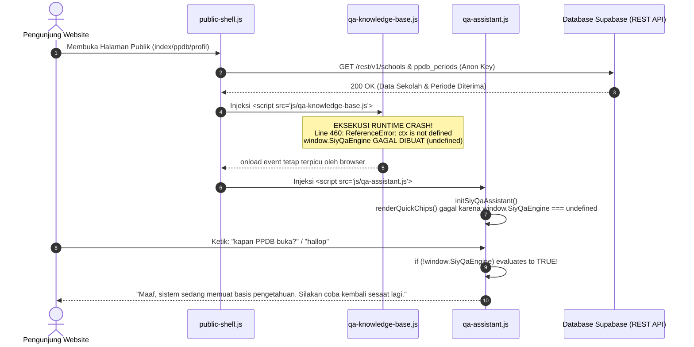

# Comprehensive Chatbot Technical Audit & Troubleshooting Report
**Fitur Asisten Informasi (Q/A Chatbot) & Knowledge Base Website Publik SIYAYASAN**
*Tanggal Audit: 3 November 2026*

---

## 1. Ringkasan Eksekutif Hasil Audit

Berdasarkan audit teknis mendalam terhadap sistem Asisten Informasi (Q/A Chatbot) pada website publik SIYAYASAN, **akar penyebab utama (*single point of failure*) telah ditemukan secara pasti dan terbukti melalui pengujian runtime di browser.**

Chatbot selalu menampilkan pesan:
> *"Maaf, sistem sedang memuat basis pengetahuan. Silakan coba kembali sesaat lagi."*

**Penyebab Sebenarnya:**  
Bukan karena proses loading database atau koneksi internet yang lambat, melainkan terjadi **Fatal Runtime Syntax/ReferenceError pada berkas `frontend/public/js/qa-knowledge-base.js` baris 460 (`ReferenceError: ctx is not defined`)**.

Akibat kesalahan referensi variabel `ctx` yang belum terdefinisi saat pendefinisian array objek statis `KNOWLEDGE_BASE`, JavaScript engine browser langsung menghentikan eksekusi skrip seketika (*abrupt termination*). Dampaknya:
1. Objek mesin `window.SiyQaEngine` **TIDAK PERNAH TERBENTUK** di memori browser (`undefined`).
2. Indikator rekomendasi pertanyaan cepat (*Quick Chips*) tidak dapat dirender dan kosong.
3. Setiap kali pengunjung website mengirim pertanyaan apapun (seperti *"hallop"*, *"Kapan PPDB buka?"*, *"Bagaimana cara mendaftar?"*, dll), kode antarmuka `qa-assistant.js` mendeteksi bahwa `window.SiyQaEngine` bernilai `undefined`, lalu secara keliru mengeluarkan pesan fallback *"sedang memuat basis pengetahuan"*.

---

## 2. Pemetaan Alur Sistem & Arsitektur Aktual



---

## 3. Investigasi Detail Komponen & Bukti Teknis

### A. Komponen Frontend (`frontend/public/js/qa-assistant.js`)
* **Lokasi Pemicu Fallback:** Baris 396–401:
  ```javascript
  if (!window.SiyQaEngine) {
    messages.push({
      sender: 'assistant',
      text: 'Maaf, sistem sedang memuat basis pengetahuan. Silakan coba kembali sesaat lagi.',
      actions: []
    });
  } else {
    const res = window.SiyQaEngine.findAnswer(q);
    // ...
  }
  ```
* **Kelemahan Penanganan State:**  
  Kondisi `!window.SiyQaEngine` menyamarkan dua keadaan yang sangat berbeda:
  1. Keadaan saat skrip memang masih dalam perjalanan network (*transient loading*).
  2. Keadaan saat skrip mengalami crash permanen atau gagal diunduh (*fatal error*).  
  Akibatnya, kesalahan fatal runtime ditampilkan ke pengguna seolah-olah sistem hanya sedang "menunggu loading".
* **Ketiadaan Chips Rekomendasi:**  
  Pada baris 318:
  ```javascript
  function renderQuickChips() {
    if (!chipsList || !window.SiyQaEngine) return;
    // ...
  }
  ```
  Karena `window.SiyQaEngine` undefined, fungsi ini langsung `return` tanpa merender satupun chip rekomendasi, sehingga area *"REKOMENDASI PERTANYAAN"* di screenshot pengguna tampak kosong melompong.

---

### B. Komponen Knowledge Base Engine (`frontend/public/js/qa-knowledge-base.js`)
* **Bukti Kegagalan Eksekusi (Browser Headless Test via Edge):**
  ```text
  JS_ERROR: Uncaught ReferenceError: ctx is not defined at line 460:55
  ENGINE_STATUS: undefined | keys: none
  ```
* **Lokasi Baris Kode Bermasalah (3 Titik Fatal):**
  1. **Baris 460:** Pada entri `ppdb_post_admission`:
     ```javascript
     actions: [
       { label: 'Lihat Lokasi Sekretariat Yayasan', url: 'kontak.html', icon: 'fi fi-rr-marker' },
       { label: 'Hubungi Panitia via WhatsApp', url: ctx.waHelpUrl, icon: 'fi fi-brands-whatsapp', isExternal: true } // <-- CRASH: ctx tidak ada di scope array statis
     ]
     ```
  2. **Baris 596:** Pada entri `school_contacts_info`:
     ```javascript
     actions: [
       { label: 'Chat WhatsApp Sekarang', url: ctx.waHelpUrl, icon: 'fi fi-brands-whatsapp', isExternal: true }, // <-- CRASH
       { label: 'Buka Formulir Kontak', url: 'kontak.html', icon: 'fi fi-rr-envelope' }
     ]
     ```
  3. **Baris 732:** Pada entri `tuition_spp_info`:
     ```javascript
     actions: [
       { label: 'Login Portal Siswa (SIAKAD)', url: 'login.html', icon: 'fi fi-rr-graduation-cap' },
       { label: 'Tanya Biaya via WhatsApp', url: ctx.waHelpUrl, icon: 'fi fi-brands-whatsapp', isExternal: true } // <-- CRASH
     ]
     ```

* **Mengapa Hal Ini Terjadi?**
  Variabel `ctx` (objek konteks dinamis) hanya didefinisikan sebagai argumen pada fungsi `buildAnswer(ctx)` di dalam masing-masing entri. Namun, properti `actions` adalah array statis yang dievaluasi **seketika saat array `KNOWLEDGE_BASE` pertama kali diinisialisasi**. Karena `ctx` tidak berada di lingkup global atau modul, mesin JavaScript langsung melempar `ReferenceError` pada entri pertama yang memanggil `ctx.waHelpUrl` (baris 460).

---

### C. Pemeriksaan Database Supabase & Hak Akses Publik (RLS)
Pengujian mandiri menggunakan anon key Supabase resmi (`https://hnkxrbmngmveoxipohtk.supabase.co`) telah dilakukan terhadap seluruh tabel yang berkaitan dengan data publik:

| Tabel Database | Status Akses Anon | Hasil Response | Keterangan |
|---|---|---|---|
| `schools` | **200 OK (Accessible)** | Data profil, alamat, telepon, WhatsApp, visi/misi lengkap. | Dapat diakses publik tanpa hambatan RLS. |
| `ppdb_periods` | **200 OK (Accessible)** | `status: "closed"`, nama: "PPDB Gelombang 1 TA 2026/2027", catatan penutupan kuota. | Terbuka untuk publik, data sinkron. |
| `news` | **200 OK (Accessible)** | Berita terpublikasi berhasil ditarik. | Normal. |
| `announcements` | **200 OK (Accessible)** | Pengumuman resmi berhasil ditarik. | Normal. |

**Kesimpulan Database:** Database Supabase dan konfigurasi Row Level Security (RLS) untuk pengguna publik **berjalan 100% normal dan tidak bermasalah sama sekali.** Sumber informasi publik dapat diakses dengan baik.

---

### D. Audit Intent Recognition & Cakupan Pola Pertanyaan
Selain crash teknis di atas, audit menemukan 2 kekurangan penting pada perancangan pola pertanyaan:

1. **Ketiadaan Intent Sapaan / Salam (*Greeting*):**
   * Pertanyaan seperti *"hallop"*, *"halo"*, *"hai"*, *"assalamu'alaikum"*, *"selamat pagi"* belum memiliki entri intent khusus.
   * Tanpa entri salam, setelah crash diperbaiki pun sistem akan menganggap sapaan sebagai pertanyaan di luar topik (*out-of-scope*) dan menjawab *"Saya tidak bisa menjawab pertanyaan Anda."*.
   * **Solusi yang Dibutuhkan:** Menambahkan intent `greeting` yang ramah, membalas salam pengunjung, dan menawarkan bantuan navigasi PPDB.

2. **Ketiadaan Pola Spesifik Jadwal Pembukaan PPDB (*"kapan PPDB buka?"*):**
   * Pola pertanyaan *"kapan PPDB buka?"* atau *"kapan pendaftaran dibuka?"* saat ini belum tercantum eksplisit dalam `patterns` di `ppdb_overview`.
   * Kata *"kapan"* saat ini masuk dalam daftar stopword (dihapus).
   * **Solusi yang Dibutuhkan:** Menambahkan intent khusus `ppdb_schedule` / `ppdb_dates` yang secara dinamis memeriksa status `ppdb_periods` (jika status *"closed"*, chatbot menjelaskan bahwa periode saat ini ditutup dan memberikan catatan panitia).

---

## 4. Evaluasi Kualitas Arsitektur & Rekomendasi

1. **Arsitektur Client-Side Rule-Based Tetap Merupakan Pilihan Terbaik:**
   * Kecepatan respons instan (< 10 milidetik).
   * Tidak ada ketergantungan API eksternal (OpenAI/Gemini) yang berisiko down atau memerlukan biaya token berkelanjutan.
   * 100% privasi dan kepatuhan informasi resmi yayasan.
2. **Kebutuhan Isolasi Error & Fallback Dinamis:**
   * Action button yang memerlukan URL dinamis (seperti tautan WhatsApp `ctx.waHelpUrl`) sebaiknya dievaluasi secara dinamis saat pencarian jawaban dilakukan (`buildActions(ctx)` atau resolusi placeholder runtime), bukan di-hardcode di array statis.
   * State asisten harus membedakan dengan jelas antara `status: 'ready'`, `status: 'loading'`, dan `status: 'error'` agar pengguna maupun pengembang mendapatkan pesan diagnostik yang jujur.

